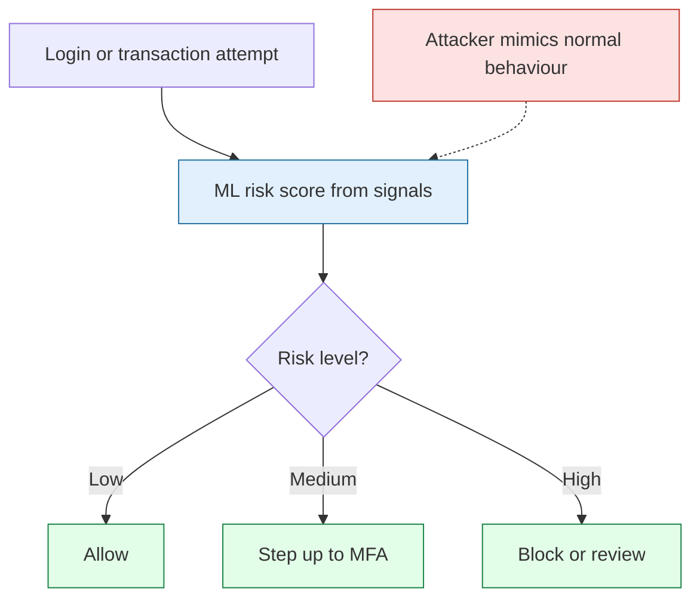

# AI for User Authentication and Fraud Prevention

## Summary

Machine learning is widely used to strengthen authentication and catch fraud by scoring how risky a login or transaction looks, rather than treating every attempt the same. It is a detection and risk-scoring layer on top of normal authentication, not a replacement for it. Used well, it raises friction only for suspicious activity; used naively, it adds false positives and can be evaded or poisoned.

## Where ML helps

| Use | What the model does |
|---|---|
| Risk-based / adaptive authentication | Scores a sign-in from signals (device, location, IP reputation, velocity, behaviour) and steps up to MFA only when risk is high. |
| Anomaly detection | Flags logins or sessions that deviate from a user's or population's normal pattern. |
| Bot and credential-stuffing detection | Distinguishes automated attempts from human ones, blunting brute force (T1110) and reuse of stolen valid accounts (T1078). |
| Behavioural biometrics | Uses typing, mouse or touch patterns as a continuous signal. |
| Transaction fraud scoring | Scores payments or actions for fraud in real time. |

## How it fits authentication

ML risk scoring sits between the credential check and granting access: a low-risk login proceeds, a medium-risk one is challenged with MFA, a high-risk one is blocked or sent for review. It complements, and does not replace, strong primary factors. Standards guidance (for example NIST SP 800-63B) still calls for phishing-resistant MFA; ML decides *when* to apply extra checks and *what* looks fraudulent, within that framework.

## Limits and attacker view

- **False positives and negatives.** Too aggressive and real users are blocked; too lax and fraud slips through. Models need tuning and clear fallback paths.
- **Adversarial evasion.** Attackers shape their behaviour to look normal (slow, human-like, from residential IPs) to stay under the threshold.
- **Data poisoning.** If a model learns continuously from traffic, attackers can try to teach it that their behaviour is normal.
- **Explainability.** A security decision a model cannot explain is hard to appeal or audit, which matters for account lockouts and fraud blocks.

## Flow

## Detection

ML-based risk scoring is itself a detection layer. Monitor its own health: score distribution drift, sudden changes in challenge or block rates, and clusters of attempts that sit just below the action threshold (a sign of probing).

## Defense

- Treat ML as a **layer on top of** phishing-resistant MFA and least privilege, not a substitute.
- Keep a safe fallback (for example, step-up MFA) for uncertain scores rather than silently allowing or hard-blocking.
- Guard against poisoning: validate training data, and do not let live adversarial traffic silently retrain a model.
- Keep decisions explainable and auditable, with an appeal path for blocked users.
- Combine model signals with hard rules (impossible travel, known-bad IPs) for defence in depth.

## ATT&CK mapping

| ID | Name | Tactic |
|---|---|---|
| T1110 | Brute Force | Credential Access |
| T1078 | Valid Accounts | Initial Access, Persistence, Privilege Escalation, Stealth |

## Explanation

AI authentication is a smart bouncer who waves through regulars, asks occasional guests for ID, and stops anyone acting oddly. It makes the line move faster for honest users and harder for attackers, but it is still a bouncer, not the lock on the door: you keep the strong lock (MFA) and use the bouncer to decide who gets a second look.
