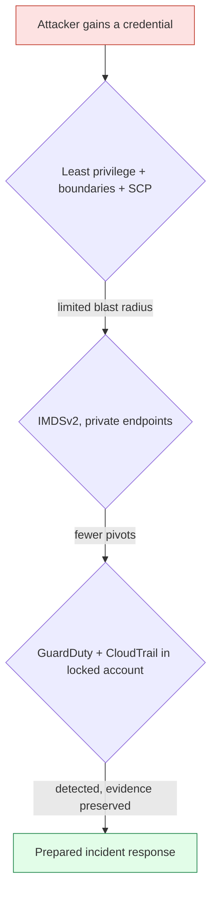

# AWS Cloud Threat Prevention Framework

## Summary

A threat-prevention framework for AWS is a layered set of controls that make attacks harder, limit what a successful attack can reach, and ensure you can see and respond to it. It lines up with the AWS Well-Architected security pillar: strong identity, traceability, protection at every layer, data protection, and prepared incident response. This file is the defensive index that ties the AWS attack-focused files together.

## The layers

### 1. Identity and access
- Prefer **roles and short-lived credentials** (including OIDC federation) over long-lived access keys.
- Apply **least privilege**; avoid `"Resource": "*"` on sensitive IAM actions and `iam:PassRole`.
- Use **permissions boundaries** and **service control policies (SCPs)** to cap what any principal can do, remembering that an **explicit deny overrides any allow**.
- Require MFA; use IAM Access Analyzer to find external access.

### 2. Traceability (logging and detection)
- Enable **CloudTrail** (management events are on by default; enable data events for sensitive resources) and deliver it to a **separate, locked-down logging account** with log file validation.
- Turn on **GuardDuty** for anomaly-based threat detection, **AWS Config** for configuration drift, and **Security Hub** to aggregate findings.
- Alert on log-tampering events (`StopLogging`, `DeleteTrail`) because disabling logs is a common early move (ATT&CK Defense Impairment).

### 3. Infrastructure and network protection
- Segment with VPCs, security groups and NACLs; keep management interfaces private.
- Use **private endpoints (VPC endpoints)** for AWS services and avoid public exposure of data stores.
- Require **IMDSv2** on EC2 to blunt SSRF-to-credential attacks.

### 4. Data protection
- Keep **S3 Block Public Access** on account-wide; encrypt sensitive data with SSE-KMS and customer-managed keys.
- Restrict and log access to data stores; use IAM Access Analyzer for buckets.

### 5. Incident response readiness
- Pre-stage roles, logging and runbooks so responders can act without scrambling for access.
- Keep logs in an account the workload cannot alter, so evidence survives a compromise.

## How the layers blunt an attack

## Detection

The framework's detection layer is GuardDuty + CloudTrail + Config + Security Hub. Key alerts: IAM writes across principals, log tampering, role credentials used off-instance, public-access changes on data stores, and GuardDuty anomaly findings.

## Defense

Defense is the whole framework: strong identity, least privilege with boundaries and SCPs, private networking and IMDSv2, data encryption and Block Public Access, centralized tamper-resistant logging, and rehearsed incident response. Each layer assumes the one before it may fail.

## ATT&CK mapping

None specific; this is a cross-cutting defensive framework. See the AWS attack files (S3, IAM, SSRF/metadata, CloudTrail evasion) for technique-level detail.

## Explanation

Think of it as castle defence: identity is the gate guard, least privilege and SCPs are internal walls that stop one breach reaching everything, IMDSv2 and private networking remove secret passages, and GuardDuty plus off-site logs are the watchtowers whose records survive even if an attacker torches the gatehouse.
