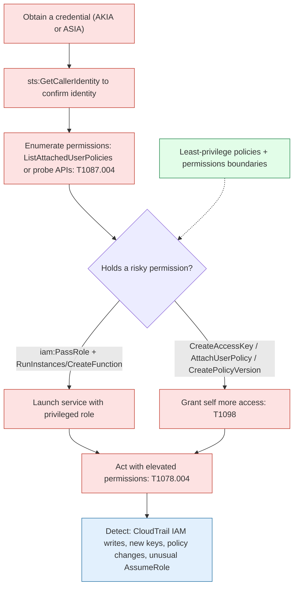

# AWS IAM Enumeration and Privilege Abuse

## Summary

AWS Identity and Access Management (IAM) decides which principal (user, role or service) can call which API on which resource. When an attacker obtains a set of credentials, their first job is to learn what those credentials can do, and their next is to find a path from that to more access. Defenders who understand the same enumeration and escalation paths can detect them in CloudTrail and close them with least-privilege policies. This file is written from the defender's point of view: what the activity looks like and how to catch and prevent it.

## Credentials and identity

- **Access keys** have two parts: an access key ID and a secret access key. Key IDs beginning with `AKIA` are long-term credentials for an IAM user or the account root user. Key IDs beginning with `ASIA` are temporary credentials issued by AWS STS. This prefix tells a responder immediately whether a leaked key is long-lived or a short-lived session.
- `sts:GetCallerIdentity` returns the account ID, user ID and ARN of whoever is calling. **No permissions are required** to call it, and it still succeeds even if a policy explicitly denies it, because the same information is returned when access is denied. It is therefore a reliable way to confirm which identity a credential belongs to, used by both responders and attackers.

## How enumeration works

Holding a credential, an actor tries to map its permissions:

1. **Confirm identity** with `sts:GetCallerIdentity`.
2. **Read attached policies** where allowed: `iam:ListAttachedUserPolicies`, `iam:ListUserPolicies`, `iam:ListGroupsForUser`, `iam:GetPolicyVersion`, and the role equivalents. These calls reveal exactly what is permitted.
3. **Fall back to probing** when policy reads are denied: calling benign APIs (such as `s3:ListAllMyBuckets` or `ec2:DescribeInstances`) and watching which succeed. Each probe is an API call recorded in CloudTrail.

Mapping another account's or role's permissions this way is ATT&CK T1087.004 (Account Discovery: Cloud Account).

## How privilege abuse works

IAM escalation almost always abuses a permission the principal legitimately holds that can be turned into broader access. The policy-evaluation rules that matter:

- Permissions are the **union** of identity-based and resource-based policy allows, intersected with any permissions boundary and SCP, and **an explicit deny anywhere overrides every allow**. An escalation path only works if no explicit deny blocks it.
- A **permissions boundary** caps what an identity-based policy can grant. Escalation that ignores the boundary will fail.

Commonly abused permissions (each is a legitimate feature that is dangerous when over-granted):

| Permission held | Why it leads to more access |
|---|---|
| `iam:PassRole` with a broad resource, plus a service that assumes roles (`ec2:RunInstances`, `lambda:CreateFunction`, …) | The actor launches a service with a more privileged role passed to it, then uses that role. AWS requires `PassRole` precisely so only approved users can hand a role to a service. |
| `iam:CreateAccessKey` on another user | Mint a second access key for a more privileged user and use it. |
| `iam:CreatePolicyVersion` / `iam:SetDefaultPolicyVersion` | Rewrite a policy the principal is attached to, granting itself more. |
| `iam:AttachUserPolicy` / `iam:PutUserPolicy` | Attach `AdministratorAccess` or an inline admin policy to itself. |
| `iam:UpdateAssumeRolePolicy` | Change a role's trust policy so the principal can assume it. |
| `sts:AssumeRole` on an over-trusting role | Assume a role whose trust policy is too broad. |

Modifying roles, trust policies or keys to keep or widen access is ATT&CK T1098 (Account Manipulation); using the resulting cloud credentials is T1078.004 (Valid Accounts: Cloud Accounts).

## Flow

## Detection

All of this is visible in CloudTrail, which logs **management events by default** (data events are not logged unless you turn them on). High-value signals:

- `CreateAccessKey`, `AttachUserPolicy`, `PutUserPolicy`, `CreatePolicyVersion`, `SetDefaultPolicyVersion`, `UpdateAssumeRolePolicy` — especially where the actor and the target principal differ.
- A burst of `List*` / `Get*` IAM calls, or many `AccessDenied` results, from one identity in a short window (enumeration and probing).
- `AssumeRole` to roles that principal has never used before.
- Use of an `AKIA` key from a new IP, ASN or region.
- Note that CloudTrail **event history** in the console covers only the past 90 days of management events; for longer retention you need a trail writing to S3.

## Defense

- **Least privilege.** Grant specific actions on specific resources. Avoid `"Resource": "*"` on `iam:PassRole` and on the IAM write actions above.
- **Permissions boundaries** on users and roles so an identity cannot grant itself beyond a ceiling.
- **Service control policies (SCPs)** to deny dangerous actions org-wide.
- **Prefer roles and short-lived credentials** over long-term `AKIA` access keys; rotate and retire unused keys.
- **Require MFA** for sensitive actions and alert on the IAM write events above.
- **GuardDuty** and similar services flag anomalous IAM and STS behaviour.

## ATT&CK mapping

| ID | Name | Tactic |
|---|---|---|
| T1087.004 | Account Discovery: Cloud Account | Discovery |
| T1098 | Account Manipulation | Persistence, Privilege Escalation |
| T1078.004 | Valid Accounts: Cloud Accounts | Initial Access, Persistence, Privilege Escalation, Stealth |

## Explanation

IAM is a very detailed guest list. A stolen credential is one name on that list, and the holder's first move is to read their own entry to see which rooms it opens. Privilege abuse is finding that your entry also lets you edit the guest list, then writing yourself into more rooms. The defence is to keep each entry narrow and to watch the log of who edits the list.

# AWS IAM Enumeration and Privilege Abuse

## Summary

In AWS, ident