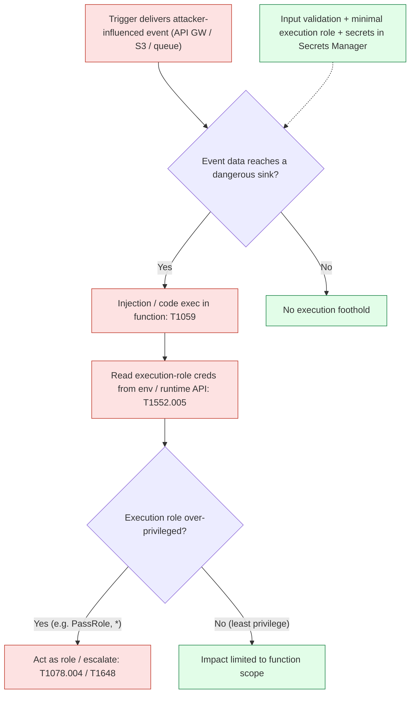

# AWS Lambda and Serverless Security

## Summary

AWS Lambda runs code without a managed server: each function has an **execution role** (its IAM identity), optional **environment variables**, and triggers from other AWS services (API Gateway, S3, SQS, EventBridge). The serverless attack surface is less about the host and more about **what the function trusts and what its role can do**. The two dominant risks are **event-data injection** (untrusted input from the trigger reaching a dangerous sink) and an **over-privileged execution role** that turns a single compromised function into broad account access. This file covers both from the defender's standpoint.

## Attack surface

- **Event injection.** A function is invoked with an event object built from attacker-influenced data (HTTP body/headers via API Gateway, object keys in S3 events, message bodies in queues). If that data flows into a shell command, a database query, a deserializer or a dynamic `eval`, it is classic injection running inside the function — ATT&CK T1059 (Command and Scripting Interpreter). Serverless does not remove injection; it just moves it.
- **Credential exposure in the runtime.** Lambda delivers the execution role's temporary credentials through **environment variables** (`AWS_ACCESS_KEY_ID`, `AWS_SECRET_ACCESS_KEY`, `AWS_SESSION_TOKEN`) and the Lambda runtime API. Any code execution inside the function can read them and act as the role from elsewhere — ATT&CK T1552.005 (Unsecured Credentials: Cloud Instance Metadata API) covers the analogous metadata/credential-endpoint retrieval, and using the stolen role is T1078.004.
- **Secrets in environment variables.** Developers often store API keys and DB passwords in plaintext Lambda env vars. These are visible to anyone with `lambda:GetFunctionConfiguration` and to any code running in the function.
- **Over-privileged execution role.** A role with `*` actions, `iam:PassRole`, or write access to many services lets a compromised function escalate or move laterally. This is the single highest-impact serverless misconfiguration.
- **Malicious code/supply chain.** A poisoned dependency or an attacker with `lambda:UpdateFunctionCode` can replace the function body — ATT&CK T1648 (Serverless Execution) is the technique for abusing serverless compute to run adversary code.

## Privilege escalation via Lambda

If a principal holds `lambda:CreateFunction` (or `UpdateFunctionCode`) **plus** `iam:PassRole` for a more privileged role, they can deploy a function that assumes that role and runs arbitrary code with it. This is a well-known IAM privesc primitive and maps to the same `PassRole` abuse described in [AWS IAM Enumeration and Privilege Abuse](aws-iam-enumeration-and-privilege-abuse.md).

## Flow

## Detection

- **CloudTrail**: `UpdateFunctionCode`, `CreateFunction`, `UpdateFunctionConfiguration` and `AddPermission` — especially where the actor is unusual or `iam:PassRole` accompanies them.
- **Execution-role credential use off-box**: the role's temporary (`ASIA…`) credentials being used from an IP/ASN that is not Lambda's service range is a strong signal of credential theft from a function.
- **CloudWatch Logs** for the function: unexpected child processes, outbound connections, or errors indicating injection attempts.
- **GuardDuty** findings for Lambda (anomalous network activity, credential exfiltration) where the Lambda protection feature is enabled.

## Defense

- **Least-privilege execution role per function** — scope to the exact actions and resources the function needs; never attach broad managed policies or `iam:PassRole` with `*`.
- **Validate and sanitise all event input**; treat every field of the event object as untrusted, exactly as you would an HTTP request.
- **Store secrets in AWS Secrets Manager or SSM Parameter Store (SecureString)** and fetch at runtime, instead of plaintext environment variables; see [AWS Secrets Management and Credential Exposure](aws-secrets-and-credential-exposure.md).
- **Pin and scan dependencies**; restrict who holds `lambda:UpdateFunctionCode`.
- **Enable CloudTrail, CloudWatch and GuardDuty Lambda protection**; alert on function-config changes and off-range use of execution-role credentials.

## ATT&CK mapping

| ID | Name | Tactic |
|---|---|---|
| T1059 | Command and Scripting Interpreter | Execution |
| T1648 | Serverless Execution | Execution |
| T1552.005 | Unsecured Credentials: Cloud Instance Metadata API | Credential Access |
| T1078.004 | Valid Accounts: Cloud Accounts | Initial Access, Persistence, Privilege Escalation, Defense Evasion |

## Explanation

A Lambda function is a tiny worker that wakes up when something pokes it, does a job, and vanishes — but while it's awake it carries a keyring (its execution role) and sometimes keeps passwords written on sticky notes (environment variables). Two things go wrong. First, the thing that pokes it often carries attacker-chosen data, and if the worker pastes that data straight into a command, the attacker is now running code inside the worker. Second, once inside, the attacker grabs the keyring — and if that keyring opens half the building instead of just the one cupboard the worker needed, a single poked function becomes a full break-in. The fix is to give each worker the smallest possible keyring, keep passwords in a real safe rather than on sticky notes, and never trust the data that woke it up.
