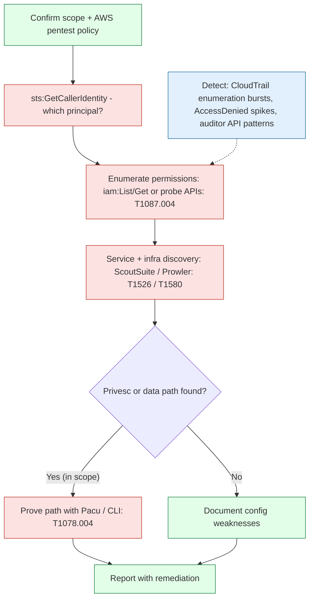

# AWS Penetration Testing Methodology and Tooling

## Summary

An authorized AWS penetration test follows a repeatable arc: confirm scope and the identity you hold, enumerate what that identity can see and do, map the account's services and trust relationships, find and (where in scope) prove privilege-escalation and data-access paths, then report with remediation. The work is credential-centric rather than exploit-centric — most AWS findings come from over-broad IAM, exposed credentials and misconfiguration, not memory-corruption bugs. This file describes that methodology from the defender's point of view and the well-known open-source tools that drive it, so blue teams can both reproduce the assessment and recognise the activity in their logs.

## Scope and authorization

- **AWS's customer support policy** permits customers to test their **own** resources for most services without prior approval, but still **prohibits** disruptive testing (DoS/DDoS, resource exhaustion) and testing of AWS-owned infrastructure. Simulated events like stress tests and red-team exercises against certain protections require going through AWS's pre-approval process. A tester confirms this policy and the engagement's rules of engagement before touching anything.
- Scope is defined by **account IDs, regions and services**, and by whether only configuration review or active exploitation is authorized. Shared-responsibility means the customer's side (IAM, data, config) is in scope; the AWS-managed substrate is not.

## Phases

1. **Identity confirmation.** Establish which principal the supplied credentials belong to with `sts:GetCallerIdentity` (needs no permission). Access key IDs beginning `AKIA` are long-term IAM/root keys; `ASIA` are temporary STS credentials.
2. **Permission enumeration.** Read attached and inline policies where allowed (`iam:List*`, `iam:Get*`); otherwise infer permissions by probing benign read APIs and observing which succeed. Mapping a cloud account this way is ATT&CK T1087.004 (Account Discovery: Cloud Account).
3. **Service and infrastructure discovery.** Inventory which services are in use and how they are configured — this is ATT&CK T1526 (Cloud Service Discovery) and T1580 (Cloud Infrastructure Discovery). Automated auditors (below) do this breadth-first.
4. **Privilege-escalation and lateral-movement analysis.** Identify abusable permissions (`iam:PassRole`, `iam:CreatePolicyVersion`, over-trusting `sts:AssumeRole`, etc.) and cross-account trust. See [AWS IAM Enumeration and Privilege Abuse](aws-iam-enumeration-and-privilege-abuse.md).
5. **Data-access and impact validation.** Where authorized, demonstrate reachable data (S3 objects, snapshots, secrets) without exfiltrating or destroying it.
6. **Reporting.** Tie each finding to the responsible misconfiguration and a concrete remediation (least privilege, boundaries, SCPs, logging).

## Tooling

| Tool | Role | Typical invocation |
|---|---|---|
| **AWS CLI** | Ground-truth API calls, scripting enumeration | `aws sts get-caller-identity`, `aws iam list-attached-user-policies` |
| **ScoutSuite** (NCC Group) | Multi-cloud **read-only configuration auditor**; produces an HTML report of misconfigurations | `scout aws` |
| **Prowler** | Configuration/compliance scanner mapped to CIS, NIST, PCI, etc. | `prowler aws` |
| **Pacu** (Rhino Security Labs) | **Offensive** AWS exploitation framework; modular enumeration and privesc | `python3 pacu.py` → `run iam__enum_permissions`, `run iam__privesc_scan` |
| **CloudMapper / cartography** | Visualise account assets and trust relationships | graph export |
| **enumerate-iam / weirdAAL** | Brute-force which API calls a credential set can make | permission probing |

ScoutSuite and Prowler are **read-only auditors** — ideal for a configuration review and for defenders to self-assess. Pacu is an **active** framework (it can create keys, modify policies, launch resources) and is used only within an authorized active-testing scope.

## Flow

## Detection

The whole methodology is visible in **CloudTrail** (management events logged by default):

- A burst of `List*`/`Get*`/`Describe*` across many services from one identity, or many `AccessDenied` results in a short window — the signature of enumeration and permission probing (Pacu, enumerate-iam, ScoutSuite, Prowler all generate this).
- `GetCallerIdentity` immediately followed by broad IAM reads from a credential used from a new IP/ASN/region.
- Read-only auditors produce a very **wide but shallow** fan-out of describe calls across every region and service at once — a recognisable pattern distinct from normal application traffic.
- **GuardDuty** findings for anomalous IAM/STS behaviour and credential use from unusual locations.

## Defense

- **Least privilege** and **permissions boundaries** so an enumerated credential reveals and reaches little (see [AWS IAM Enumeration and Privilege Abuse](aws-iam-enumeration-and-privilege-abuse.md)).
- **Service control policies (SCPs)** to deny dangerous actions org-wide.
- **Prefer short-lived role credentials** over long-term `AKIA` keys; rotate and retire unused keys.
- **Run Prowler/ScoutSuite yourself** on a schedule to close misconfigurations before an assessor (or attacker) finds them.
- **Multi-region CloudTrail to S3** plus GuardDuty, with alerting on enumeration bursts and IAM write events.

## ATT&CK mapping

| ID | Name | Tactic |
|---|---|---|
| T1087.004 | Account Discovery: Cloud Account | Discovery |
| T1526 | Cloud Service Discovery | Discovery |
| T1580 | Cloud Infrastructure Discovery | Discovery |
| T1078.004 | Valid Accounts: Cloud Accounts | Initial Access, Persistence, Privilege Escalation, Defense Evasion |

## Explanation

Testing AWS is less like picking a lock and more like auditing a very large office with a borrowed keycard. The first thing you do is check whose card you're holding and which doors it opens, because in the cloud almost everything is governed by that permission list rather than by software bugs. Then you walk the building — with automated tools that photograph every room's configuration at once — looking for a door left propped open or a card that can quietly reprogram itself to open more doors. Read-only tools like ScoutSuite and Prowler take the photos; Pacu is the one that will actually try the handles, so you only let it loose when the owner has signed off on active testing. For the defender, the giveaway is the walk itself: a single keycard suddenly checking every door in the building, all at once, is a pattern you can watch for in the access log.
