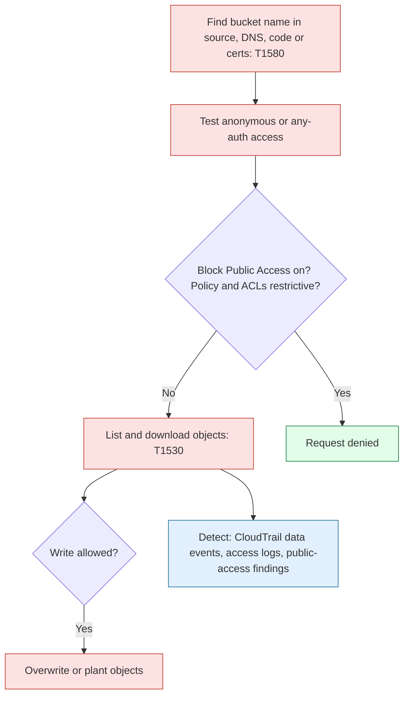

# AWS S3 Bucket Security and Misconfiguration

## Summary

Amazon S3 stores objects in buckets. Historically the most common cloud data exposure was a bucket left readable to the public, or writable by too many principals. AWS has since changed several defaults so that new buckets are private, but older buckets, deliberate changes and over-broad policies still cause exposures. Understanding the access model and the current defaults is what lets a defender spot a misconfiguration.

## The access model

Access to an S3 object can be granted by several mechanisms, evaluated together:

- **Bucket policies** (resource-based, JSON) attached to the bucket.
- **IAM policies** attached to a user or role.
- **Access Control Lists (ACLs)**, a legacy per-bucket and per-object mechanism.
- **S3 Block Public Access**, a set of switches that override the above to keep resources private.

Because several mechanisms combine, a bucket can be exposed by any one of them. A permissive bucket policy, a public-read ACL, or an object ACL can each open data.

## Current defaults (and why they matter)

AWS changed the dangerous defaults; knowing the cut-off dates helps when auditing old resources:

- **Block Public Access is on by default** for new buckets: "By default, new buckets, access points, and objects don't allow public access." Users can still turn it off.
- **ACLs are disabled by default** on new buckets via the **Bucket owner enforced** Object Ownership setting: "By default, Object Ownership is set to the Bucket owner enforced setting and all ACLs are disabled." AWS recommends keeping ACLs off and using bucket policies instead.
- **Default encryption is on**: since January 5, 2023, all new object uploads are automatically encrypted with SSE-S3 (Amazon S3 managed keys). Encryption at rest is therefore not something you enable; you can upgrade to SSE-KMS with your own key.

A bucket created years ago may predate these defaults, so audits must check the actual settings, not assume them.

## How exposure happens and is found

1. **Discovery.** Attackers look for bucket names in web page source, JavaScript, DNS, code repositories and certificate transparency logs, and guess names from company and project names. Finding exposed cloud storage is ATT&CK T1580 (Cloud Infrastructure Discovery) / T1526 (Cloud Service Discovery) at the recon stage.
2. **Testing access.** They try anonymous or any-authenticated-user reads and lists. A bucket that allows listing hands over an index of every object.
3. **Reading data.** Public or over-shared objects are downloaded. Reading data from cloud storage is ATT&CK T1530 (Data from Cloud Storage).
4. **Writing data**, where write is allowed, to deface content, host malware, or tamper with files other systems trust.

## Flow

## Detection

- **S3 Block Public Access findings** at the account and bucket level; alert when it is turned off.
- **IAM Access Analyzer** reports buckets that can be accessed from outside the account.
- **CloudTrail data events** for S3 (these are **not** logged by default and must be enabled) record `GetObject`, `PutObject` and `ListObjects`, revealing who read what.
- **S3 server access logs** or the same data events show anonymous reads.
- Config rules that flag buckets without Block Public Access, with ACLs enabled, or without the encryption or policy you expect.

## Defense

- Keep **Block Public Access on** at the account level, which covers every bucket, unless a bucket genuinely must be public (for example a static website), and then isolate that bucket.
- Keep **ACLs disabled** (Bucket owner enforced) and control access with bucket and IAM policies.
- Grant least privilege in bucket policies; avoid `"Principal": "*"` and wildcard actions.
- Use SSE-KMS with a customer-managed key for sensitive data, and consider bucket policies that deny unencrypted uploads.
- Enable CloudTrail S3 data events for sensitive buckets and review access with IAM Access Analyzer.

## ATT&CK mapping

| ID | Name | Tactic |
|---|---|---|
| T1580 | Cloud Infrastructure Discovery | Discovery |
| T1530 | Data from Cloud Storage | Collection |

## Explanation

A bucket is a storage unit with a lock that can be set several ways at once: the master switch (Block Public Access), the door policy (bucket and IAM policies), and old-style stickers (ACLs). Modern defaults ship the unit locked, but anyone can unlock it, and old units were shipped unlocked, so an audit checks the actual locks rather than trusting the shipping default.
