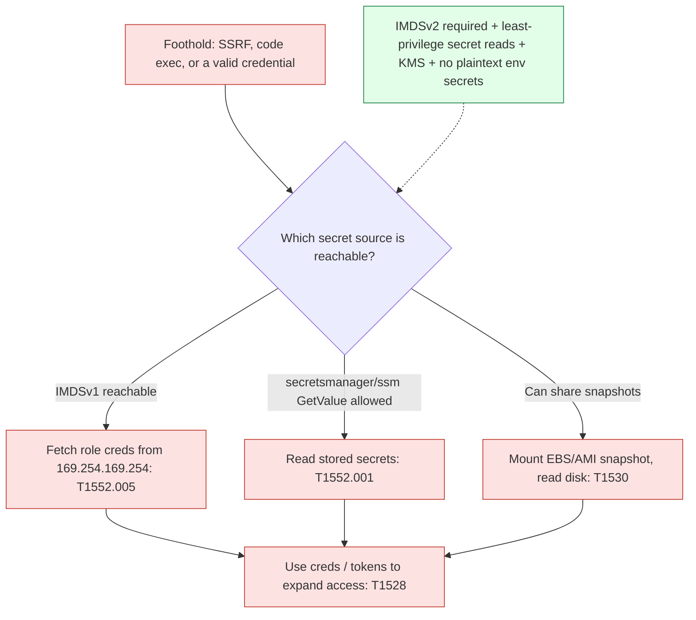

# AWS Secrets Management and Credential Exposure

## Summary

Most real AWS compromises start with a **leaked credential**, not an exploit. Secrets live in many places — the EC2 instance metadata service, Secrets Manager, SSM Parameter Store, Lambda environment variables, EBS/AMI snapshots, source code and CI logs — and each is a distinct exposure path with its own detection and mitigation. This file maps where AWS credentials and secrets are found, how an actor who already has a foothold harvests them, and how defenders lock each source down. The framing is defensive: these are the places to audit and monitor first.

## Where secrets live and how they leak

| Source | Exposure | ATT&CK |
|---|---|---|
| **Instance Metadata Service (IMDS)** | A role's temporary creds are readable at `http://169.254.169.254/...`. Reachable via SSRF against an app on the instance if IMDSv1 is allowed. | T1552.005 |
| **Secrets Manager** | A principal with `secretsmanager:GetSecretValue` reads the plaintext secret. Over-broad read grants are the risk. | T1552.001 |
| **SSM Parameter Store** | `ssm:GetParameter`/`GetParameters` returns values; `SecureString` needs KMS decrypt, but a role often has both. | T1552.001 |
| **Lambda / ECS env vars** | Plaintext API keys and DB passwords in environment configuration, readable via `GetFunctionConfiguration` or in-process. | T1552.001 |
| **EBS & AMI snapshots** | A shared or public snapshot can be mounted in the attacker's account to read secrets, keys and tokens on disk. | T1530 |
| **Private keys / credential files** | `~/.aws/credentials`, SSH keys, `.pem` files on hosts and in repos. | T1552.004, T1552.001 |
| **Application access tokens** | OAuth/service tokens in config, logs or caches used to reach cloud services. | T1528 |

## IMDS and SSRF

The instance metadata service is the classic credential source. **IMDSv1** answers a plain `GET`, so a server-side request forgery bug on the instance can fetch the role's credentials. **IMDSv2** requires a session token obtained with a `PUT` carrying `X-aws-ec2-metadata-token-ttl-seconds`, and the default **hop limit of 1** stops the token response from being proxied off the instance — together these defeat most SSRF-to-metadata attacks. Enforcing IMDSv2 (`HttpTokens=required`) is the single highest-value hardening step. See [SSRF and the Cloud Metadata API](../web-security/ssrf-and-cloud-metadata-api.md).

## Harvesting after a foothold

An actor with code execution or a working credential sweeps these sources: query IMDS, call `secretsmanager:ListSecrets` + `GetSecretValue`, `ssm:DescribeParameters` + `GetParameters`, read Lambda/ECS task env, enumerate snapshots they can share to themselves, and grep disks and repos for keys. Each is an ordinary API call or file read — which is exactly what makes least privilege and logging the controls that matter.

## Flow

## Detection

- **CloudTrail**: `GetSecretValue`, `GetParameters`, `ListSecrets`/`DescribeParameters` bursts; `ModifySnapshotAttribute`/`CreateSnapshot` that shares a snapshot to another account; `GetFunctionConfiguration` enumeration.
- **Metadata credential use off-instance**: the role's `ASIA…` credentials appearing from an IP outside the instance is a high-fidelity indicator of IMDS theft (data point also surfaced by GuardDuty's `UnauthorizedAccess:IAMUser/InstanceCredentialExfiltration` findings).
- **KMS**: unusual `Decrypt` volume against the key protecting SecureString parameters or secrets.
- Secret scanners (git-secrets, trufflehog, GitHub secret scanning) firing on committed keys.

## Defense

- **Enforce IMDSv2** (`HttpTokens=required`) and keep the metadata **hop limit at 1**; block app egress to `169.254.169.254` where feasible.
- **Centralise secrets** in Secrets Manager / SSM SecureString with **tight, resource-scoped read policies** and KMS encryption; never store secrets in plaintext env vars or code.
- **Rotate** secrets and credentials automatically; prefer short-lived role credentials over long-term `AKIA` keys.
- **Lock down snapshots**: never make EBS/AMI snapshots public; audit cross-account sharing.
- **Scan repos and CI logs** for leaked keys; alert on the CloudTrail and KMS signals above.

## ATT&CK mapping

| ID | Name | Tactic |
|---|---|---|
| T1552.005 | Unsecured Credentials: Cloud Instance Metadata API | Credential Access |
| T1552.001 | Unsecured Credentials: Credentials In Files | Credential Access |
| T1552.004 | Unsecured Credentials: Private Keys | Credential Access |
| T1528 | Steal Application Access Token | Credential Access |
| T1530 | Data from Cloud Storage | Collection |

## Explanation

In AWS, the keys to the kingdom are usually just lying around rather than locked behind a clever puzzle. The instance a web app runs on will, if asked politely at a special address, hand over its credentials — and a server-side request forgery bug is a way to ask on the app's behalf, which is why making the instance demand a token first (IMDSv2) matters so much. Elsewhere, secrets sit in the account's own safes (Secrets Manager, Parameter Store), in sticky-note form inside function settings, or frozen into old disk snapshots someone forgot to keep private. An intruder who gets any foothold simply walks this list and pockets whatever each spot will give up. The defence is boring but decisive: one real safe, give each app the key to only its own drawer, encrypt it, rotate it, and watch the log for anyone reading more than their share.
