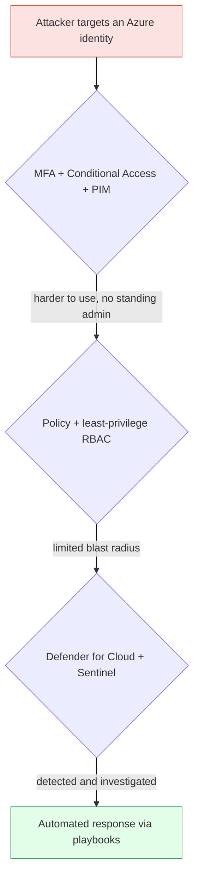

# Azure Cloud Threat Prevention and Detection Framework

## Summary

A prevention-and-detection framework for Azure combines governance, identity controls, posture management and a SIEM into layers that reduce attack surface, limit blast radius, and make attacks visible. The Microsoft building blocks are Entra ID (identity), management groups and Azure Policy (governance), Microsoft Defender for Cloud (posture and workload protection), and Microsoft Sentinel (SIEM/SOAR). This file is the defensive index for the Azure attack-focused files.

## The layers

### 1. Identity (the primary control plane)
- Enforce **MFA and Conditional Access** for everyone, with stronger policies for admins.
- Use **PIM** so privileged roles are eligible/just-in-time, not standing.
- Prefer **Contributor over Owner** where role assignment is not needed; guard Owner and User Access Administrator.
- Use managed identities instead of secrets where possible.

### 2. Governance
- Structure resources under **management groups** and apply **Azure Policy** at the top so baseline rules (encryption, no public IPs, allowed regions) inherit to every subscription.
- Review role assignments and remove standing privilege.

### 3. Posture management and workload protection
- Turn on **Microsoft Defender for Cloud** plans for your resource types; work the **secure score** down the recommendations and enforce fixes with policy.
- Defender's CWPP provides threat detection for VMs, containers, storage, databases and serverless.

### 4. Network and data protection
- Use **NSGs** (priority 100-4096, lower first), **Azure Firewall** for egress, and **Private Endpoints** to take sensitive services off the public internet.
- Store secrets in **Key Vault** (Azure RBAC, purge protection); storage is always encrypted, and sensitive data should use customer-managed keys in Key Vault.

### 5. Detection and response
- Feed logs into **Microsoft Sentinel**: Entra sign-in/audit, Azure Activity, Defender alerts, and workload logs.
- Write analytics rules mapped to ATT&CK, hunt with KQL, and automate response with playbooks (Azure Logic Apps).

## How the layers blunt an attack

## Detection

Defender for Cloud (workload alerts, falling secure score) plus Sentinel (analytics rules over identity, control-plane and workload logs) form the detection layer. Priority signals: privileged role grants and PIM activations, sign-ins from new locations for admins, policy or logging changes, and Defender high-severity alerts.

## Defense

The framework is the defense: identity hardening with MFA/Conditional Access/PIM, governance with management groups and Azure Policy, posture and workload protection with Defender for Cloud, private networking and Key Vault for data, and Sentinel for detection and response. Each layer assumes the previous one can fail.

## ATT&CK mapping

None specific; this is a cross-cutting defensive framework. See the Azure attack/identity files for technique-level detail.

## Explanation

It is defence in depth for Azure: the front door checks ID carefully (MFA, Conditional Access) and hands out temporary admin passes (PIM); inside, policy and least privilege act as internal walls; Defender for Cloud is the building inspector and alarm; and Sentinel is the control room that watches every feed and can trigger automatic responses.
