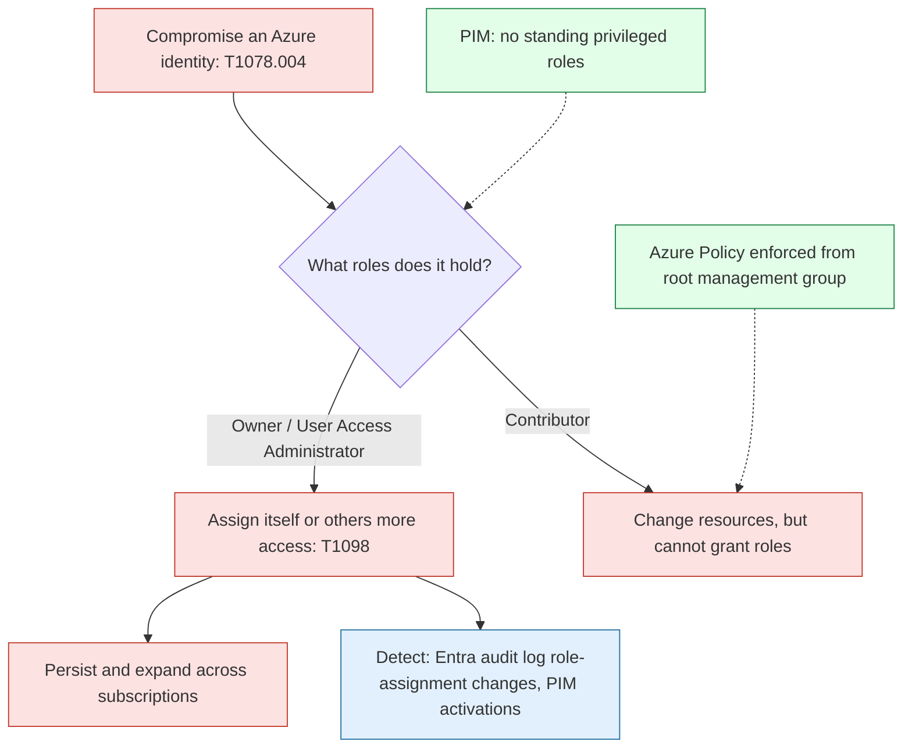

# Azure Governance and Identity Security

## Summary

In Azure, identity is the main control plane: almost every action is an authenticated call authorised by a role assignment. Governance is the structure that keeps those identities and their permissions under control across many subscriptions. The two together, **Microsoft Entra ID** (identity) and **Azure governance** (management groups, RBAC and policy), decide who can do what, and are where most Azure security posture is won or lost.

## Naming note

Azure Active Directory was renamed **Microsoft Entra ID** in 2023 (the change was announced on 11 July 2023 and rolled out from 15 August 2023). Older material says "Azure AD"; it means the same service.

## Governance structure

Azure resources sit in a hierarchy, and governance flows down it:

```
Management groups  >  Subscriptions  >  Resource groups  >  Resources
```

- A **management group tree can be up to six levels deep**, not counting the root level or the subscription level.
- Anything assigned at the root management group applies to the entire hierarchy: all management groups, subscriptions, resource groups and resources beneath it.
- **Azure Policy** assignments cascade by inheritance to all subscriptions under the scope where they are assigned, which is how an organisation enforces rules such as "no public IPs" or "encryption required" everywhere at once.

## Azure RBAC

Access is granted by assigning a **role** to a **principal** at a **scope**. Four built-in roles matter most:

| Role | What it allows |
|---|---|
| Owner | Full access to manage all resources, **including assigning roles** in Azure RBAC. |
| Contributor | Full access to manage all resources, but **cannot assign roles**, manage Blueprint assignments, or share image galleries. |
| Reader | View all resources; cannot make changes. |
| User Access Administrator | Manage user access to Azure resources (that is, manage role assignments). |

The security-relevant line is that **Contributor can change almost anything but cannot grant access**. Role assignment is reserved for Owner and User Access Administrator, so those two are the privileged-identity targets.

## Privileged Identity Management (PIM)

Microsoft Entra PIM provides **time-based and approval-based role activation**: instead of holding a privileged role permanently, an eligible user activates it just-in-time, for a limited window, optionally with approval and MFA. This shrinks the number of standing privileged accounts an attacker can target. PIM requires a licence (Microsoft Entra ID P2 or Entra ID Governance).

## Attacker and defender view



## Detection

- **Microsoft Entra audit logs** for new or changed role assignments, especially grants of Owner or User Access Administrator.
- **PIM activation events**: unusual activations, or activations outside normal hours.
- **Azure Activity log** for changes to policy assignments or management-group structure.
- Sign-ins from new locations for privileged accounts (Entra sign-in logs).

## Defense

- Use **PIM** so privileged roles are eligible, not permanent, with approval and MFA on activation.
- Assign roles at the narrowest scope that works, and prefer Contributor over Owner where role assignment is not needed.
- Enforce baseline rules with **Azure Policy** at the management-group level so they apply everywhere by inheritance.
- Require MFA and Conditional Access for all users, and more for admins.
- Review role assignments regularly and remove standing Owner/User Access Administrator grants.

## ATT&CK mapping

| ID | Name | Tactic |
|---|---|---|
| T1078.004 | Valid Accounts: Cloud Accounts | Initial Access, Persistence, Privilege Escalation, Stealth |
| T1098 | Account Manipulation | Persistence, Privilege Escalation |

## Explanation

Think of management groups as the org chart and RBAC as the set of keys each person holds. Policy is a rule the head office pins to the top of the org chart so every office below follows it. The dangerous keys are not the ones that change things (Contributor) but the ones that hand out keys (Owner, User Access Administrator), and PIM makes people check those out from the front desk rather than carry them around.
