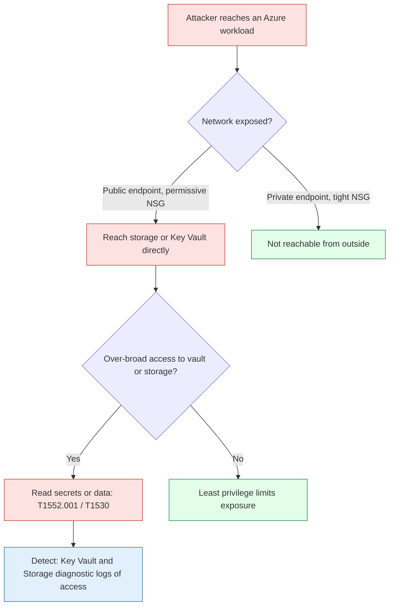

# Azure Network, Key Vault and Data Security

## Summary

Three controls protect the lower layers of an Azure workload: **network security** keeps traffic to what is intended, **Key Vault** holds secrets, keys and certificates, and **storage encryption** protects data at rest. Each has defaults and options worth knowing, because the difference between a safe and an exposed deployment is usually a single setting.

## Network security

- **Network Security Groups (NSGs)** filter traffic to and from Azure resources with a list of allow/deny rules. Each rule has a **priority between 100 and 4096**; rules are processed in priority order, and **lower numbers are processed first (higher priority)**. Default rules sit at 65000 and above, so custom rules always take precedence.
- **Azure Firewall** is a managed, stateful firewall for a virtual network, used for centralised egress and inter-network filtering.
- **Private Endpoint / Private Link** give a service (such as Storage or Key Vault) a private IP inside your virtual network, so traffic does not traverse the public internet.
- **Azure DDoS Protection** defends public endpoints against volumetric attacks.

Good network design uses NSGs for subnet- and NIC-level rules, private endpoints to take sensitive services off the public internet, and the firewall for controlled egress.

## Key Vault

Key Vault stores secrets, keys and certificates and controls access to them.

- **Access model**: Key Vault supports **Azure RBAC** and a legacy **access policy** model. For new vaults, Azure RBAC is the default control model; the access-policy model is marked legacy. RBAC is the better choice because it uses the same role system as the rest of Azure.
- **Soft-delete** is **on by default and cannot be disabled** once a vault is created. Deleted vaults and objects are recoverable for a retention period you set between **7 and 90 days** (90 is the default).
- **Purge protection**, once enabled, **cannot be disabled or overridden by anyone, including Microsoft**, during the retention period. This stops an attacker (or a mistake) from permanently destroying keys to cause an outage.
- Reading secrets from a vault with over-broad access is a cloud-credentials risk (ATT&CK T1552.001, Credentials in files/stores at the cloud level).

## Storage and data security

- **Azure Storage encryption at rest is always on and cannot be disabled.** Data is encrypted with **256-bit AES (AES-GCM)**, using Microsoft-managed keys by default.
- You can switch to **customer-managed keys**, which **must be stored in Azure Key Vault or Key Vault Managed HSM**, for control over the key lifecycle.
- Combine encryption with network controls (private endpoints, firewall rules on storage accounts) and least-privilege access, because encryption at rest does not stop an authorised-but-over-permissioned principal from reading data (T1530).

## Flow

## Detection

- **Key Vault diagnostic logs**: secret/key/certificate reads, especially by unexpected principals or from unexpected IPs.
- **Storage diagnostic and access logs**: large or unusual read volumes.
- **NSG flow logs**: traffic that no rule was meant to allow.
- Alerts on changes that reduce protection: disabling purge protection (blocked once on), opening NSG rules, switching a vault to the legacy access-policy model.

## Defense

- Put sensitive services behind **private endpoints** and restrict them with NSGs and service firewalls.
- Use **Azure RBAC** for Key Vault, enable **purge protection**, and keep soft-delete retention generous.
- Use **customer-managed keys** in Key Vault for sensitive storage, and deny unencrypted or public access at the storage-account level.
- Apply least privilege to who can read secrets and data, and monitor the diagnostic logs above.

## ATT&CK mapping

| ID | Name | Tactic |
|---|---|---|
| T1552.001 | Unsecured Credentials: Credentials In Files | Credential Access |
| T1530 | Data from Cloud Storage | Collection |

## Explanation

Network rules decide who can walk up to the safe, Key Vault is the safe for keys and passwords, and storage encryption means the documents are written in cipher even inside the safe. The common mistake is leaving the safe in the lobby (public endpoint) or giving too many people the combination (over-broad access); encryption alone does not help against someone who is allowed to open it.
