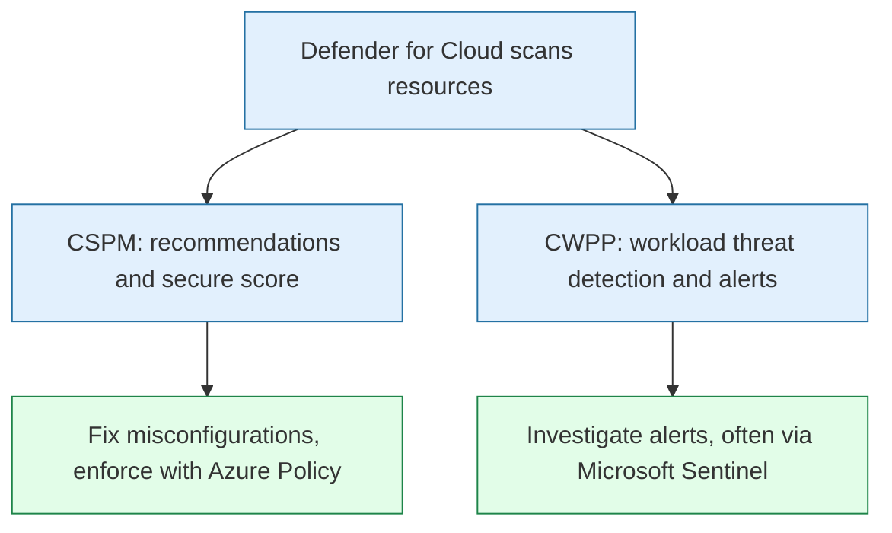

# Azure Security Center and Security Best Practices (Microsoft Defender for Cloud)

## Summary

Azure Security Center is now **Microsoft Defender for Cloud**. It assesses the security posture of your cloud resources, recommends fixes, and detects threats against workloads. It has two broad jobs, posture management and workload protection, and produces a single score so teams can track whether they are getting more or less secure over time.

## Naming note

The product formerly called **Azure Security Center** (and, for servers, Azure Defender) is now **Microsoft Defender for Cloud**. Older material uses the old names for the same capabilities.

## What it does

### Cloud Security Posture Management (CSPM)
CSPM "checks and improves the security posture of cloud resources". It continuously evaluates resources against security recommendations and surfaces misconfigurations (for example storage open to the public, missing encryption, over-broad network rules).

### Secure score
Defender for Cloud summarises posture as a **secure score**: an assessment of your cloud security posture, driven by how many recommendations are satisfied. A higher score means more recommended controls are in place. The score gives teams a single number to drive and report on. (The current product has both a risk-based Cloud Secure Score in the Microsoft Defender portal and the classic Secure Score in the Azure portal.)

### Cloud Workload Protection Platform (CWPP)
CWPP "defends workloads such as virtual machines, containers, storage, databases, and serverless functions". These workload-protection plans add threat detection and alerts for each resource type, feeding security alerts that can be investigated or automated.

## How to use it (best practice)

1. **Turn on Defender plans** for the resource types you run (servers, storage, containers, databases, key vault, and so on) so you get both posture checks and threat detection.
2. **Work the secure score down the recommendation list**, highest-impact first, and track the score over time.
3. **Route alerts** into your SIEM/SOAR (Microsoft Sentinel or another) so detections become investigations and automated responses.
4. **Enforce the fixes with policy**: many recommendations map to Azure Policy definitions that can be assigned at management-group scope to prevent regressions.
5. **Review regularly**, because new resources and new recommendations appear continuously.

## Where it fits

## Detection

Defender for Cloud **is** a detection tool. Its alerts cover suspicious activity on protected workloads. Treat a falling secure score, newly failing recommendations, and new high-severity alerts as the signals to act on.

## Defense

- Enable the relevant Defender plans; posture checks alone do not detect active threats.
- Drive the secure score and enforce fixes with Azure Policy so they stick.
- Connect alerts to Sentinel for investigation and automated response.

## ATT&CK mapping

None specific. Defender for Cloud is a posture-management and detection layer across many techniques.

## Explanation

Defender for Cloud is both a building inspector and a burglar alarm. CSPM is the inspector pointing out unlocked windows and giving the building a safety score; CWPP is the alarm that goes off when someone actually breaks in. Best practice is to act on the inspector's list, keep the score rising, and wire the alarm to someone who will respond.
