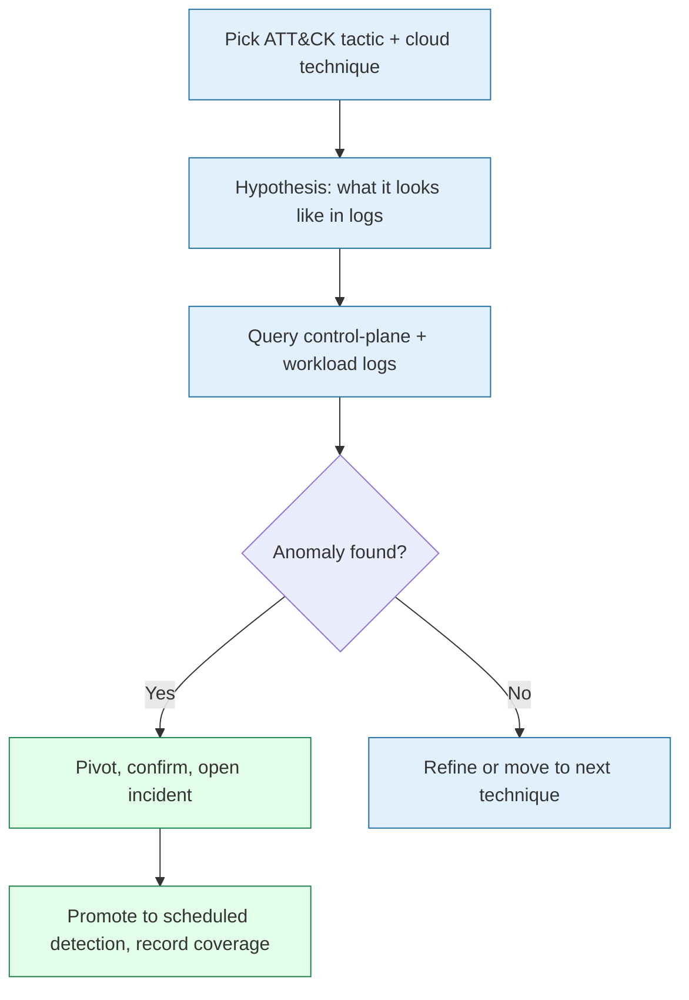

# Cloud Threat Hunting with MITRE ATT&CK Tactics

## Summary

Threat hunting is proactively searching logs for attacker behaviour that automated alerts missed. Using MITRE ATT&CK as the map keeps a hunt systematic: pick a tactic, pick a technique attackers use in your cloud, form a hypothesis about what it would look like in your logs, and go look. ATT&CK publishes cloud-focused coverage (IaaS, Identity Provider, SaaS, Office Suite) that tells you which techniques are even relevant.

> ATT&CK note: in the current ATT&CK (v2.0), the tactic formerly called "Defense Evasion" is now **Stealth**, and a new **Defense Impairment** tactic covers disabling tools and logs. Hunts and mappings should use the current tactic names.

## The hunt loop

1. **Choose a tactic and technique.** For cloud, high-value starting points are Initial Access (valid accounts), Persistence (account manipulation, additional credentials), Privilege Escalation (role abuse), Defense Impairment (disabling cloud logs), Credential Access (metadata API, secret stores), Discovery (enumerating resources), Exfiltration (to cloud storage or web services).
2. **Form a hypothesis.** State what the technique would produce in your data. Example: "If someone is persisting via extra credentials, I should see `CreateAccessKey` where the caller and target user differ."
3. **Query the data.** Run it against the control-plane logs (CloudTrail, Azure Activity, Entra audit/sign-in, GCP audit) and workload logs. In Sentinel this is KQL.
4. **Triage results.** Separate normal automation from suspicious activity; pivot to related events.
5. **Turn findings into detections.** Promote a good hunt to a scheduled analytics rule so it runs continuously, and record coverage against ATT&CK.

## Mapping cloud data to tactics

| Tactic (current ATT&CK) | Example technique | Where to look |
|---|---|---|
| Initial Access | Valid Accounts (T1078.004) | Sign-in logs: new IP/ASN, impossible travel |
| Persistence | Account Manipulation (T1098) | IAM/Entra audit: new keys, roles, delegation |
| Privilege Escalation | role/policy abuse | IAM writes: policy changes, PassRole use |
| Defense Impairment | Disable or Modify Cloud Log (T1685.002) | CloudTrail `StopLogging`/`DeleteTrail` |
| Credential Access | Cloud Instance Metadata API (T1552.005) | Role creds used off-instance |
| Discovery | Cloud Service/Resource Discovery (T1526/T1580/T1613) | Bursts of `List*`/`Describe*` |
| Exfiltration | Exfiltration to Cloud Storage (T1567.002) | Egress to external buckets/services |

## Flow

## Detection

Hunting feeds detection. Each confirmed hunt should become a continuous analytics rule, and each technique you can hunt should be recorded on an ATT&CK coverage map so gaps are visible.

## Defense

- Ensure the logs each technique needs are actually collected (control plane, identity, workload). A hunt is impossible without the data.
- Prioritise techniques that are both common in the wild and relevant to your cloud footprint.
- Keep ATT&CK references current; technique IDs and tactic names change between versions.

## ATT&CK mapping

No single technique: this is a methodology spanning the ATT&CK cloud matrices.

## Explanation

ATT&CK-guided hunting is using a known list of burglar tricks as a checklist: for each trick, ask "what trace would it leave in my cameras?" and then go watch that camera. Every answered question either finds an intruder or becomes a permanent alarm, and the checklist shows which tricks you still cannot see.
