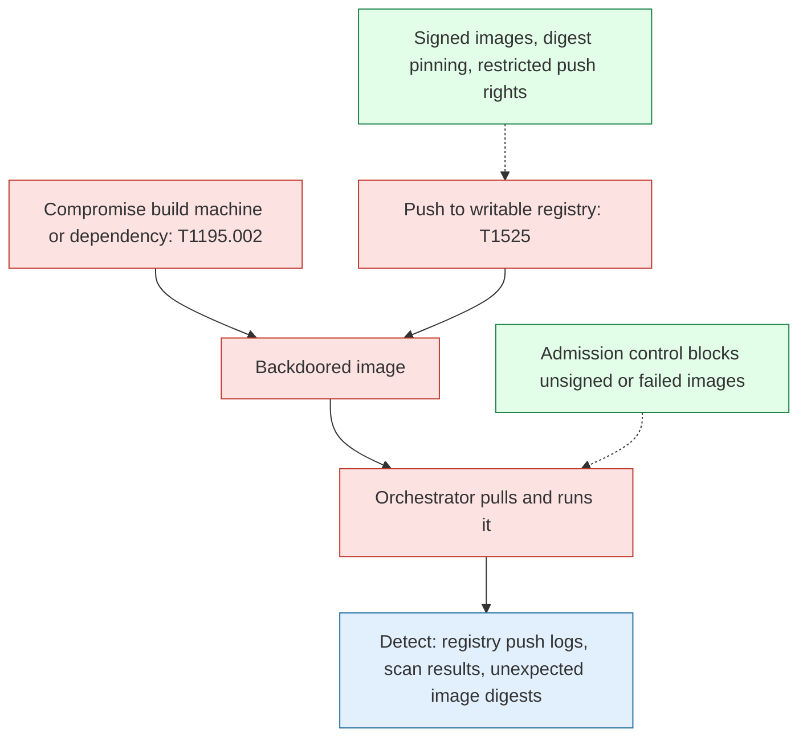

# Container Images and Image Vulnerabilities

## Summary

A container image is a packaged root filesystem: usually a base Linux distribution, the packages installed on top, and the application. Every container started from that image inherits everything in it, including vulnerable packages and anything an attacker added. Image security therefore covers three stages: how the image is **built**, how it is **stored**, and how it is **deployed**, plus regular **scanning** of what is inside.

## How it works

### Build
- A classic `docker build` talks to the Docker daemon, which normally runs as root. Anyone who can drive builds on a shared daemon has root-level power on that build host. Daemonless or rootless builders reduce that risk.
- Each instruction in a Dockerfile adds a layer. A secret copied in one layer and deleted in a later one is still present in the earlier layer and can be extracted from the image.
- The build machine is a high-value target. If an attacker can influence a build, every container started from the output runs their code. Harden build machines like production: minimal tools, restricted access, network isolation, and limited cloud permissions.

### Store
- Whoever can push to, or replace images in, a registry decides what runs. Use a private or managed registry, restrict push rights, and allow deployment only from approved registries.
- Refer to images by immutable digest (`image@sha256:...`) rather than a mutable tag like `latest`, so the image cannot change under the same name.
- Sign images and verify signatures before deployment.

### Deploy
- Use admission control in the orchestrator to block images that are unsigned, from unapproved registries, or that failed a scan.

### Scan
- Image scanners read the package databases inside the filesystem (for example `dpkg`, `rpm`, `apk`, plus language manifests such as `pip` or `npm` lock files) and compare versions against vulnerability feeds. This is different from a network scanner that probes running services.
- Software copied in directly with `curl` or `wget` is usually invisible to scanners because no package manager recorded it. Install through package managers where possible.
- Scanners can disagree or be wrong: feeds go out of date, distributions mark some issues "won't fix", sub-packages have different names, and back-ported fixes can make versions look vulnerable when they are not.
- An image that has not changed can become vulnerable tomorrow because a new CVE is published. Scan on build **and** on a schedule.
- Fix by rebuilding and redeploying, not by patching running containers. Containers should be treated as immutable.

## Attacker view

## Detection

- Registry audit logs for pushes by unexpected identities or at unusual times.
- Running containers whose image digest does not match what the deployment pipeline produced.
- Scheduled scan results that show new critical vulnerabilities in images already in production.

## Defense

- Small base images with few packages.
- No secrets in images or layers.
- Build on hardened, isolated machines; prefer daemonless or rootless builders.
- Private registry, least-privilege push rights, image signing, digest pinning.
- Scan in CI and on a schedule; block failed images with admission control.
- Rebuild and redeploy to patch.

## ATT&CK mapping

| ID | Name | Tactic |
|---|---|---|
| T1525 | Implant Internal Image | Persistence |
| T1195.002 | Supply Chain Compromise: Compromise Software Supply Chain | Initial Access |

## Explanation

An image is a recipe that gets cooked every time a container starts. If the recipe has a bad ingredient, every meal has it. Scanning reads the ingredient list, signing proves who wrote the recipe, and admission control is the chef refusing recipes that fail either check.
