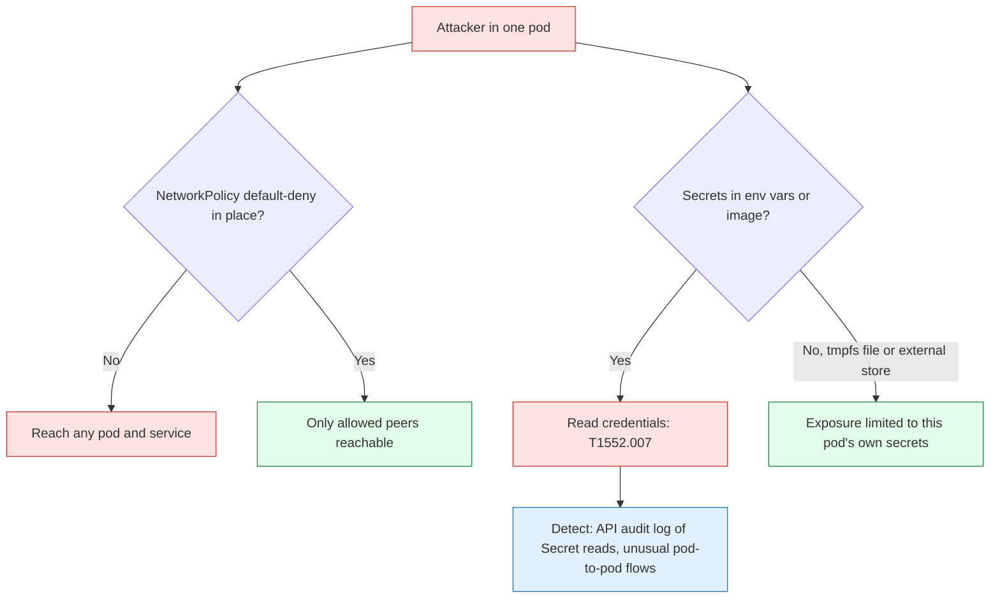

# Container Network Security, TLS and Secrets

## Summary

Containers usually run small services that talk to each other over the network, and they need credentials to do it. Three controls keep that safe: **network policy** so each workload can reach only what it needs, **TLS** (ideally mutual TLS) so traffic is encrypted and both sides are authenticated, and **careful secret delivery** so credentials do not leak through images, logs or the orchestrator.

## Network policy

- In Kubernetes, pods are **non-isolated by default**: if no NetworkPolicy selects a pod, all inbound and outbound traffic to and from it is allowed.
- NetworkPolicy objects are enforced by the **network plugin**. If the cluster's plugin does not support NetworkPolicy, the objects are accepted but have no effect.
- A common pattern is a **default-deny** policy per namespace for ingress and egress, followed by narrow allow rules. A default-deny egress policy also blocks DNS, so allow DNS explicitly when workloads need it.
- Policies work at layers 3 and 4 (IP addresses, pod and namespace selectors, ports). A **service mesh** can add identity-based rules and mutual TLS at layer 7.

## TLS between components

- TLS relies on X.509 certificates. Each service holds a private key, a certificate authority (CA) signs a certificate that binds the public key to the service's name, and peers verify that signature.
- **Mutual TLS** means both client and server present certificates, so a stolen network position alone is not enough to impersonate a service.
- Plan for certificate rotation and revocation. Short-lived certificates issued automatically reduce the need for revocation.

## Secrets

Ways to get a secret into a container, from worst to best:

| Method | Risk |
|---|---|
| Baked into the image | Anyone who can pull the image has it, and it persists in image layers. Build arguments and environment variables used during a build also persist in the final image. |
| Environment variable at run time | Visible to anything that can inspect the container or its process environment, and easy to leak into logs and crash dumps. |
| File mounted at run time | Better. Kubernetes mounts Secret volumes on a `tmpfs` so the data is not written to the node's durable storage. |
| External secret store fetched at run time | Best for most cases. Short-lived, audited, centrally rotated. |

Kubernetes-specific points:
- Secrets are stored **unencrypted in etcd by default**. Values in manifests are only base64-encoded, which is encoding, not protection. Enable **encryption at rest** for Secrets.
- Anyone who can **create a pod** in a namespace can read every Secret in that namespace by mounting it, including indirectly through a Deployment.
- Use least-privilege RBAC for Secrets and consider an external secret store provider.
- Root on the node can read the secrets of pods running on that node, whatever delivery method is used.

Reading credentials from orchestrator APIs or Secrets is ATT&CK T1552.007 (Unsecured Credentials: Container API).

## Flow

## Detection

- Network flow logs or CNI telemetry showing pod-to-pod connections that no policy expects.
- API server audit logs of `get` and `list` on Secrets, especially by service accounts.
- TLS handshake failures between services, which can indicate a misconfiguration or an interception attempt.

## Defense

- Default-deny NetworkPolicy per namespace, then explicit allow rules; confirm the CNI plugin enforces them.
- Mutual TLS between services, with automatic short-lived certificates.
- No secrets in images or build arguments; prefer mounted files or an external secret store over environment variables.
- Enable encryption at rest for Kubernetes Secrets and restrict who can read them or create pods.

## ATT&CK mapping

| ID | Name | Tactic |
|---|---|---|
| T1552.007 | Unsecured Credentials: Container API | Credential Access |

## Explanation

Network policy decides which rooms a service may walk into, TLS checks the ID badge at each door, and secret handling decides where the keys are kept. A container with keys in its pocket (environment variables) is easier to rob than one that collects a key from a guarded desk each time it needs one.
