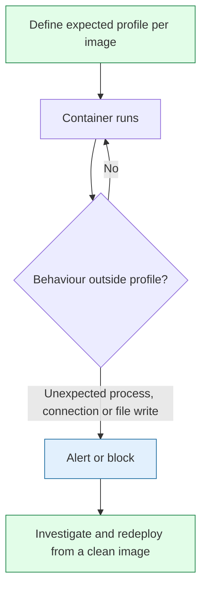

# Container Runtime Protection and the OWASP Top 10

## Summary

Runtime protection watches what a running container actually does and compares it with what it should do. Containers make this easier than traditional servers because a microservice image usually does one small job, so its normal behaviour is narrow and predictable. Separately, containers do not remove ordinary application risks: the OWASP Top 10 still applies, and some items have container-specific mitigations.

## Runtime protection

### Profiles per image
Every container started from the same image should behave the same way. That makes it practical to define an expected profile per image and alert on (or block) anything outside it:

- **Processes**: which executables run. A shell or package manager appearing in a web service container is a strong signal.
- **Network**: which destinations and ports it connects to and accepts from.
- **Files**: which paths it reads and writes. Writes to binaries or configuration are suspicious, especially with a read-only root filesystem.
- **User IDs and privileges**: which uid it runs as and whether it tries to gain capabilities.

Enforcement can use kernel mechanisms (seccomp for system calls, AppArmor or SELinux for files and operations) or a runtime security tool that monitors system calls per container.

### Kubernetes note
Older material often mentions **PodSecurityPolicy** for enforcing runtime restrictions per pod. PodSecurityPolicy was deprecated in Kubernetes v1.21 and **removed in v1.25**. Its replacement is **Pod Security Admission**, which enforces the Privileged, Baseline and Restricted Pod Security Standards per namespace, or a third-party policy engine.

## The OWASP Top 10 for containerised applications

The current edition is the OWASP Top 10:2025. Some items have container-specific help; others are pure application problems that containers do not change.

| OWASP 2025 item | Container angle |
|---|---|
| A01 Broken Access Control | Nothing container-specific for app logic; least-privilege service accounts and RBAC limit damage after a breach. |
| A02 Security Misconfiguration | Directly relevant: privileged containers, host mounts, default credentials in images, exposed orchestrator APIs. |
| A03 Software Supply Chain Failures | Image scanning, trusted base images, signing, and admission control. |
| A04 Cryptographic Failures | TLS between services, secrets kept out of images. |
| A05 Injection | Nothing container-specific; scanning can flag known-vulnerable libraries, but your own code needs secure coding and testing. |
| A06 Insecure Design | Threat modelling of the container architecture. |
| A07 Authentication Failures | Mutual TLS between services, external secret stores, short-lived credentials. |
| A08 Software or Data Integrity Failures | Image signing, digest pinning, read-only root filesystems. |
| A09 Security Logging and Alerting Failures | Collect container, orchestrator audit and runtime logs centrally, because containers are short-lived and their local logs disappear. |
| A10 Mishandling of Exceptional Conditions | Application concern; make sure containers fail closed and do not leak secrets in error output. |

Material written before 2021 uses the 2017 list, whose names and order differ (for example 2017 A1 was Injection).

## Flow

## Detection

Deviations from the image profile: new processes (especially shells), outbound connections to new destinations, writes to executable paths, privilege changes.

## Defense

- Define per-image profiles and enforce them with seccomp, AppArmor or SELinux, or a runtime security tool.
- Read-only root filesystem, non-root user, fewest capabilities.
- Enforce Pod Security Standards with Pod Security Admission.
- Keep applying normal application security for the OWASP items containers do not address.

## ATT&CK mapping

None specific. Runtime protection is a detection and prevention layer across many techniques.

## Explanation

A container running one microservice is like a vending machine: it should only ever take coins and drop snacks. If it suddenly starts making phone calls, something is wrong. Runtime protection writes down what "normal" looks like for each machine and raises the alarm on anything else.
