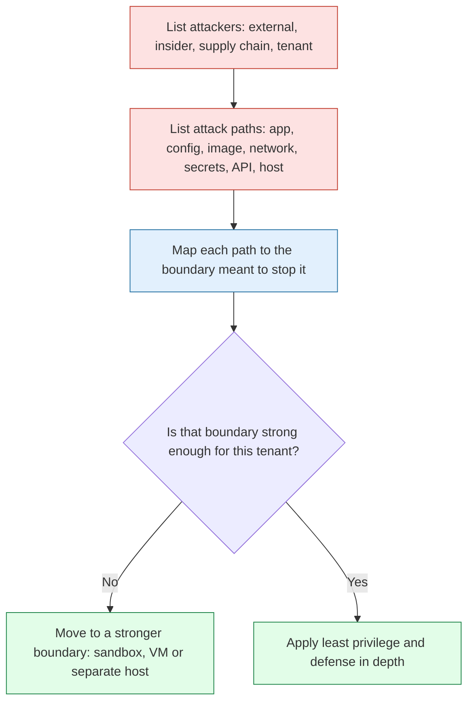

# Container Threat Model and Security Boundaries

## Summary

Before choosing container controls, decide who you are defending against and which boundary is supposed to stop them. A threat model for containers lists the attackers, the paths they could take, and the isolation boundary on each path. The most important fact to keep in mind is that containers on one host share a kernel, so the container boundary is weaker than the boundary between virtual machines.

## Who the attackers are

| Attacker | Example |
|---|---|
| External attacker | Exploits a bug in an application running in a container |
| Internal attacker with some access | Developer or operator with more cluster rights than they need |
| Malicious or compromised supply chain | Poisoned base image, dependency or build step |
| Neighbouring tenant | Another workload on the same host or cluster |
| Compromised host or control plane | Anyone who controls the node can see and change every container on it |

## Attack paths to consider

1. **Vulnerable application code** in a container is exploited.
2. **Misconfigured container** (root, extra capabilities, host mounts) lets that foothold reach the host.
3. **Poisoned image** is pulled from a registry or built on a compromised build machine.
4. **Container-to-container traffic** is used to move laterally, because by default many networks allow it.
5. **Secrets** are read from images, environment variables, mounted files or the orchestrator.
6. **Orchestrator API** (Kubernetes API server, kubelet, Docker daemon) is reached with stolen or overly broad credentials.
7. **Host compromise** gives control of every container on that host.

## Security boundaries

| Boundary | Strength | Note |
|---|---|---|
| Between containers on one host | Weakest | Shared kernel; enforced by namespaces, cgroups, capabilities, seccomp and LSM profiles |
| Between Kubernetes namespaces | Weak on its own | Kubernetes guidance uses namespaces to separate trust levels, but a namespace only means something when RBAC, network policy and Pod Security are applied to it. Boundaries inside one namespace should be considered weak. |
| Sandboxed container (gVisor, Kata) | Stronger | Adds a user-space kernel or a lightweight VM |
| Between virtual machines | Strong | Separate kernels, enforced by the hypervisor |
| Between physical hosts | Strongest | Separate hardware |

Multi-tenant designs should place tenants that do not trust each other on the strongest boundary they can afford.

## Principles to apply

- **Least privilege**: every container, service account and user gets only what it needs.
- **Defense in depth**: assume one layer will fail and add another behind it.
- **Reduce attack surface**: small images, fewer packages, fewer open ports, fewer privileges.
- **Limit blast radius**: separate workloads so one compromise does not reach everything.
- **Segregation of duties**: the people who build images are not the only ones who approve what runs in production.

## Threat model flow

## Detection

A threat model tells you where to look. For each path above, decide which log or signal would show it being used: image scan results and registry logs for supply chain, orchestrator audit logs for the API, network flow logs for lateral movement, and runtime alerts for escape attempts.

## Defense

Use this file as the index for the other container topics in this folder: image security, isolation, network security and secrets, runtime protection, and container escape.

## ATT&CK mapping

No single technique. The paths above map to techniques such as T1610 (Deploy Container), T1611 (Escape to Host) and T1613 (Container and Resource Discovery), covered in the related files.

## Explanation

Threat modelling is asking three questions before buying locks: who might break in, which doors would they use, and how strong is each door. With containers the surprise is usually that the door between two containers on the same host is the thinnest one.
