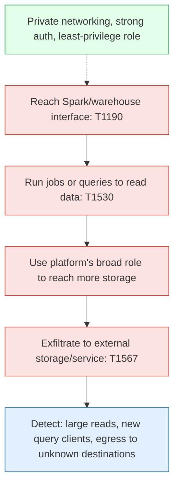

# Data Platform Attacks (Spark, Redshift) and Data Theft

## Summary

Big-data and analytics platforms (Apache Spark clusters, cloud data warehouses such as Amazon Redshift, and the storage behind them) are attractive because they concentrate large amounts of valuable data in one place and often hold broad credentials to reach more. Attacks on them usually come down to reaching an exposed interface (ATT&CK T1190), reading the data (T1530), and moving it out (T1567).

## Where the weaknesses are

- **Exposed management or compute interfaces.** A Spark master or UI, a notebook service, or a database endpoint reachable from the internet or an over-broad network is a direct entry.
- **Weak or missing authentication.** Analytics tooling is frequently deployed inside a "trusted" network with little auth, so one foothold inside the network reaches it.
- **Over-broad credentials.** These platforms often run with cloud roles that can read many buckets, warehouses and services, so compromising the platform yields far more than its own data.
- **Insecure configuration.** Public storage behind the warehouse, unencrypted connections, and overly permissive grants inside the database.

## How an attack proceeds

1. **Reach the platform** through an exposed interface or from a foothold on the trusted network (T1190).
2. **Use its compute to read data.** On a compute platform like Spark, the attacker can submit jobs that read any data the cluster can reach; on a warehouse, they query tables (T1530).
3. **Pivot with the platform's credentials.** The role or service account attached to the platform often reaches additional storage and services.
4. **Exfiltrate.** Copy data out to attacker-controlled storage or an external service (T1567; the cloud-storage variant is T1567.002).

## Flow

## Detection

- Platform access from new clients, IPs or networks; use of admin or job-submission interfaces by unexpected principals.
- Unusually large scans or reads, or queries that touch far more data than normal workloads.
- The platform's cloud role used for actions or buckets it never touched before.
- Egress to external storage or endpoints, and large outbound transfers from the analytics tier.

## Defense

- Put analytics platforms on **private networks**; never expose management, UI or database endpoints to the internet.
- Require strong authentication and authorization on every interface, including internal ones; do not rely on network trust alone.
- Give each platform a **least-privilege role** scoped to the exact data it needs, so a compromise does not reach the whole account.
- Encrypt data in transit and at rest, and restrict and log access to the underlying storage.
- Monitor query and job activity, data volumes and egress, and alert on anomalies.

## ATT&CK mapping

| ID | Name | Tactic |
|---|---|---|
| T1190 | Exploit Public-Facing Application | Initial Access |
| T1530 | Data from Cloud Storage | Collection |
| T1567 | Exfiltration Over Web Service | Exfiltration |

## Explanation

A data platform is a warehouse that also carries the keys to every other warehouse. Breaking into it is valuable twice over: for the goods inside and for the keys it holds. The defence is to keep the warehouse off the public street, check everyone's ID at the door even inside the compound, and give it only the keys it actually needs.
