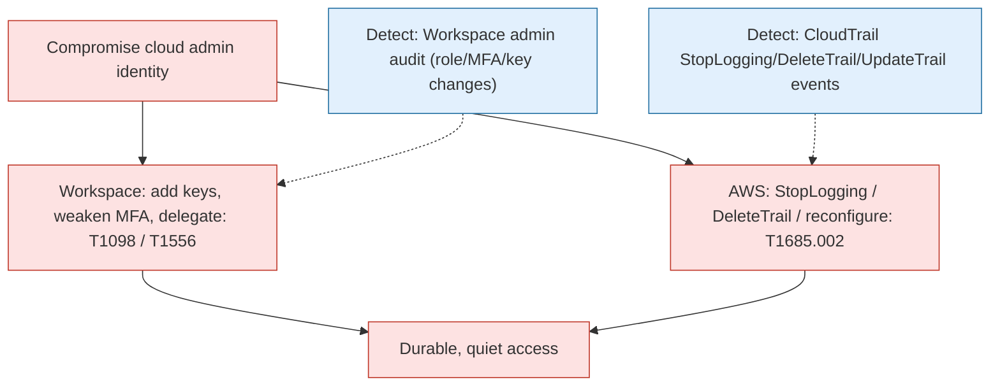

# Google Workspace Takeover and CloudTrail Evasion

## Summary

Two related post-compromise goals in the cloud: take durable control of an identity platform (here, Google Workspace), and blind the logging that would reveal it (here, AWS CloudTrail). Both are about holding access while reducing the defender's visibility. The techniques are account manipulation (ATT&CK T1098) and disabling or modifying cloud logs (ATT&CK T1685.002).

> ATT&CK note: "Disable or Modify Cloud Logs" is now **T1685.002**. Earlier material (and some KB rows) used the retired ID **T1562.008**; use T1685.002.

## Google Workspace takeover

Once an attacker has an admin or a high-privilege account in Google Workspace, they work to keep it:

- **Add credentials or keys** to accounts and service accounts (an application of T1098): new app passwords, OAuth tokens, or service-account keys that survive a password reset.
- **Weaken authentication** (T1556): disable or downgrade MFA requirements, add trusted devices, or alter SSO/identity-provider settings so future logins are easier.
- **Create or elevate accounts**: new admin users, or granting admin roles to existing ones.
- **Abuse delegation**: domain-wide delegation on a service account lets it impersonate users across the tenant, a powerful and quiet persistence path.

The defender's signals are in the Google Workspace admin audit logs: role changes, MFA changes, new service-account keys, and delegation changes.

## CloudTrail evasion

AWS CloudTrail is the control-plane audit log. An attacker who wants to act unseen targets it (T1685.002):

- **Stop or delete the trail**, or **stop logging** (`StopLogging`).
- **Reconfigure the trail** so it no longer covers the region or resource they will use, or remove it from an organization trail.
- **Disrupt delivery**, for example by changing or deleting the destination S3 bucket or breaking its policy.

The paradox the defender relies on: the act of tampering with CloudTrail is itself a CloudTrail event, as long as the tampering has not already taken effect. Those specific events (`StopLogging`, `DeleteTrail`, `UpdateTrail`, `PutEventSelectors`) are high-value alerts.

## Flow

## Detection

- **Google Workspace**: alert on admin-role grants, MFA/2SV policy changes, new service-account keys, and domain-wide delegation changes.
- **AWS CloudTrail**: alert on `StopLogging`, `DeleteTrail`, `UpdateTrail`, `PutEventSelectors`, and on changes or deletions to the trail's destination bucket.
- **Cross-check sinks**: forward logs to a separate, append-only account so that disabling a local trail does not erase the evidence already shipped.

## Defense

- Enforce phishing-resistant MFA for all admins; use PIM-style just-in-time admin where available.
- Use **organization trails** and deliver CloudTrail to a dedicated logging account the workload accounts cannot modify; enable log file validation.
- Restrict who can change identity settings and logging configuration, and alert on every such change.
- Rotate and inventory service-account keys and OAuth grants; remove unused delegation.

## ATT&CK mapping

| ID | Name | Tactic |
|---|---|---|
| T1098 | Account Manipulation | Persistence, Privilege Escalation |
| T1685.002 | Disable or Modify Cloud Log | Defense Impairment |
| T1556 | Modify Authentication Process | Credential Access, Defense Impairment, Persistence |

## Explanation

This is a burglar who first copies the house keys and disables the alarm's recorder. Copying keys is account manipulation; silencing the recorder is cloud-log tampering. The defence is keys that expire and alarms whose recordings are copied off-site the instant they are made, so cutting the local recorder changes nothing.
