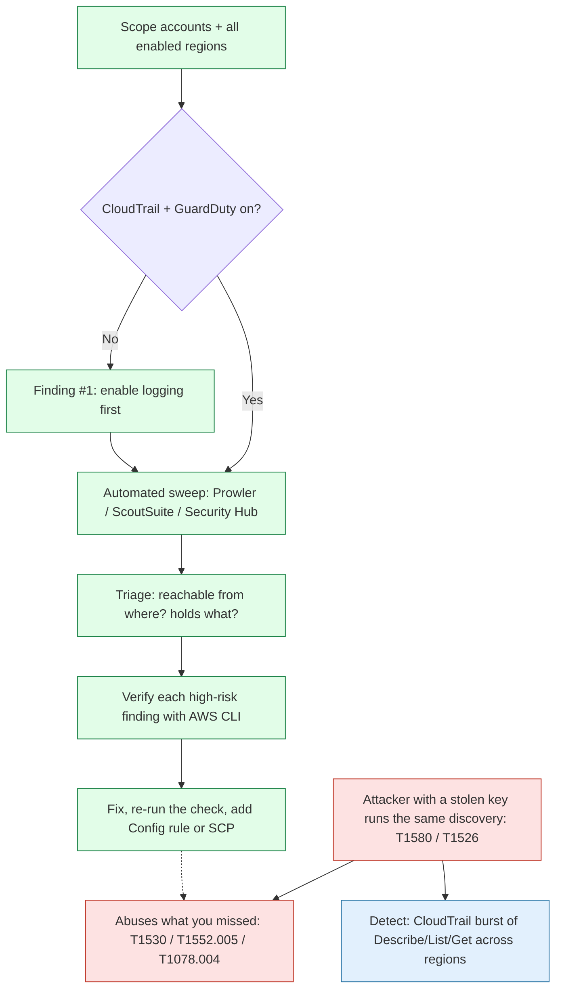

# Hunting for AWS Misconfigurations

## Summary

Most AWS breaches do not need an exploit. They need one setting that someone got wrong: a security group open to the internet, a snapshot shared with everyone, a role that trusts too much, an instance still answering IMDSv1, or logging that was never turned on. **Misconfiguration hunting** is the discipline of finding those settings systematically, across every region and service, before an attacker does.

This file is the practical "how to hunt" guide. It ties together the topic files that explain each weakness in depth ([S3](aws-s3-bucket-security-and-misconfiguration.md), [IAM](aws-iam-enumeration-and-privilege-abuse.md), [secrets and IMDS](aws-secrets-and-credential-exposure.md), [Lambda](aws-lambda-and-serverless-security.md)) into one repeatable workflow, then walks through worked examples: the command you run, what the output looks like, why it is dangerous, how to fix it, and how to confirm the fix. It sits alongside the broader [AWS Penetration Testing Methodology](aws-penetration-testing-methodology-and-tooling.md), which covers the whole engagement; this file zooms into the configuration-review phase.

> Everything here is meant for accounts you own or are explicitly authorized to assess. All commands below are **read-only** except the ones in the "Fix" steps, which change your own resources. Account IDs, resource IDs and IPs in the examples are made up.

## Why misconfigurations dominate cloud risk

AWS works on a **shared responsibility model**: AWS secures the hardware, hypervisor and managed service internals; the customer secures what they configure, namely identities, network rules, data sharing, encryption and logging. Almost every customer-side failure is therefore a configuration choice, and three properties make those choices easy to get wrong:

1. **Scale.** A single account can have resources in more than 30 regions and hundreds of services. A setting that is fine in `us-east-1` can be wrong in a region nobody looks at.
2. **Layered access controls.** Access to one resource can be granted by an IAM policy, a resource policy, an ACL, a sharing attribute or a network rule. Any one of them can open it, so checking only one layer gives false comfort.
3. **Defaults changed over time.** AWS has made many defaults safer (S3 Block Public Access and ACLs off for new buckets since April 2023, IMDSv2 as the default in newer launch paths), but **older resources keep their old settings**. An audit has to read the actual configuration, never assume the default.

## The hunting workflow

A good hunt follows the same loop every time:

1. **Scope.** List the accounts, and enumerate every **enabled region**, not just the one you work in.
2. **Visibility first.** Confirm CloudTrail and GuardDuty are on. If logging is off, nothing else you find can be investigated, so that is finding number one.
3. **Automated sweep.** Run a read-only scanner (Prowler, ScoutSuite) or read AWS Security Hub / AWS Config results. These cover hundreds of checks in minutes.
4. **Triage by exposure.** Rank findings by *who can reach it* (internet, any AWS account, another of your accounts, internal only) and *what it holds* (admin rights, credentials, customer data). An internet-reachable resource that leaks credentials beats a hundred "low" findings.
5. **Manual verification.** Confirm each high-risk finding with the AWS CLI. Scanners produce false positives (an "open" security group with no instance attached) and miss context (a "private" bucket that a public CloudFront distribution serves).
6. **Prove impact, only if in scope.** In an active test, show what an attacker would reach, without exfiltrating or destroying data.
7. **Fix and re-check.** Remediate, re-run the same check, then turn it into a continuous control (AWS Config rule, Security Hub control, SCP) so it cannot silently come back.



The point of the bottom half of the diagram: an attacker holding a leaked access key performs exactly the same discovery you do (ATT&CK T1580 Cloud Infrastructure Discovery, T1526 Cloud Service Discovery). Hunting is a race to read your own configuration first.

## Setting up: identity and regions

Use a dedicated, **read-only** auditing identity. The AWS managed policies `SecurityAudit` and `ViewOnlyAccess` are the usual basis for scanner roles; Prowler's documentation lists the extra read permissions it needs.

Confirm who you are, then build the region list you will loop over:

```bash
aws sts get-caller-identity

# Every region enabled for this account
REGIONS=$(aws ec2 describe-regions --query "Regions[].RegionName" --output text)
echo "$REGIONS"
```

Most later checks are regional, so they are wrapped in a loop:

```bash
for r in $REGIONS; do
  echo "== $r"
  aws ec2 describe-security-groups --region "$r" --query "..." --output table
done
```

IAM, S3 bucket listing and the credential report are global, so they run once.

## Automated sweep: the tools

| Tool | What it is | Typical command | Notes |
|---|---|---|---|
| **Prowler** | Open-source scanner with hundreds of AWS checks, mapped to CIS, NIST, PCI and others | `prowler aws` | `--severity critical high` to focus; `-s s3 iam` to limit services; `-c s3_bucket_public_access` for one check; `-f us-east-1` to limit regions; `-p <profile>`; `-M csv json-ocsf html` for output formats; `--list-checks` to see everything |
| **ScoutSuite** (NCC Group) | Multi-cloud, read-only configuration auditor; builds a browsable offline HTML report | `scout aws --profile <profile>` | Good for walking a whole account visually, service by service |
| **AWS Security Hub** | AWS's native posture service; runs the *AWS Foundational Security Best Practices* and CIS standards as controls | Console or `aws securityhub get-findings` | Since 2025 the posture-check product is branded **Security Hub CSPM**; the newer "Security Hub" correlates findings across services |
| **AWS Config** | Records resource configuration over time and evaluates it against rules | `aws configservice describe-compliance-by-config-rule` | Managed rules (listed in the cheat sheet below) turn each manual check into a continuous one |
| **IAM Access Analyzer** | Proves which resources are shared **outside** your account or organization | `aws accessanalyzer list-findings --analyzer-arn <arn>` | Uses automated reasoning over resource policies; catches over-trusting roles, shared KMS keys, public buckets, Lambda and SQS policies and more |

**How to read scanner output:** a scanner tells you a setting matches a risky pattern, not that you are breached. Treat every `FAIL` as a lead to verify, and check whether the resource is actually in use and reachable.

## Worked examples

Each example follows the same pattern: **Check** (read-only), **Example output**, **Why it matters**, **Fix**, **Verify**.

### Example 1: Root user with no MFA and live access keys

The root user can do anything, including close the account, and cannot be restricted by IAM policies. It should have MFA and **no access keys**.

**Check**

```bash
aws iam get-account-summary \
  --query "SummaryMap.{RootMFA:AccountMFAEnabled,RootKeys:AccountAccessKeysPresent}"
```

**Example output**

```json
{
    "RootMFA": 0,
    "RootKeys": 1
}
```

**Why it matters.** `RootKeys: 1` means a long-term `AKIA...` key for root exists somewhere: a laptop, a script, a CI variable. Anyone who finds it owns the account outright (T1078.004, Valid Accounts: Cloud Accounts), and no IAM policy or permissions boundary can limit it. `RootMFA: 0` means the console password alone protects the account.

**Fix.** Sign in as root, enable an MFA device, and delete the root access key (root keys can only be managed while signed in as root). Use IAM roles or IAM Identity Center for daily work. In AWS Organizations, centralized root access management can remove root credentials from member accounts entirely.

**Verify.** Re-run the command and expect `RootMFA: 1`, `RootKeys: 0`. Continuous controls: Config rules `root-account-mfa-enabled` and `iam-root-access-key-check`.

### Example 2: Stale and unused IAM access keys (credential report)

The **credential report** is a CSV of every IAM user with password, MFA and access-key status and last-use dates. It is the fastest way to find forgotten credentials.

**Check**

```bash
aws iam generate-credential-report
aws iam get-credential-report --query Content --output text | base64 -d > cred-report.csv

# user, MFA active, key 1 active, key 1 last rotated, key 1 last used
cut -d, -f1,8,9,10,11 cred-report.csv | column -s, -t
```

**Example output**

```
user               mfa_active  access_key_1_active  access_key_1_last_rotated   access_key_1_last_used_date
<root_account>     false       true                 2019-03-02T10:11:00+00:00   N/A
ci-deploy          false       true                 2020-06-14T08:00:00+00:00   2026-11-19T22:41:07+00:00
old-contractor     false       true                 2021-01-09T13:20:00+00:00   N/A
alice              true        false                N/A                         N/A
```

**Why it matters.**
- `old-contractor` has an **active key that has never been used** since 2021. Nobody will notice if it is stolen and used, because nobody expects it to do anything.
- `ci-deploy` has a five-year-old key that is used daily. Long-lived keys leak through repos, CI logs and laptops; age multiplies the chance it already has.
- The root row repeats Example 1.

**Fix.** Deactivate, then delete, unused keys: `aws iam update-access-key --user-name old-contractor --access-key-id AKIA... --status Inactive`. Move CI to short-lived role credentials (for example, OIDC federation from your CI provider) instead of a stored key.

**Verify.** Regenerate the report. Continuous controls: Config rules `access-keys-rotated` and `iam-user-unused-credentials-check`.

### Example 3: CloudTrail missing, single-region or stopped

Without CloudTrail you cannot investigate anything else on this list. Attackers know this, which is why disabling or tampering with cloud logs is its own technique (T1685.002, Disable or Modify Cloud Log).

**Check**

```bash
aws cloudtrail describe-trails \
  --query "trailList[].{Name:Name,MultiRegion:IsMultiRegionTrail,Bucket:S3BucketName,Validation:LogFileValidationEnabled}" \
  --output table

aws cloudtrail get-trail-status --name main-trail --query "{Logging:IsLogging,LastDelivery:LatestDeliveryTime}"
```

**Example output**

```
-------------------------------------------------------------------
|                         DescribeTrails                          |
+------------------+--------------+---------------+---------------+
|      Bucket      | MultiRegion  |     Name      |  Validation   |
+------------------+--------------+---------------+---------------+
|  acme-trail-logs |  False       |  main-trail   |  False        |
+------------------+--------------+---------------+---------------+
{
    "Logging": false,
    "LastDelivery": "2026-08-02T04:13:55+00:00"
}
```

**Why it matters.** Three problems in one trail:
- **Single-region:** an attacker who works in a region you never use is not recorded by this trail.
- **Not logging** since August: someone (or some automation) stopped it. That is itself an incident to investigate; look for the `StopLogging` event in CloudTrail Event history, which keeps 90 days of management events even without a trail.
- **No log file validation:** you cannot prove log files were not altered.

Also remember that CloudTrail records **management events** by default; **data events** (such as S3 `GetObject`) are only recorded if you turn them on, so data theft from S3 is invisible without them.

**Fix.**

```bash
aws cloudtrail update-trail --name main-trail --is-multi-region-trail --enable-log-file-validation
aws cloudtrail start-logging --name main-trail
```

In an organization, use an **organization trail** written to a bucket in a separate log-archive account, and deny `cloudtrail:StopLogging` and `cloudtrail:DeleteTrail` with an SCP.

**Verify.** `get-trail-status` shows `"Logging": true` and a fresh delivery time. Continuous control: Config rule `multi-region-cloudtrail-enabled`. Check GuardDuty the same way (`aws guardduty list-detectors` in each region; an empty list means it is off there).

### Example 4: Security group open to the internet on an admin or database port

**Check** (run per region)

```bash
aws ec2 describe-security-groups --region "$r" \
  --query "SecurityGroups[?IpPermissions[?IpRanges[?CidrIp=='0.0.0.0/0']]].{ID:GroupId,Name:GroupName,Rules:IpPermissions[].[IpProtocol,FromPort,ToPort]}" \
  --output json
```

The query keeps only groups that have at least one inbound rule containing `0.0.0.0/0`. Repeat with `Ipv6Ranges[?CidrIpv6=='::/0']` for IPv6, which is easy to forget.

**Example output**

```json
[
  {
    "ID": "sg-0a1b2c3d4e5f60718",
    "Name": "legacy-db",
    "Rules": [["tcp", 22, 22], ["tcp", 5432, 5432]]
  }
]
```

**Why it matters.** SSH (22) and PostgreSQL (5432) are reachable from the entire internet. Internet scanners find open admin and database ports within minutes, then try default or reused passwords and known exploits against the service (T1190, Exploit Public-Facing Application). A group is only dangerous if something uses it, so check:

```bash
aws ec2 describe-network-interfaces --filters Name=group-id,Values=sg-0a1b2c3d4e5f60718 \
  --query "NetworkInterfaces[].{ENI:NetworkInterfaceId,Instance:Attachment.InstanceId,PublicIP:Association.PublicIp}"
```

If that returns an interface with a public IP, the finding is live and urgent.

**Fix.**

```bash
aws ec2 revoke-security-group-ingress --group-id sg-0a1b2c3d4e5f60718 \
  --protocol tcp --port 22 --cidr 0.0.0.0/0
aws ec2 revoke-security-group-ingress --group-id sg-0a1b2c3d4e5f60718 \
  --protocol tcp --port 5432 --cidr 0.0.0.0/0
```

Replace SSH with **SSM Session Manager** (no inbound port at all) and allow the database port only from the application's security group.

**Verify.** Re-run the check. Continuous controls: Config rules `restricted-ssh` and `restricted-common-ports`.

### Example 5: Public EBS snapshot (and public AMI)

An EBS snapshot is a full copy of a disk. If its `createVolumePermission` includes the group `all`, **any AWS account** can copy it, attach it to their own instance and read every file, including configuration files, database dumps, SSH keys and `.aws/credentials` (T1530, Data from Cloud Storage).

**Check** (per region)

```bash
aws ec2 describe-snapshots --region "$r" --owner-ids self --restorable-by-user-ids all \
  --query "Snapshots[].{ID:SnapshotId,Vol:VolumeId,Size:VolumeSize,Desc:Description,Started:StartTime}" \
  --output table

aws ec2 describe-images --region "$r" --owners self --filters Name=is-public,Values=true \
  --query "Images[].{ID:ImageId,Name:Name}"
```

`--restorable-by-user-ids all` returns only the snapshots shared publicly.

**Example output**

```
--------------------------------------------------------------------------------------
|                                 DescribeSnapshots                                  |
+-------------------------+-------------------------+------+--------------------------+
|          Desc           |           ID            | Size |         Started          |
+-------------------------+-------------------------+------+--------------------------+
|  prod-db backup pre-mig |  snap-0f1e2d3c4b5a69788 |  200 | 2022-05-11T02:00:00Z     |
+-------------------------+-------------------------+------+--------------------------+
```

**Why it matters.** "prod-db backup" shared with everyone is a full database copy available to anyone with an AWS account. Researchers routinely find public snapshots like this by listing all public snapshots in a region and filtering by owner or description.

**Fix.**

```bash
aws ec2 modify-snapshot-attribute --snapshot-id snap-0f1e2d3c4b5a69788 \
  --attribute createVolumePermission --operation-type remove --group-names all

# Account-wide guardrail, per region
aws ec2 enable-snapshot-block-public-access --state block-all-sharing
```

**Verify.** The first check returns nothing. Continuous control: Config rule `ebs-snapshot-public-restorable-check`. If the snapshot was public for any length of time, treat the secrets on it as compromised and rotate them.

### Example 6: Public RDS instance or RDS snapshot

**Check** (per region)

```bash
aws rds describe-db-instances --region "$r" \
  --query "DBInstances[?PubliclyAccessible==\`true\`].{DB:DBInstanceIdentifier,Endpoint:Endpoint.Address,Encrypted:StorageEncrypted}"

for s in $(aws rds describe-db-snapshots --region "$r" --snapshot-type manual \
             --query "DBSnapshots[].DBSnapshotIdentifier" --output text); do
  aws rds describe-db-snapshot-attributes --region "$r" --db-snapshot-identifier "$s" \
    --query "DBSnapshotAttributesResult.{Snap:DBSnapshotIdentifier,Restore:DBSnapshotAttributes[?AttributeName=='restore'].AttributeValues[]}"
done
```

**Example output**

```json
{
    "Snap": "customers-2023-q4",
    "Restore": ["all"]
}
```

**Why it matters.** A `restore` attribute containing `all` means any AWS account can restore this database snapshot. `PubliclyAccessible: true` on an instance gives it a public DNS name and, combined with an open security group (Example 4), puts the database login prompt on the internet.

**Fix.**

```bash
aws rds modify-db-snapshot-attribute --db-snapshot-identifier customers-2023-q4 \
  --attribute-name restore --values-to-remove all
aws rds modify-db-instance --db-instance-identifier <db> --no-publicly-accessible --apply-immediately
```

**Verify.** Re-run both checks. Continuous controls: Config rules `rds-snapshots-public-prohibited` and `rds-instance-public-access-check`.

### Example 7: S3 Block Public Access off and a public bucket policy

The [S3 file](aws-s3-bucket-security-and-misconfiguration.md) explains the access model. The hunt is three questions: is the account-level guardrail on, which buckets does AWS itself evaluate as public, and what does the policy actually say?

**Check**

```bash
ACCOUNT=$(aws sts get-caller-identity --query Account --output text)
aws s3control get-public-access-block --account-id "$ACCOUNT"

for b in $(aws s3api list-buckets --query "Buckets[].Name" --output text); do
  status=$(aws s3api get-bucket-policy-status --bucket "$b" \
             --query PolicyStatus.IsPublic --output text 2>/dev/null)
  echo "$b  public=$status"
done
```

**Example output**

```
An error occurred (NoSuchPublicAccessBlockConfiguration) when calling the GetPublicAccessBlock operation: ...
acme-logs           public=
acme-web-assets     public=True
acme-hr-exports     public=True
```

**Why it matters.** The error means **no account-level Block Public Access** is configured, so any bucket owner can make a bucket public. An empty `public=` means the bucket has no bucket policy (the call returns `NoSuchBucketPolicy`, which the loop hides); check its ACLs separately if ACLs are still enabled on it. `acme-web-assets` may be public on purpose (a static site), but `acme-hr-exports` almost certainly is not. Read its policy:

```bash
aws s3api get-bucket-policy --bucket acme-hr-exports --query Policy --output text | python3 -m json.tool
```

```json
{
  "Statement": [{
    "Effect": "Allow",
    "Principal": "*",
    "Action": ["s3:GetObject", "s3:ListBucket"],
    "Resource": ["arn:aws:s3:::acme-hr-exports", "arn:aws:s3:::acme-hr-exports/*"]
  }]
}
```

`"Principal": "*"` with no `Condition` means anyone on the internet can list and download every object (T1530).

**Fix.** Remove the statement (or the whole policy with `aws s3api delete-bucket-policy --bucket acme-hr-exports`), then enable account-level Block Public Access:

```bash
aws s3control put-public-access-block --account-id "$ACCOUNT" \
  --public-access-block-configuration BlockPublicAcls=true,IgnorePublicAcls=true,BlockPublicPolicy=true,RestrictPublicBuckets=true
```

Serve genuinely public web content through CloudFront with Origin Access Control instead of a public bucket.

**Verify.** `get-bucket-policy-status` returns `False`. Continuous controls: Config rules `s3-account-level-public-access-blocks` and `s3-bucket-public-read-prohibited`.

### Example 8: EC2 instances still allowing IMDSv1, with secrets in user data

**Check** (per region)

```bash
aws ec2 describe-instances --region "$r" \
  --query "Reservations[].Instances[?MetadataOptions.HttpTokens=='optional'].{ID:InstanceId,Role:IamInstanceProfile.Arn,PublicIP:PublicIpAddress}"

# Read the startup script of one instance
aws ec2 describe-instance-attribute --instance-id i-0123456789abcdef0 \
  --attribute userData --query UserData.Value --output text | base64 -d
```

**Example output**

```json
[
  {
    "ID": "i-0123456789abcdef0",
    "Role": "arn:aws:iam::111122223333:instance-profile/web-app-role",
    "PublicIP": "203.0.113.25"
  }
]
```

```bash
#!/bin/bash
export DB_PASSWORD='Spring2021!'
aws s3 cp s3://acme-deploy/app.tar.gz /opt/app/
```

**Why it matters.** `HttpTokens: optional` means the instance still answers **IMDSv1**, which hands out the instance role's temporary credentials to a plain `GET`. One server-side request forgery bug in the public web app on this instance is enough to steal `web-app-role`'s credentials (T1552.005, Cloud Instance Metadata API; see [SSRF and the Cloud Metadata API](../web-security/ssrf-and-cloud-metadata-api.md)). Separately, the user data holds a **plaintext database password**, readable by anyone with `ec2:DescribeInstanceAttribute`, and by any process on the instance through the metadata service.

**Fix.**

```bash
aws ec2 modify-instance-metadata-options --instance-id i-0123456789abcdef0 \
  --http-tokens required --http-endpoint enabled
```

Move the password to Secrets Manager, have the app read it at runtime with its role, rotate the exposed one, and remove it from user data. Set IMDSv2 as the default for new launches (account-level instance metadata defaults, or launch templates).

**Verify.** The IMDSv1 query returns no instances. Continuous control: Config rule `ec2-imdsv2-check`.

### Example 9: An IAM role that trusts too much

A role's **trust policy** decides who may assume it. The common mistakes are `"Principal": {"AWS": "*"}` and trusting a whole external account without an `sts:ExternalId` or organization condition.

**Check.** Create an IAM Access Analyzer once (free for external-access findings), then read its findings:

```bash
aws accessanalyzer create-analyzer --analyzer-name account-analyzer --type ACCOUNT
ARN=$(aws accessanalyzer list-analyzers --query "analyzers[0].arn" --output text)
aws accessanalyzer list-findings --analyzer-arn "$ARN" \
  --filter '{"status":{"eq":["ACTIVE"]}}' \
  --query "findings[].{Type:resourceType,Resource:resource,Principal:principal,Public:isPublic}"
```

**Example output**

```json
[
  {
    "Type": "AWS::IAM::Role",
    "Resource": "arn:aws:iam::111122223333:role/vendor-integration",
    "Principal": {"AWS": "444455556666"},
    "Public": false
  }
]
```

Then read the trust policy directly:

```bash
aws iam get-role --role-name vendor-integration --query Role.AssumeRolePolicyDocument
```

```json
{
  "Statement": [{
    "Effect": "Allow",
    "Principal": {"AWS": "arn:aws:iam::444455556666:root"},
    "Action": "sts:AssumeRole"
  }]
}
```

**Why it matters.** Trusting `arn:aws:iam::444455556666:root` lets **any principal in that account** that has `sts:AssumeRole` permission assume the role, not only the vendor's integration service. With no `sts:ExternalId` condition, this role is also exposed to the "confused deputy" problem if the vendor is a multi-tenant SaaS. If the role carries broad permissions, a compromise at the vendor becomes a compromise of your account (T1078.004). A trust policy with `"AWS": "*"` and no conditions would show `Public: true` and lets any AWS account assume the role.

**Fix.** Narrow the principal to the specific role the vendor uses, add `"Condition": {"StringEquals": {"sts:ExternalId": "<unique-id>"}}`, cut the role's own permissions to what the integration needs, and archive the finding only after it is intentionally accepted. See [AWS IAM Enumeration and Privilege Abuse](aws-iam-enumeration-and-privilege-abuse.md) for the permissions that turn an over-trusting role into full privilege escalation.

**Verify.** The Access Analyzer finding moves to `RESOLVED` after the policy change.

### Example 10: Lambda function URL with no authentication and secrets in environment variables

**Check** (per region)

```bash
for f in $(aws lambda list-functions --region "$r" --query "Functions[].FunctionName" --output text); do
  aws lambda list-function-url-configs --region "$r" --function-name "$f" \
    --query "FunctionUrlConfigs[?AuthType=='NONE'].{Fn:FunctionArn,URL:FunctionUrl}" --output json
done

aws lambda list-functions --region "$r" \
  --query "Functions[?Environment.Variables].{Fn:FunctionName,Env:Environment.Variables}"
```

**Example output**

```json
[{"Fn": "arn:aws:lambda:us-east-1:111122223333:function:export-report",
  "URL": "https://abcdefghij1234567890.lambda-url.us-east-1.on.aws/"}]

[{"Fn": "export-report",
  "Env": {"STRIPE_KEY": "sk_live_...", "BUCKET": "acme-hr-exports"}}]
```

**Why it matters.** `AuthType: NONE` means Lambda does not perform IAM authentication on the function URL; access is governed only by the function's resource-based policy, and when you create a `NONE` URL in the console Lambda adds a statement allowing any principal (`"Principal": "*"`) to invoke it. Anyone who finds the URL can invoke the function, and its code runs with the function's execution role. The environment variables add a live payment API key in plaintext, readable by anyone with `lambda:GetFunctionConfiguration` or `lambda:ListFunctions`. See [AWS Lambda and Serverless Security](aws-lambda-and-serverless-security.md).

**Fix.** Switch the URL to `AWS_IAM` auth (`aws lambda update-function-url-config --function-name export-report --auth-type AWS_IAM`) or delete it, put authentication in front through API Gateway if the endpoint must be public, and move secrets to Secrets Manager.

**Verify.** Re-run the check. Continuous control: Config rule `lambda-function-public-access-prohibited` (covers public resource policies).

## Cheat sheet: what to hunt, how, and the continuous control

| Misconfiguration | Read-only check | Why it is dangerous | AWS Config managed rule |
|---|---|---|---|
| Root MFA off / root keys exist | `aws iam get-account-summary` | Unrestricted account takeover | `root-account-mfa-enabled`, `iam-root-access-key-check` |
| Unused or old access keys | Credential report | Silent credential abuse | `iam-user-unused-credentials-check`, `access-keys-rotated` |
| CloudTrail off, single-region or stopped | `describe-trails`, `get-trail-status` | No investigation possible | `multi-region-cloudtrail-enabled` |
| GuardDuty off in a region | `aws guardduty list-detectors` per region | No threat detection there | `guardduty-enabled-centralized` |
| Security group `0.0.0.0/0` or `::/0` on admin/DB ports | `describe-security-groups` query | Direct internet attack on the service | `restricted-ssh`, `restricted-common-ports` |
| Public EBS snapshot or AMI | `describe-snapshots --restorable-by-user-ids all` | Anyone copies your disk | `ebs-snapshot-public-restorable-check` |
| Public RDS instance or snapshot | `describe-db-instances`, `describe-db-snapshot-attributes` | Database exposed or copyable | `rds-instance-public-access-check`, `rds-snapshots-public-prohibited` |
| No account-level S3 Block Public Access / public bucket | `s3control get-public-access-block`, `get-bucket-policy-status` | Data readable by anyone | `s3-account-level-public-access-blocks`, `s3-bucket-public-read-prohibited` |
| IMDSv1 allowed | `describe-instances` `HttpTokens=='optional'` | SSRF steals role credentials | `ec2-imdsv2-check` |
| EBS default encryption off | `aws ec2 get-ebs-encryption-by-default` per region | New volumes and snapshots unencrypted | `ec2-ebs-encryption-by-default` |
| Over-trusting role / externally shared resource | IAM Access Analyzer findings | Outside principals reach your account | (Access Analyzer itself) |
| Public Lambda / function URL with `NONE` auth | `list-function-url-configs`, `get-policy` | Anyone runs code as the function's role | `lambda-function-public-access-prohibited` |

## Practicing safely

- Build findings on purpose in a **separate lab account**, then hunt them: create an open security group, a public snapshot of an empty volume, an IMDSv1 instance, and watch Prowler, Security Hub and Config flag each one.
- Intentionally vulnerable AWS labs such as **CloudGoat** (Rhino Security Labs) deploy misconfigured scenarios with Terraform; running Prowler or ScoutSuite against a deployed scenario before solving it is a good way to connect scanner output to a real attack path. Destroy the lab afterwards, since several scenarios are deliberately exposed.
- Never point scanners or active tools at accounts you do not own or have written authorization for. AWS's penetration-testing policy is summarized in the [methodology file](aws-penetration-testing-methodology-and-tooling.md).

## Detection

When an **attacker** hunts your misconfigurations, it looks like this in CloudTrail (management events, logged by default):

- A **wide, shallow burst** of `Describe*`, `List*` and `Get*` calls across many services and **every region** within minutes, from one identity. Normal applications touch a few services in one or two regions.
- Calls that only make sense for an auditor or attacker from an identity that never made them before: `GetAccountSummary`, `GenerateCredentialReport`, `DescribeSnapshots` with public filters, `DescribeInstanceAttribute` for `userData`, `GetBucketPolicy` across all buckets.
- Many `AccessDenied` errors in a short window (permission probing).
- **Changes that create the misconfigurations:** `StopLogging`, `DeleteTrail`, `UpdateTrail` (T1685.002); `AuthorizeSecurityGroupIngress` with `0.0.0.0/0`; `ModifySnapshotAttribute` or `ModifyDBSnapshotAttribute` adding `all` or an unknown account; `PutBucketPolicy`; `UpdateAssumeRolePolicy`; `ModifyInstanceMetadataOptions` setting tokens to optional.
- **GuardDuty** findings for anomalous API discovery behaviour and for instance credentials used from outside AWS (`UnauthorizedAccess:IAMUser/InstanceCredentialExfiltration`).

Your own scheduled scans produce the first pattern too, so run them from a dedicated, tagged auditing role and exclude that role from the alert.

## Defense

- **Hunt continuously, not once.** Turn on AWS Config with the managed rules above and Security Hub (CSPM) standards in every region and account, aggregated into one delegated administrator account.
- **Guardrails that prevent the setting, not just detect it:** account-level S3 Block Public Access, EBS snapshot block public access, IMDSv2-by-default, EBS encryption-by-default, and SCPs that deny `cloudtrail:StopLogging`, `cloudtrail:DeleteTrail` and disabling GuardDuty.
- **Least privilege and short-lived credentials** so a missed misconfiguration reaches less (see the [IAM file](aws-iam-enumeration-and-privilege-abuse.md)).
- **Infrastructure as code with scanning in CI**, so misconfigurations are caught in the pull request rather than in production (Prowler also scans IaC).
- **Ownership and triage.** Every finding needs an owner and an expiry. "Accepted risk" must be a recorded decision, not a finding that has sat red for a year.

## ATT&CK mapping

Misconfiguration hunting is a defensive practice. The table maps the attacker behaviour that the hunted weaknesses enable.

| ID | Name | Tactic |
|---|---|---|
| T1580 | Cloud Infrastructure Discovery | Discovery |
| T1526 | Cloud Service Discovery | Discovery |
| T1530 | Data from Cloud Storage | Collection |
| T1552.005 | Unsecured Credentials: Cloud Instance Metadata API | Credential Access |
| T1078.004 | Valid Accounts: Cloud Accounts | Initial Access, Persistence, Privilege Escalation, Stealth |
| T1190 | Exploit Public-Facing Application | Initial Access |
| T1685.002 | Disable or Modify Cloud Log | Defense Impairment |

## Explanation

Think of an AWS account as a large office building that you rent. The landlord (AWS) guarantees the walls and the locks work. You decide which doors to lock, who gets a keycard, which windows are open and whether the security cameras are on. Misconfiguration hunting is walking every floor of every building you rent with a checklist: Is the master key (root) in a safe? Are there old keycards still active for people who left? Are the cameras recording, and on every floor? Is a back door to the server room propped open to the street? Did someone leave a photocopy of the filing cabinet (a public snapshot) in the lobby? Is there a sticky note with a password on a machine by the window (user data, environment variables)? Automated scanners walk the floors for you in minutes and hand back a list; your job is to check which items are real, fix the dangerous ones first, and then install locks that close themselves so the same door cannot be propped open again. A burglar with a stolen keycard walks the same floors with the same checklist, so whoever finishes the walk first wins.
