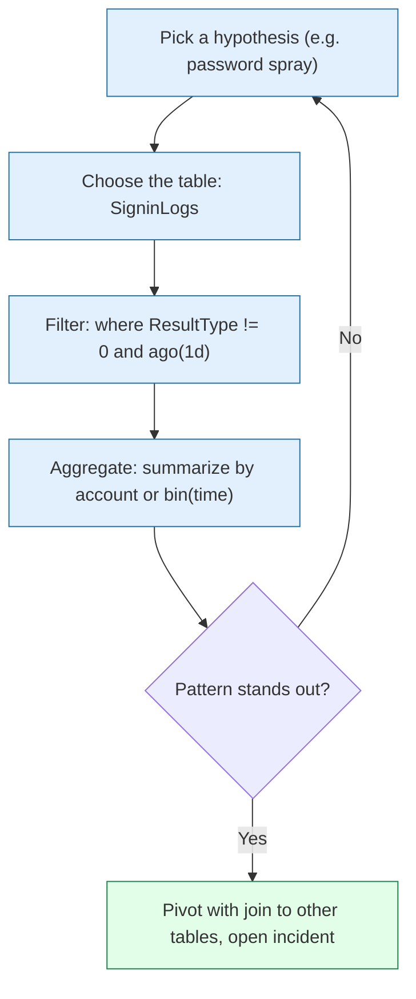

# Kusto Query Language (KQL) for Threat Hunting

## Summary

KQL is the read-only query language used by Azure Monitor Logs, Microsoft Sentinel and Microsoft Defender. A threat hunter uses it to ask precise questions of large log tables: who signed in from where, which process spawned which, what changed in the control plane. Knowing a handful of operators and the common tables covers most hunting.

## Note on syntax

KQL is **case-sensitive** for table names and operators. `SigninLogs` is not `signinlogs`, and `where` is not `Where`.

## Core operators

A query starts with a table and pipes it through operators, left to right:

| Operator | What it does |
|---|---|
| `where` | Filter rows by a condition. |
| `project` | Choose (and rename) columns. |
| `extend` | Add a computed column. |
| `summarize` | Aggregate (count, sum, etc.), optionally grouped `by` columns. |
| `join` | Combine two tables on a key. |
| `take` / `limit` | Return some rows (the two are **synonyms**); unordered. |
| `top` | Return the first N rows **by a sort order**. |
| `sort by` / `order by` | Order rows. |

Useful scalar functions:
- `ago(timespan)` returns a time offset relative to when the query runs, for example `TimeGenerated > ago(24h)`.
- `bin(value, size)` rounds values into buckets, used to group events into time windows.

## Common tables

| Table | Holds |
|---|---|
| `SigninLogs` | Microsoft Entra interactive sign-ins. |
| `AuditLogs` | Entra directory changes (role assignments, app changes). |
| `AzureActivity` | Azure control-plane operations (resource create/modify/delete). |
| `SecurityEvent` | Windows security event log data collected from machines. |

(`SigninLogs` is confirmed in the Azure Monitor Logs table reference; the others are standard Sentinel tables used the same way.)

## Example hunting patterns

Failed sign-ins by account in the last day, busiest first:
```kusto
SigninLogs
| where TimeGenerated > ago(1d)
| where ResultType != 0
| summarize failures = count() by UserPrincipalName
| top 20 by failures
```

Sign-in attempts bucketed by hour, to spot spray-like bursts:
```kusto
SigninLogs
| where TimeGenerated > ago(7d)
| summarize attempts = count() by bin(TimeGenerated, 1h)
| order by TimeGenerated asc
```

Control-plane deletions by caller:
```kusto
AzureActivity
| where OperationNameValue has "delete"
| summarize ops = count() by Caller, OperationNameValue
| top 50 by ops
```

## Hunting flow



## Detection

Turn repeatable hunts into Sentinel analytics rules so they run continuously instead of only when a hunter looks. Map each to an ATT&CK technique so coverage is measurable.

## Defense

KQL is the tool, not the control. Its value is confirming or ruling out a hypothesis quickly and feeding the good queries back into automated detection.

## ATT&CK mapping

None specific. KQL supports detection and hunting across the matrix.

## Explanation

KQL reads like a conveyor belt: start with a pile of logs (the table), and each `|` is a station that filters, reshapes or counts what passes. A hunt is just choosing the right pile and the right few stations to make an anomaly obvious.
