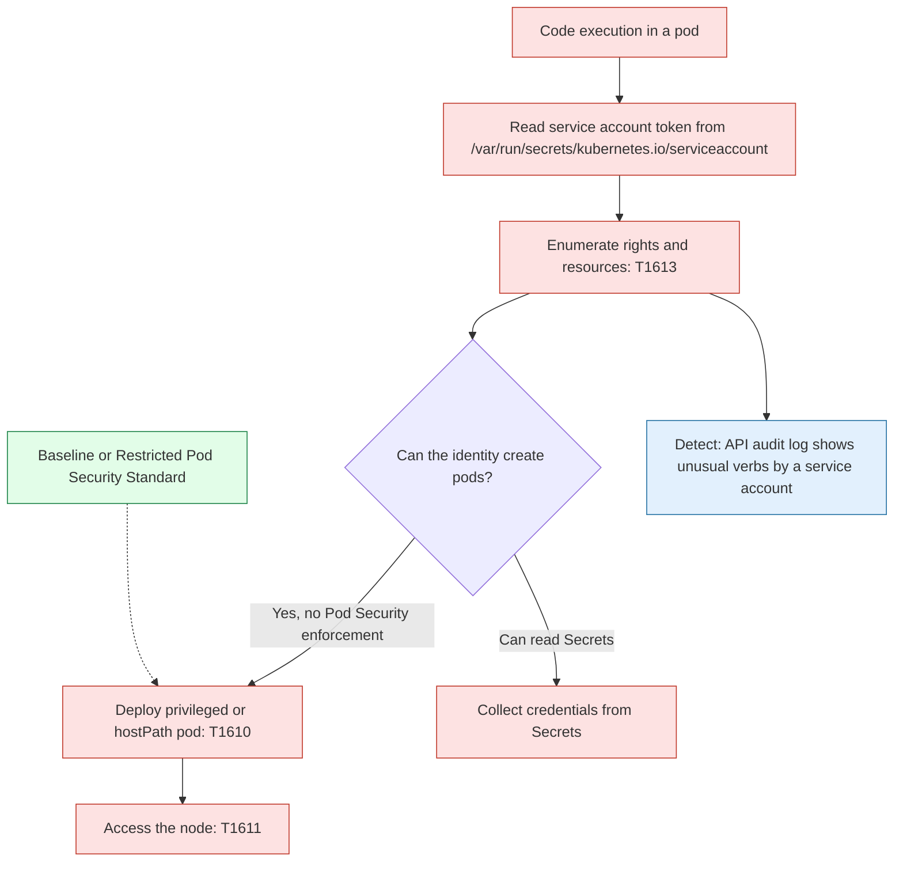

# Kubernetes Architecture and Attacks (Pods, RBAC, Service Accounts)

## Summary

Kubernetes runs containers across a set of machines (nodes) and is controlled through one HTTP API. Almost every attack on a cluster is an attack on **who can call that API, and with what rights**, or on a node that a pod manages to reach. The key pieces to understand are the API server, the kubelet on each node, RBAC, service accounts, and the rules that decide what a pod is allowed to request from its node.

## Architecture in brief

| Component | Role | Default port |
|---|---|---|
| kube-apiserver | The front door. Every `kubectl` command and every controller talks to it. | TCP 6443 |
| etcd | Key-value store holding all cluster state, including Secrets. | TCP 2379-2380 |
| kubelet | Agent on each node that starts pods and exposes its own API (logs, exec). | TCP 10250 |
| Pod | One or more containers that share a network namespace, scheduled onto a node. | - |
| ServiceAccount | The identity a pod uses when it calls the API server. | - |

A pod's service account token is mounted by default at `/var/run/secrets/kubernetes.io/serviceaccount` on Linux. Current versions mount a short-lived, automatically rotated token obtained through the TokenRequest API in a projected volume.

## How attacks work

### 1. Steal the pod's identity
Code execution inside a pod gives access to its mounted service account token. The attacker uses it against the API server to see what that identity can do (for example with `kubectl auth can-i --list`). Listing pods, nodes and other resources through the API is ATT&CK T1613 (Container and Resource Discovery).

### 2. Abuse RBAC permissions that are more powerful than they look
The Kubernetes documentation calls out several permissions that let a holder gain more rights:

- **Create pods or workloads** in a namespace. A pod can mount any Secret, ConfigMap or volume in that namespace and can run as any service account there, so it inherits all of their access.
- **Read Secrets** (`get` or `list`). A `list` response includes the contents of every Secret returned.
- **`escalate` and `bind` verbs.** These bypass the built-in protection that stops users from granting rights they do not hold.
- **`impersonate` verb.** It lets the holder act as other users or service accounts and take on their rights.
- **Create PersistentVolumes**, which allows `hostPath` volumes and therefore access to the node's filesystem.
- **`get` on `nodes/proxy`.** This reaches the kubelet API, which can execute commands in any pod on the node, and that access bypasses audit logging and admission control.

### 3. Get from a pod to the node
If an attacker can create a pod and nothing enforces a Pod Security Standard, they can request `privileged: true`, host namespaces or a `hostPath` mount of `/`. That is the Kubernetes version of a container escape (T1611). Deploying such a pod is ATT&CK T1610 (Deploy Container).

### 4. Talk to the kubelet directly
The kubelet's defaults are permissive: unauthenticated requests are treated as `system:anonymous`, and the default authorization mode is `AlwaysAllow`. Clusters built by hand that never hardened these flags can expose a node's pod exec API on port 10250 to anyone who can reach it. Most managed and installer-built clusters set them correctly, but it is worth checking.

## Attack flow

## Detection

- **API server audit logs**: service accounts doing things they normally do not, such as listing Secrets cluster-wide, creating pods, creating RoleBindings or ClusterRoleBindings, or using impersonation.
- **New pods with risky settings**: `privileged`, `hostPID`, `hostNetwork`, `hostPath` volumes, or added capabilities.
- **`exec` into pods**, and any use of `nodes/proxy`. Because kubelet calls through `nodes/proxy` skip API audit logging, the grant itself is the thing to watch.
- **Bindings to `system:unauthenticated`** or `system:anonymous`.

## Defense

- Enforce the **Baseline** or **Restricted** Pod Security Standard per namespace with Pod Security Admission (stable since v1.25), or an equivalent policy engine.
- Apply least-privilege RBAC: namespace-scoped RoleBindings rather than ClusterRoleBindings, and no wildcard verbs or resources.
- Treat `create pods`, `get/list secrets`, `escalate`, `bind`, `impersonate`, `create persistentvolumes` and `nodes/proxy` as admin-level rights.
- Set `automountServiceAccountToken: false` for pods that never call the API.
- Harden the kubelet with `--anonymous-auth=false` and `--authorization-mode=Webhook`.
- Use namespaces to separate trust levels, but do not treat a namespace as a strong boundary.
- Restrict network access to the API server, etcd and kubelet ports.

## ATT&CK mapping

| ID | Name | Tactic |
|---|---|---|
| T1613 | Container and Resource Discovery | Discovery |
| T1610 | Deploy Container | Execution |
| T1611 | Escape to Host | Privilege Escalation |

## Explanation

In Kubernetes the API server is the boss and RBAC is the boss's list of who may ask for what. Many permissions that sound harmless, such as "may create pods", are in practice "may borrow every key in this namespace", because a pod can mount those keys. The defender's job is to keep that list short and to stop pods from asking their node for dangerous privileges.
