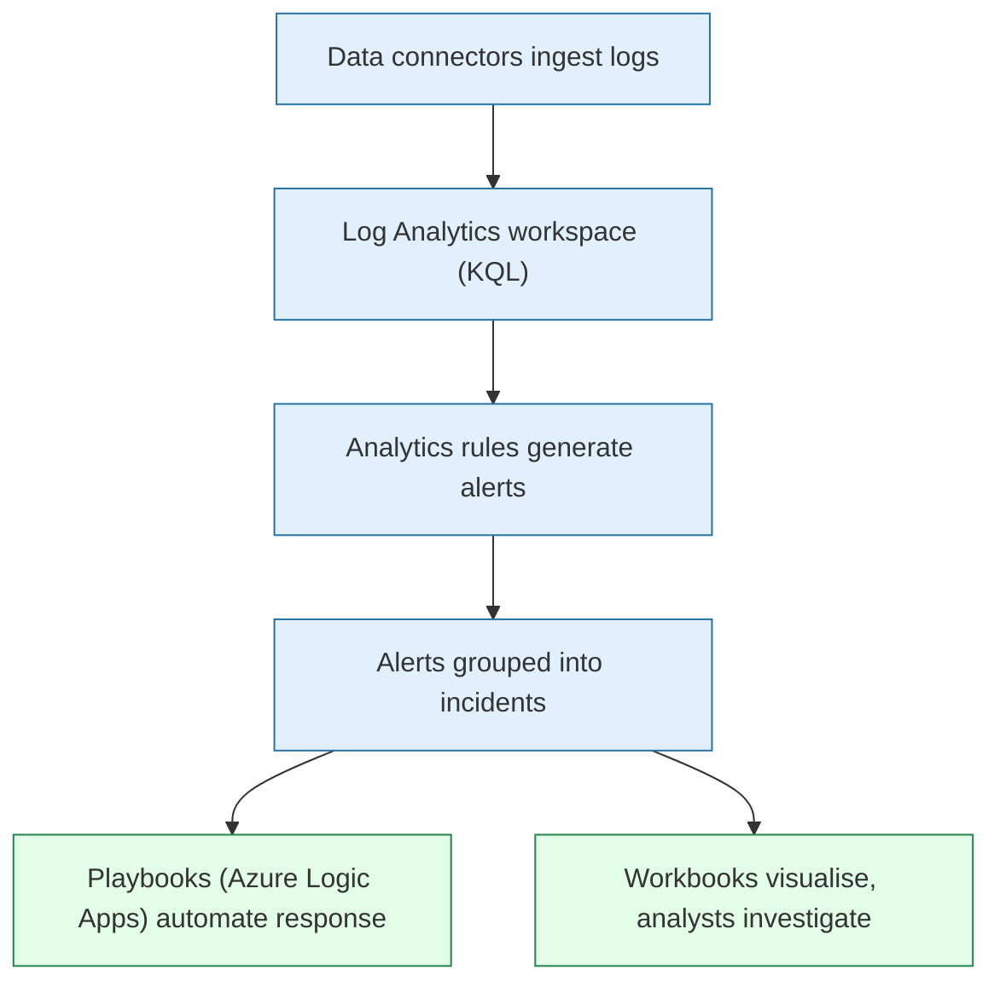

# Microsoft Sentinel Overview and Data Connectors

## Summary

Microsoft Sentinel is a cloud-native **SIEM** (security information and event management) solution with **SOAR** (security orchestration, automation and response) built in. It collects security data from across an estate, detects threats with analytics rules, groups the resulting alerts into incidents, and can respond automatically with playbooks.

## Core pieces

| Piece | What it is |
|---|---|
| Log Analytics workspace | Where Sentinel stores all of its data. Sentinel runs on top of a Log Analytics workspace, and queries use KQL. |
| Data connectors | The inputs. Connectors bring in logs from Microsoft services (Entra ID, Defender, Azure activity), other clouds, network devices, and custom sources. |
| Analytics rules | Detection logic. Sentinel uses analytics to group alerts into incidents. |
| Incidents | Grouped alerts an analyst investigates. |
| Workbooks | Interactive visual reports for monitoring and investigation. |
| Playbooks | Automated response workflows, **built on Azure Logic Apps**, triggered by alerts or incidents. |

## Data connectors

Connectors are how data gets in, and coverage depends entirely on which connectors are enabled:

- **Microsoft sources** (Entra ID sign-in and audit logs, Defender for Cloud, Defender XDR, Azure Activity) connect natively.
- **Other clouds and third parties** (AWS CloudTrail, GCP, firewalls, proxies) connect through dedicated connectors or standard formats (Syslog, Common Event Format, or the Logs Ingestion API).
- Each connector writes to specific tables in the workspace (for example `SigninLogs`, `AzureActivity`, `SecurityEvent`), which analytics rules and hunting queries then read.

A detection is only as good as its inputs: if a source is not connected, Sentinel cannot see it.

## Portal note

Microsoft Sentinel is generally available in the **Microsoft Defender portal**. The Azure portal experience is being retired: **after 31 March 2027, Sentinel will no longer be supported in the Azure portal**, and the product will be used through the Defender portal.

## Flow

## Detection

Sentinel is the detection platform. Practical points:
- Enable the connectors that cover your real attack surface first (identity, endpoint, cloud control plane).
- Use built-in and custom analytics rules mapped to ATT&CK so coverage is measurable.
- Tune rules to cut false positives, because incident fatigue is the main failure mode of a SIEM.

## Defense

- Connect identity, endpoint and cloud-control-plane logs as a baseline.
- Build analytics rules and hunting queries in KQL; automate repeatable response with playbooks.
- Watch for gaps: disconnected connectors, tables that stopped receiving data, and rules that never fire.

## ATT&CK mapping

None specific. Sentinel is a detection-and-response platform spanning the whole matrix.

## Explanation

Sentinel is a control room. Data connectors are the camera feeds wired into it, the Log Analytics workspace is the recording system, analytics rules are the guards watching for trouble, incidents are the reports they file, and playbooks are the automatic doors and alarms that respond. A camera that is never wired in shows nothing, which is why connectors come first.
