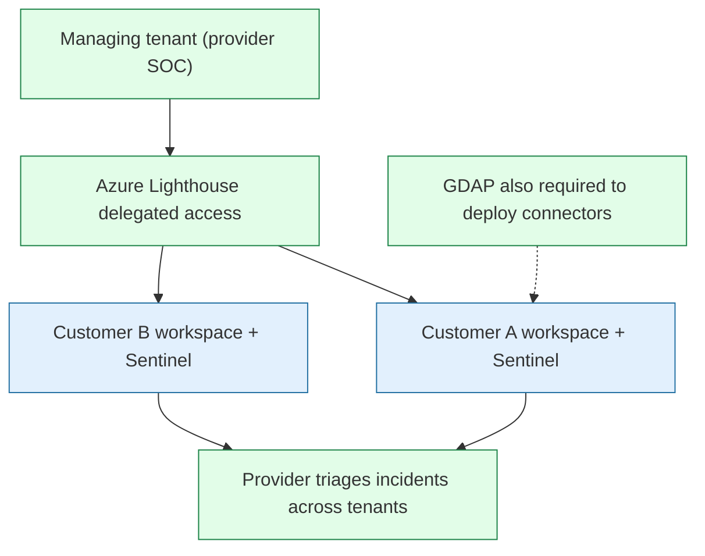

# Sentinel Multi-Tenant Architecture and Operations

## Summary

Managed security providers and large organisations often run security operations across many Microsoft Entra tenants at once. Microsoft Sentinel supports this through **Azure Lighthouse**, which lets a managing tenant operate another tenant's Sentinel resources from its own tenant, without switching directories. This file covers how that is put together and the operational points that matter.

## Architecture

- **Azure Lighthouse** is the mechanism for cross-tenant management. With it, a service provider "can manage your customers' Microsoft Sentinel resources directly from your own Azure tenant". The customer delegates specific scopes (subscriptions or resource groups) and roles to the provider.
- Each customer keeps **its own Log Analytics workspace** and Sentinel instance. The provider sees across them from a single pane rather than copying all data into one place.
- Analysts in the managing tenant use delegated roles to run queries, triage incidents and respond across customers.

## Operational points

- **Granular delegation**: the customer grants only the scopes and roles the provider needs, following least privilege. The provider should request the minimum.
- **Connector caveat**: you **cannot deploy data connectors in a managed workspace using Azure Lighthouse alone**. You must **also configure GDAP** (Granular Delegated Admin Privileges) for connector deployment. This is a common gap: Lighthouse covers management and investigation, but some onboarding steps need GDAP in addition.
- **Cross-workspace queries**: KQL can query across multiple workspaces, which is how an analyst hunts over several customers at once.
- **Separation**: keep each customer's data in its own workspace for isolation, data residency and clean offboarding.

## Flow

## Detection and operations

- Monitor the provider's own delegated access: who in the managing tenant used which customer scope, via each customer's Entra and Activity logs.
- Track incident volume and response times per customer separately.
- Watch for delegation drift: scopes or roles broader than needed, or stale delegations after offboarding.

## Defense

- Delegate the **minimum** scopes and roles per customer; review and remove stale delegations.
- Add **GDAP** only where needed (for example connector deployment) and keep it scoped.
- Keep workspaces separate per customer for isolation and clean offboarding.
- Protect the managing tenant heavily: it is a single point of access to every customer, so enforce MFA, PIM and Conditional Access there.

## ATT&CK mapping

None specific. This is operational architecture; the techniques detected are those covered by the underlying Sentinel analytics.

## Explanation

Azure Lighthouse is like a master key system in a building complex: each tenant (flat) keeps its own locks and belongings, and the managing security team gets a delegated key to specific flats so it can watch them all from one office. The catch is that the master key lets you manage and investigate, but adding new cameras (connectors) needs a second permission (GDAP). The office itself must be very well guarded, because its keys open many doors.
