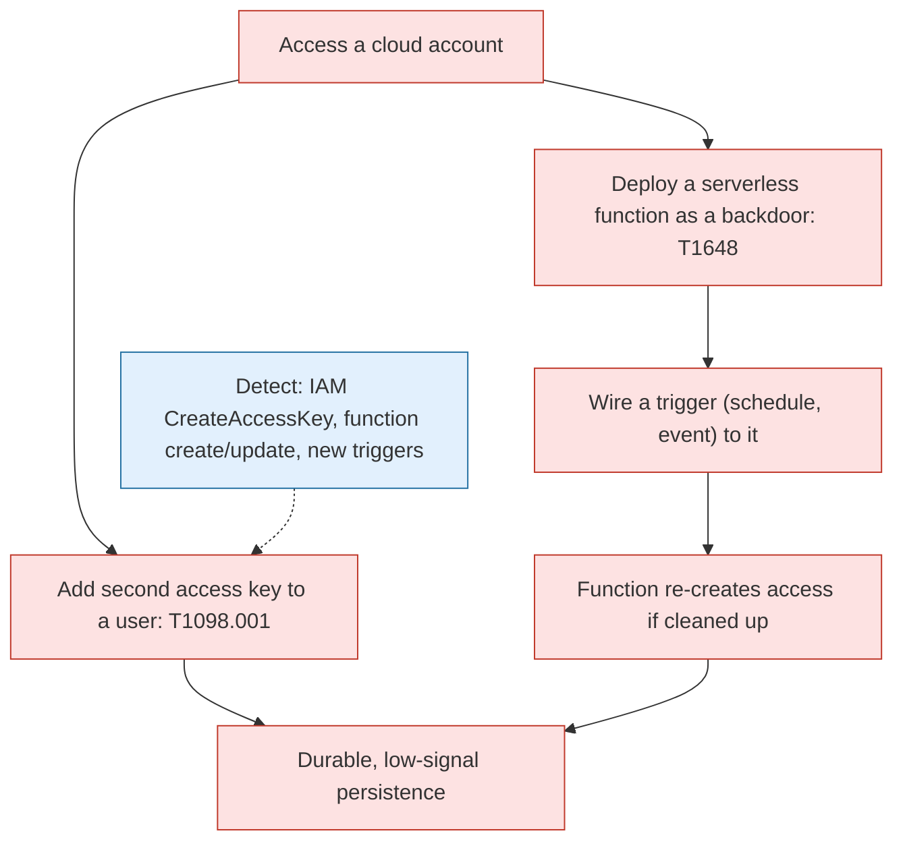

# Stealthy Persistence in Cloud Environments (Backdoors, Lambda)

## Summary

After gaining access to a cloud account, a capable attacker wants to keep it in a way that survives password resets and is hard to spot. Cloud platforms offer many quiet persistence footholds that do not look like malware: extra credentials on identities, event-driven serverless functions, and changes to trust relationships. The core techniques are account manipulation (ATT&CK T1098, and T1098.001 for additional cloud credentials) and serverless execution (T1648).

## Common stealthy footholds

| Foothold | Why it is quiet |
|---|---|
| **Additional access keys / credentials** on an existing identity (T1098.001) | No new user appears; a second key on a legitimate user is easy to miss. |
| **New service accounts / IAM roles** with broad trust | Look like normal automation. |
| **Serverless functions as backdoors** (AWS Lambda, Azure Functions, GCP Cloud Functions) (T1648) | Triggered by events (a schedule, an object upload, an API call), run briefly, leave little trace, and can re-create access if removed. |
| **Event triggers** wired to a function | A function that runs on every new login or object write can re-plant credentials automatically. |
| **Altered trust policies / federation** | Adding an external identity provider or a cross-account trust gives a durable outside entry. |
| **OAuth app or token grants** | Persist across password changes. |

A particularly resilient pattern is a function plus a trigger: delete the attacker's extra key and the function, fired by its trigger, simply creates another.

## Flow

## Detection

- **IAM writes**: `CreateAccessKey`, `CreateUser`, `CreateRole`, `UpdateAssumeRolePolicy`, added service-account keys, especially targeting accounts other than the caller's own.
- **Serverless changes**: function create/update, new or changed event-source mappings and triggers, and functions with unusual outbound network behaviour.
- **Federation / trust changes**: new identity providers, cross-account trust, OAuth app grants.
- **Correlation**: a cleanup action (key deleted) quickly followed by a matching re-creation suggests an automated backdoor.

## Defense

- Inventory and rotate credentials; alert on second keys and on keys for service accounts.
- Review serverless functions and their triggers; require code review and deployment through the pipeline, not ad-hoc console edits.
- Lock down who can change IAM, trust policies and federation, and alert on every change.
- Use short-lived, federated credentials (OIDC) instead of long-lived keys so there is less to persist.
- When evicting an intruder, remove the triggers and functions, not just the visible credentials, and rotate everything.

## ATT&CK mapping

| ID | Name | Tactic |
|---|---|---|
| T1098 | Account Manipulation | Persistence, Privilege Escalation |
| T1098.001 | Account Manipulation: Additional Cloud Credentials | Persistence, Privilege Escalation |
| T1648 | Serverless Execution | Execution |

## Explanation

Cloud persistence is less about hiding a file and more about leaving spare keys and a helper that cuts new keys for you. A Lambda backdoor is a robot locksmith wired to the doorbell: evict the intruder and clip the key you can see, and the robot quietly cuts another. Clearing it means finding and unplugging the robot, not just taking back the key.
