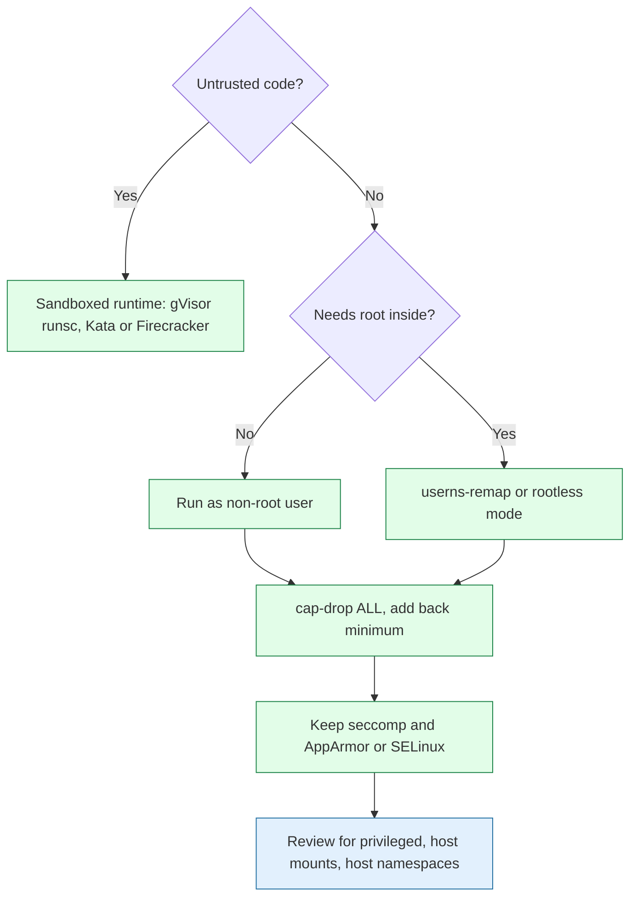

# Strengthening and Breaking Container Isolation

## Summary

Every container on a Linux host shares that host's kernel. Isolation therefore depends on a stack of kernel features, each of which can be tightened or loosened by configuration. Tightening means fewer system calls, fewer capabilities, a mandatory access control profile, an unprivileged user, or a sandboxed runtime. Loosening means root, extra capabilities, `--privileged`, host mounts or shared namespaces. Most real escapes use the loosened settings, not exotic bugs.

## The layers

| Layer | What it limits | Default in Docker |
|---|---|---|
| Namespaces | What the process can see: PIDs, mounts, network, hostname, IPC, users | Separate namespaces per container, except the user namespace |
| cgroups | How much CPU, memory and I/O it can use | Applied |
| Capabilities | Which slices of root's power it holds | A short allow-list (for example no `SYS_ADMIN`, no `SYS_MODULE`) |
| seccomp | Which system calls it may make | A default profile that blocks around 44 of 300+ system calls, including `mount`, `init_module`, `kexec_load`, `bpf`, `keyctl` and `reboot` |
| AppArmor or SELinux | Which files and operations it may touch | `docker-default` AppArmor profile where AppArmor is in use |
| User | Which uid the process runs as | Root (uid 0) unless the image or run command sets a user |

## Strengthening isolation

- **Run as a non-root user.** Set `USER` in the image or `--user` at run time.
- **Remap users.** With `userns-remap`, uid 0 in the container maps to an unprivileged range on the host defined in `/etc/subuid` and `/etc/subgid`. The daemon itself still runs as root.
- **Rootless mode** runs both the daemon and the containers without root on the host.
- **Drop capabilities.** Start from `--cap-drop=ALL` and add back only what the workload needs.
- **Keep seccomp and AppArmor or SELinux on**, and tighten them for sensitive workloads.
- **Use a sandboxed runtime for untrusted code:**
  - *gVisor* is an application kernel that implements much of the Linux system call interface in user space, so the container mostly talks to gVisor instead of the host kernel. Its OCI runtime is called `runsc`.
  - *Kata Containers* runs each container or pod inside a lightweight virtual machine with its own kernel.
  - *Firecracker* is a virtual machine monitor that uses KVM to run minimal "microVMs", designed for running many isolated workloads.
- **Read-only root filesystem** and no host path mounts.

## Breaking isolation

Each of these removes a layer from the table above:

- **Running as root** with no user namespace. Root inside is uid 0 on the host, held back only by capabilities, seccomp and the LSM profile.
- **`--privileged`** grants all capabilities, disables seccomp, AppArmor and the SELinux label, exposes all host devices and makes `/sys` and cgroup mounts writable.
- **`--cap-add`** of powerful capabilities. `SYS_ADMIN` covers mount and many other privileged operations. `SYS_MODULE` allows loading kernel modules.
- **`--security-opt seccomp=unconfined`** or an unconfined AppArmor profile.
- **Sensitive mounts**: the Docker socket, `/`, `/etc`, `/proc` or `/sys` from the host.
- **Shared namespaces** with the host (`--pid=host`, `--network=host`, `--ipc=host`).
- **Sidecar or helper containers** given broad shared access widen the attack surface for every container in the group.

Any one of these can be enough for an escape (ATT&CK T1611). Several together almost guarantee it.

## Decision flow

## Detection

- Audit container definitions (Compose files, Kubernetes manifests, run commands) for `privileged`, added capabilities, unconfined seccomp or AppArmor, host namespaces, and host path mounts. This finds the highest-risk problems before they are used.
- At runtime, alert on containers calling `mount`, loading modules, or writing to host paths.

## Defense

The "Strengthening" list above is the defense. The short form: non-root, fewest capabilities, default or tighter seccomp and LSM profiles, no host mounts or namespaces, and a sandboxed runtime for anything untrusted.

## ATT&CK mapping

| ID | Name | Tactic |
|---|---|---|
| T1611 | Escape to Host | Privilege Escalation |

## Explanation

Picture isolation as a set of locks on one door. Namespaces, capabilities, seccomp and AppArmor are separate locks, and each configuration flag either adds a lock or removes one. `--privileged` removes almost all of them at once. A sandboxed runtime like gVisor or Kata puts a second door behind the first.
