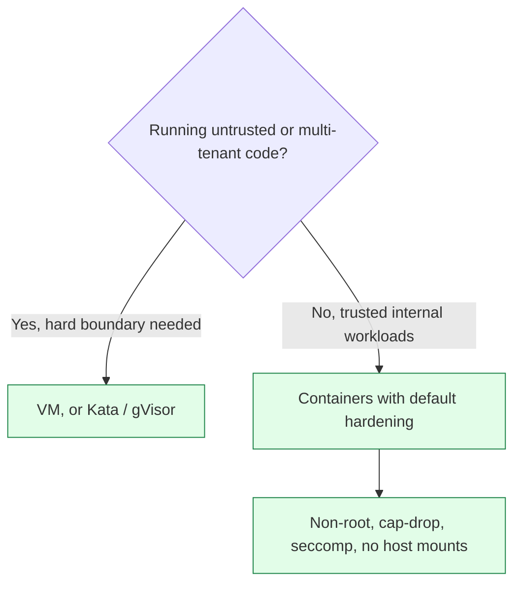

# Virtual Machines versus Containers Isolation

## Summary

Virtual machines and containers both run isolated workloads, but they draw the isolation boundary in different places, and that difference decides how strong the boundary is. A VM has its own kernel behind a hypervisor; a container shares the host kernel and is separated only by kernel features. For security decisions, the short version is: VM isolation is stronger, container isolation is lighter and faster, and sandboxed runtimes sit in between.

## How each isolates

### Virtual machines
- A hypervisor presents virtual hardware; each VM runs its **own operating system kernel**.
- The boundary is enforced by the hypervisor and CPU virtualization features. To escape, an attacker needs a hypervisor vulnerability, which is comparatively rare and hard.
- Cost: each VM carries a full OS, so they are heavier and slower to start.

### Containers
- All containers on a host **share the host kernel**. Separation comes from kernel features: namespaces (what the process sees), cgroups (what it can use), capabilities, seccomp and an LSM profile (AppArmor/SELinux).
- The boundary is only as strong as those features and their configuration. A kernel bug, or a loosened setting such as `--privileged`, can lead to escape to the host (ATT&CK T1611).
- Benefit: containers are lightweight, start in milliseconds, and pack densely.

### Sandboxed runtimes (the middle ground)
- **gVisor** puts a user-space kernel (`runsc`) between the container and the host kernel, shrinking the host's attack surface.
- **Kata Containers** runs each container or pod inside a lightweight VM, giving a hypervisor boundary with a container-like workflow.
- These trade some performance for closer-to-VM isolation.

## Comparison

| Property | Virtual machine | Container | Sandboxed container |
|---|---|---|---|
| Kernel | Own, per VM | Shared host kernel | Own (gVisor user-space, or Kata microVM) |
| Boundary enforced by | Hypervisor + CPU | Namespaces, cgroups, seccomp, LSM | User-space kernel or hypervisor |
| Isolation strength | Strongest | Lightest | In between |
| Start time / density | Slow / low | Fast / high | Medium |
| Main escape path | Hypervisor bug (rare) | Kernel bug or misconfig | Sandbox bug |

## Choosing

## Detection and defense

- Match the boundary to the trust level: untrusted or multi-tenant workloads belong on a VM or a sandboxed runtime, not a plain shared-kernel container.
- For ordinary containers, keep the kernel-feature boundary intact: non-root, dropped capabilities, default seccomp and LSM profiles, and no `--privileged` or host mounts (see "Strengthening and Breaking Container Isolation").
- Patch the host kernel and the hypervisor; each is the thing standing between a workload and everything else on the machine.

## ATT&CK mapping

| ID | Name | Tactic |
|---|---|---|
| T1611 | Escape to Host | Privilege Escalation |

## Explanation

A VM is a separate house with its own foundations; a container is a room in a shared house with internal walls. The internal walls are cheaper and quicker to build, but a hole in the shared foundations (the kernel) affects every room. Sandboxed runtimes give a room its own small foundations, costing a little speed for much better separation.
