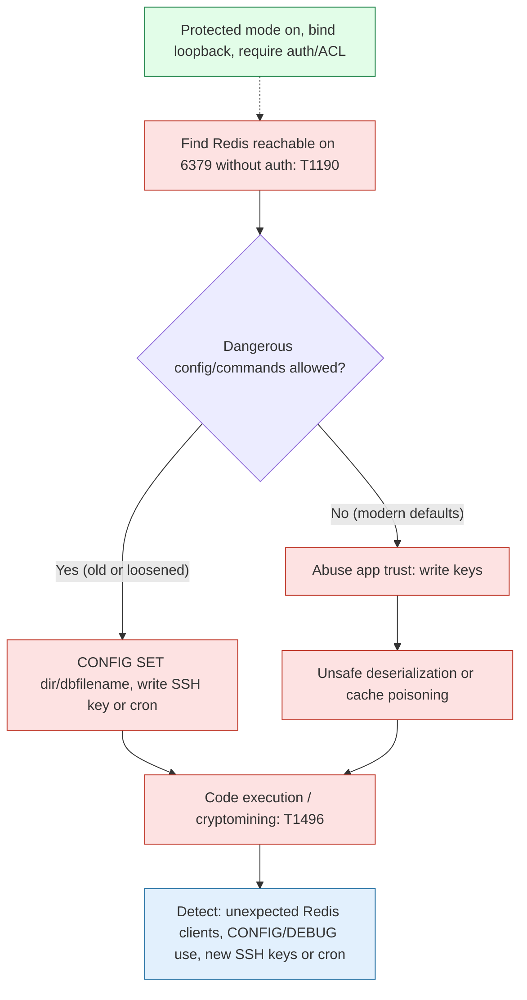

# Redis Exploitation (Deserialization and Cache Poisoning)

## Summary

Redis is an in-memory data store designed to be reached by **trusted clients inside a trusted environment**, not exposed to the internet. When an instance is left reachable without authentication, or an application trusts whatever it reads back from the cache, attackers get a path to remote code execution, data tampering and lateral movement. Reaching an exposed service is ATT&CK T1190 (Exploit Public-Facing Application); a frequent end goal is resource hijacking for cryptomining (T1496).

## The exposure

- Redis's own documentation states it "is designed to be accessed by trusted clients inside trusted environments" and should not be exposed directly to the internet.
- Defaults that reduce this risk: since 3.2.0 Redis runs in **protected mode**, and with the default config it binds loopback (`bind 127.0.0.1 -::1`). With protected mode on and no password on the default user, the server **only accepts local connections**. The default port is **6379**.
- The danger appears when an operator disables protected mode or binds all interfaces **without** setting authentication, putting an unauthenticated Redis on the network.

## How it is exploited

### Unauthenticated access to code execution
Historically, an unauthenticated Redis let an attacker use `CONFIG SET dir` and `CONFIG SET dbfilename` to write the database file to an arbitrary path (for example an SSH `authorized_keys` file, a web root, or a cron directory), turning data writes into code execution. Modern Redis hardens this: directives that control files Redis writes (such as `dir` and `dbfilename`) are **immutable at runtime by default**, and potentially dangerous commands are **blocked by default** (`enable-protected-configs`, `enable-debug-command`, `enable-module-command` all default to off). So this path works mainly against older or deliberately loosened instances.

### Deserialization and cache poisoning
Redis stores bytes; it does not vouch for their meaning. Two application-level problems follow:
- **Unsafe deserialization**: if the application stores serialized objects in Redis and deserializes them with an unsafe deserializer, an attacker who can write to the cache can achieve code execution in the application, not Redis itself.
- **Cache poisoning**: if the application treats cached values as trusted (authorization decisions, HTML fragments, session data), an attacker who can write keys can tamper with what every user receives.

### Lateral movement
A reachable Redis often holds session tokens, credentials or queued jobs. Reading or altering those lets an attacker move to the application and beyond.

## Flow

## Detection

- Redis reachable from outside the trusted network, or connections from unexpected clients.
- Use of `CONFIG SET`, `DEBUG`, `MODULE LOAD`, `SLAVEOF/REPLICAOF` from clients that should not issue them.
- Host-level signs of the write-file path: new entries in `authorized_keys`, new cron jobs, or unexpected files in web roots, around the time of Redis activity.
- Cryptominer indicators (high CPU, outbound pool connections) following a Redis compromise.

## Defense

- Keep Redis on a private network; never expose 6379 to the internet. Bind loopback or a private interface and firewall the port.
- Set authentication (ACL users in Redis 6+, or `requirepass`) and keep **protected mode enabled**.
- Leave the hardened defaults in place: do not enable protected configs, the debug command, or module loading unless truly required.
- In the application, never deserialize cached data with an unsafe deserializer, and do not treat cached values as trusted for security decisions.
- Keep Redis patched.

## ATT&CK mapping

| ID | Name | Tactic |
|---|---|---|
| T1190 | Exploit Public-Facing Application | Initial Access |
| T1496 | Resource Hijacking | Impact |

## Explanation

Redis is a fast notepad meant to sit in a locked office, trusting everyone who can reach it. Leave the office door open to the street and anyone can not only read the notes but, on older setups, tell Redis to write a note into the building's key box. Even on a hardened Redis, an app that blindly believes whatever the notepad says can be fooled by a forged note.
