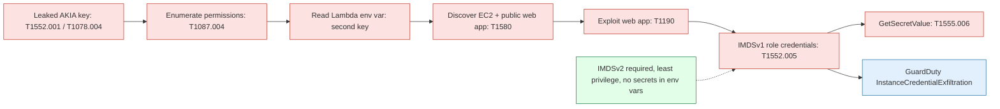

# Interview Prep: AWS Penetration Testing

> **How to use this page.** This is a rehearsal script, not a command reference. Every concept is
> written in the same four parts so you can practise saying it out loud:
>
> - **What it is**: the technically correct definition.
> - **Why a pentester cares**: what it means for an attack path.
> - **Explain it simply**: a plain-language version, built on one running analogy (the office
>   building below). Interviewers often ask "explain that to a non-technical stakeholder".
> - **Interview angle**: the question you are likely to get, and the key point to land.
>
> Commands are kept to the minimum needed to make a point. For the full command sets see the
> [AWS IAM Enumeration Cheat Sheet](../../general/discovery-and-recon/aws-iam-enumeration-cheat-sheet.md)
> and [AWS and API Penetration Testing Cheat Sheet](../../general/discovery-and-recon/aws-and-api-pentesting-cheat-sheet.md).
> For worked labs see the two [walkthroughs](../walkthroughs/). API pentesting gets its own prep page.

---

## Part 0 — The 60-second answer: "How would you approach an AWS pentest?"

Memorise the shape of this answer. Almost every AWS interview opens with a version of it.

1. **Scope and rules first.** Confirm which account IDs, regions and services are in scope, whether
   it is a config review or active exploitation, and that the work fits AWS's penetration testing
   policy (no DoS, no testing AWS's own infrastructure).
2. **Who am I?** `aws sts get-caller-identity` tells me which account and which identity my
   credentials belong to. It needs no permissions, so it always works.
3. **What can I do?** Enumerate my own permissions: the policies attached to my user or role, its
   inline policies, and its groups' policies. If I cannot read IAM, I probe permissions by trying
   calls (tools such as Pacu or enumerate-iam do this).
4. **What is out there?** Discover the services and resources my identity can see: EC2, S3, Lambda,
   Secrets Manager, roles and their trust policies.
5. **Where are the weak spots?** Look for the five classic AWS findings: over-permissive policies,
   public resources, exposed credentials, roles I can assume, and privilege-escalation permissions.
6. **Prove impact safely.** Chain findings into a path (for example leaked key → read Lambda env var →
   second key → metadata service → role credentials → secret), stopping at proof rather than damage.
7. **Report with detection and fix.** For every step, say what CloudTrail/GuardDuty would have shown
   and the least-privilege fix.

**The one-line version:** "AWS pentesting is credential-centric. I start from whatever identity I'm
given, find out what it can see and do, and look for the misconfiguration that lets one identity
become a more powerful one."

---

## Part 1 — The mental model: AWS as an office building

Every "explain it simply" section below uses this one picture, so learn it once.

| AWS concept | In the building |
|---|---|
| **AWS account** | The building itself. Everything inside belongs to one owner. |
| **Root user** | The owner's master key. Opens every door, cannot be restricted by the building's own rules (only by organization-level rules). |
| **IAM** | The security desk that issues badges and decides which doors each badge opens. |
| **IAM user** | A permanent employee with a permanent badge (long-term access key, `AKIA…`). |
| **IAM group** | A department. Everyone in "Finance" gets the Finance door permissions. |
| **IAM role** | A visitor badge or a "hat" kept at the desk. Nobody owns it; authorised people put it on for a while and gain its permissions. |
| **Policy** | The rule sheet attached to a badge: "may open doors X and Y, may not open Z". |
| **Trust policy** | The sign on the hat: "only these people may wear me". |
| **STS** | The badge printer that prints temporary badges (`ASIA…` keys) that expire. |
| **EC2 instance** | A worker robot inside the building. |
| **Instance metadata service (IMDS)** | An internal window, reachable only from inside the robot, that tells the robot facts about itself, including the temporary badge it is wearing. |
| **S3** | Storage lockers. Each locker's lock can be set by several rules at once. |
| **Lambda** | A vending machine: it springs to life, does one job, and goes idle. It wears a badge (its execution role) while it works. |
| **Secrets Manager** | The safe where passwords and keys are supposed to live. |
| **CloudTrail** | The CCTV recording of who did what at the desk. |
| **GuardDuty** | The security guard watching the CCTV and raising alarms when something looks wrong. |

**The pentester's job in one sentence of this analogy:** find a badge, work out which doors it
opens, and look for a door that leads to a better badge.

---

## Part 2 — Reading the JSON you keep seeing

### 2.1 ARNs: the address of everything

**What it is.** An Amazon Resource Name uniquely identifies a resource:
`arn:partition:service:region:account-id:resource`.

```text
arn:aws:iam::123456789012:user/cg-bob-lab
│   │   │   │ │            └─ resource type / path / name
│   │   │   │ └─ 12-digit account ID (the "building number")
│   │   │   └─ region (empty for global services like IAM and S3 bucket ARNs)
│   │   └─ service
│   └─ partition (aws, aws-cn, aws-us-gov)
└─ always "arn"
```

Shapes worth recognising:

| ARN | Meaning |
|---|---|
| `arn:aws:iam::<ACCT>:user/alice` | IAM user |
| `arn:aws:iam::<ACCT>:role/AppRole` | IAM role (the role itself) |
| `arn:aws:sts::<ACCT>:assumed-role/AppRole/session1` | Someone currently *wearing* that role; `session1` is the session name |
| `arn:aws:iam::<ACCT>:root` | The account as a whole (in a trust policy it means "this account may delegate to its own users") |
| `arn:aws:iam::aws:policy/IAMReadOnlyAccess` | AWS-managed policy (`aws` instead of an account ID) |
| `arn:aws:iam::<ACCT>:policy/MyPolicy` | Customer-managed policy |
| `arn:aws:s3:::my-bucket` / `arn:aws:s3:::my-bucket/*` | The bucket itself / every object in it |

**Why a pentester cares.** The account ID in an ARN tells you whether a trust relationship points
**inside** the account or to **another** account. A role that trusts someone else's account ID is a
door into your building from outside.

**Explain it simply.** An ARN is a full postal address: country, city, building number, floor, room.
`:root` is "anyone the building owner authorises", not literally the master key.

### 2.2 ID prefixes: tell what something is at a glance

AWS unique IDs start with a four-letter prefix that reveals the type:

| Prefix | Type | Pentest meaning |
|---|---|---|
| `AKIA` | Long-term access key (IAM user or root) | Valid until someone deactivates it. A leaked `AKIA` key is the classic initial access. |
| `ASIA` | Temporary STS access key | Expires; useless without its matching secret **and** session token. |
| `AIDA` | IAM user ID | You hold a user. |
| `AROA` | Role ID | You are holding a role. |
| `AGPA` | Group ID | |
| `ANPA` | Managed policy ID | |
| `AIPA` | EC2 instance profile ID | |

**Interview angle.** "You found `AKIA…` in a GitHub repo. What do you do?" Land: confirm scope, then
`sts get-caller-identity` to see whose it is (or `sts get-access-key-info --access-key-id AKIA…`,
which returns only the owning account ID). The `AKIA` prefix tells you it is long-term, so it will
keep working until rotated. This is T1552.001 (Credentials In Files) leading to T1078.004
(Cloud Accounts).

### 2.3 `sts get-caller-identity`

```json
{
    "UserId": "AIDA<REDACTED>",
    "Account": "123456789012",
    "Arn": "arn:aws:iam::123456789012:user/cg-bob-lab"
}
```

| Field | Meaning | Why it matters |
|---|---|---|
| `UserId` | Unique ID of the caller. For a user: `AIDA…`. For a role session: `AROA…:<session-name>`. | Prefix tells you user vs role. |
| `Account` | 12-digit account the credentials belong to. | Confirms you are in the in-scope account. |
| `Arn` | Full identity. `:user/` = long-term user; `:assumed-role/` = role session. | Decides your next enumeration commands. |

**Key fact.** It needs **no permissions**, and AWS states that even an explicit `Deny` on
`sts:GetCallerIdentity` does not stop it. That is why it is always the first command.

**Explain it simply.** Holding up a found badge to a mirror: it tells you whose badge it is, never
which doors it opens.

### 2.4 The IAM policy document, field by field

This is the JSON you will be asked about most. Annotated example:

```jsonc
{
  "Version": "2012-10-17",                 // policy language version, not a date you edit
  "Statement": [
    {
      "Sid": "ReadAppSecrets",              // optional label for this statement
      "Effect": "Allow",                     // Allow or Deny
      "Action": [                            // which API calls
        "secretsmanager:GetSecretValue",
        "secretsmanager:ListSecrets"
      ],
      "Resource": "arn:aws:secretsmanager:us-east-1:123456789012:secret:prod/*",  // on what
      "Condition": {                         // only when these are true
        "IpAddress": { "aws:SourceIp": "203.0.113.0/24" }
      }
    }
  ]
}
```

| Element | What it is | What a pentester looks for |
|---|---|---|
| `Version` | Policy-language version. `2012-10-17` is current; `2008-10-17` is the old version, which does not support policy variables like `${aws:username}`. | Rarely a finding. `2008-10-17` on a policy that uses variables means the variables silently do not work. |
| `Statement` | One statement or an array of them. Each is evaluated independently. | Read **every** statement; the dangerous one is often not the first. |
| `Sid` | Optional statement ID. In IAM it must be unique within the policy, and AWS does not use it in the allow/deny decision. | Pure metadata, but anyone who can read the policy reads it, so secrets hidden in Sids leak (flag 2 in the [IAM walkthrough](../walkthroughs/aws-iam-enumeration-four-flags-walkthrough.md)). |
| `Effect` | `Allow` or `Deny`. | A `Deny` you cannot get around is a dead end; note it and move on. |
| `Action` | API actions, `service:Operation`, wildcards allowed (`s3:Get*`, `iam:*`, `*`). | `"*"` or `service:*`; any IAM write action (`iam:Put*`, `iam:Attach*`, `iam:Create*`); `iam:PassRole`. |
| `NotAction` | "Every action **except** these". | `Allow` + `NotAction` is nearly always far broader than the author meant: `"NotAction": "iam:*"` still allows every other service. |
| `Resource` | Which resources the actions apply to (ARNs, wildcards). | `"Resource": "*"` on a sensitive action, especially `iam:PassRole`. |
| `NotResource` | Every resource except these. | Same trap as `NotAction`. |
| `Principal` | **Who** the policy applies to. Only appears in **resource-based** policies (bucket policies, trust policies, Lambda/KMS/Secrets Manager resource policies), never in a policy attached to a user or role. | `"Principal": "*"` or `{"AWS": "*"}` = anyone, potentially including anonymous callers. A foreign account ID = cross-account access. |
| `NotPrincipal` | Everyone except these. | Rare and easy to get wrong; review carefully. |
| `Condition` | Extra checks on the request context: operator → key → value. | **Missing** conditions where you would expect them (no `sts:ExternalId` for a third-party role, no `aws:SourceArn` on a service principal). Also conditions that look restrictive but use a weak operator (`StringLike` with `*`). |

Condition keys you should be able to explain:

| Key | Use |
|---|---|
| `aws:SourceIp` | Request must come from these IPs. Does not apply to calls AWS services make on your behalf. |
| `aws:MultiFactorAuthPresent` | Caller authenticated with MFA. Common on sensitive role trust policies. |
| `aws:PrincipalOrgID` | Caller belongs to this AWS Organization. A good way to say "anyone in our company, nobody outside". |
| `sts:ExternalId` | A shared value a third party must pass when assuming your role. Protects against the **confused deputy** problem. |
| `aws:SourceArn` / `aws:SourceAccount` | Which resource or account a service is acting for. Also confused-deputy protection on service principals. |
| `aws:RequestedRegion` | Limits which regions can be used. |

**Explain it simply.** A policy is the rule sheet stapled to a badge: *Effect* is "may" or "may not",
*Action* is the verb ("open", "read", "copy"), *Resource* is the door, and *Condition* is the small
print ("only during office hours, only from the lobby"). *Principal* only appears on rule sheets
stuck to a **door**, because a door needs to say *who* may open it; a badge's rule sheet already
knows who carries it.

### 2.5 How the fields combine: policy evaluation logic

Interviewers love this because it separates people who have read policies from people who have run
tools.

1. **Default is deny.** Every request starts as an implicit deny (except the root user).
2. **Explicit `Deny` always wins.** If any applicable policy has a matching `Deny`, the answer is no.
3. **An `Allow` is needed somewhere.** Identity-based policy (on the user/role/group) or a
   resource-based policy (on the bucket, secret, role…).
4. **Guardrails can only take away.** Organizations SCPs, permissions boundaries and session
   policies never grant anything. If any of them does not allow the action, it is denied.
5. **Cross-account needs both sides.** Access to another account's resource needs an `Allow` in your
   identity policy **and** an `Allow` in the resource's policy.

Within one account, AWS documents an exception: if a resource-based policy names an IAM user (or a
role session) **directly by ARN**, that grant is not limited by an implicit deny in the caller's
identity policies. That is why a role trust policy that names `user/cg-bob-lab` directly lets that
user assume the role even without its own `sts:AssumeRole` permission, while a trust policy that
names the whole account (`:root`) still needs the user to be granted `sts:AssumeRole` separately.

**Explain it simply.** The desk starts at "no". One "absolutely not" rule anywhere beats every "yes".
Otherwise you need at least one "yes", and head office (SCP) and your manager's cap (boundary) can
each veto it but never add to it. To enter **another** building, you need a "yes" from your own
desk and from theirs.

### 2.6 Managed vs inline policy output

```bash
aws iam list-attached-user-policies --user-name alice   # managed policies only
aws iam list-user-policies          --user-name alice   # inline policy NAMES only
aws iam get-user-policy             --user-name alice --policy-name <name>  # inline document
aws iam get-policy         --policy-arn <arn>           # metadata incl. DefaultVersionId
aws iam get-policy-version --policy-arn <arn> --version-id v3  # the managed document
```

| Field | Meaning |
|---|---|
| `PolicyName`, `PolicyArn` | Managed policy identity. `arn:aws:iam::aws:policy/...` = AWS-managed. |
| `DefaultVersionId` | Managed policies keep up to five versions; only the **default** one is in force. |
| `AttachmentCount` | How many identities share this policy. |
| `PolicyDocument` | The actual JSON from 2.4. |

**Why a pentester cares.** Effective permissions = user's managed + user's inline + every group's
managed + every group's inline (plus anything resource policies grant). Forgetting inline or group
policies is the most common way to under-count what a credential can do. Old **non-default**
versions matter too: with `iam:SetDefaultPolicyVersion` an attacker can switch back to an older,
broader version.

**Explain it simply.** A managed policy is a printed rulebook many badges point to; an inline policy
is a sticky note on one badge. You have to read both, plus the department's rulebook.

### 2.7 A role, and its trust policy (`AssumeRolePolicyDocument`)

```json
{
  "Role": {
    "Path": "/",
    "RoleName": "cg-flag4-role-lab",
    "RoleId": "AROA<REDACTED>",
    "Arn": "arn:aws:iam::123456789012:role/cg-flag4-role-lab",
    "AssumeRolePolicyDocument": {
      "Version": "2012-10-17",
      "Statement": [{
        "Effect": "Allow",
        "Principal": { "AWS": "arn:aws:iam::123456789012:user/cg-bob-lab" },
        "Action": "sts:AssumeRole"
      }]
    },
    "MaxSessionDuration": 3600,
    "Tags": [{ "Key": "Stack", "Value": "CloudGoat" }],
    "RoleLastUsed": {}
  }
}
```

| Field | Meaning | Pentest meaning |
|---|---|---|
| `Path` | Optional organising prefix; becomes part of the ARN. `/aws-service-role/…` marks service-linked roles. | Service-linked roles trust an AWS service, not a person; usually not assumable by you. |
| `RoleName`, `RoleId`, `Arn` | Identity of the role. | The ARN is what you pass to `sts assume-role`. |
| `AssumeRolePolicyDocument` | The **trust policy**: a resource-based policy saying **who may assume** the role. | The single most important field. If it names you, your group's users, your account, `"*"`, or an account you control, you have a path. |
| `Principal` (in trust) | `{"AWS": …}` = IAM users/roles/accounts; `{"Service": "ec2.amazonaws.com"}` = an AWS service; `{"Federated": …}` = SAML/OIDC identity provider. | `"AWS": "*"` with no condition = anyone in any AWS account can assume it. A `Federated` OIDC principal without an audience/subject condition can be abused from outside (for example a GitHub Actions trust that does not pin the repository). |
| `Action` (in trust) | `sts:AssumeRole`, `sts:AssumeRoleWithSAML` or `sts:AssumeRoleWithWebIdentity`. | Tells you which kind of caller the role expects. |
| `Condition` (in trust) | e.g. `sts:ExternalId`, `aws:MultiFactorAuthPresent`, `token.actions.githubusercontent.com:sub`. | Absent conditions on cross-account or federated trusts are findings. |
| `MaxSessionDuration` | Longest session you can request, 1 to 12 hours (3600 s = 1 h). | How long stolen role credentials stay useful. |
| `Tags` | Key/value metadata. Only returned by `get-role` / `list-role-tags`, not `list-roles`. | Tags are not secret storage; they also feed **attribute-based access control** (ABAC), so `iam:TagRole`/`iam:TagUser` can be an escalation path if policies trust tags. |
| `RoleLastUsed` | When/where the role was last assumed. `{}` = never used. | A never-used role that trusts you is a quiet escalation path, and its first use is a strong detection signal. |
| `PermissionsBoundary` (if present) | The maximum permissions the role can ever have. | Caps what you get even if the role's policies say `*`. |

**Remember the split:** the trust policy decides **who can put the hat on**; the role's
permission policies (`list-attached-role-policies`, `list-role-policies`) decide **what the hat lets
you do**. You need to read both.

**Explain it simply.** A role is a hat hanging at the security desk. The sign on the hook (trust
policy) says who may take it down. The rules sewn into the hat (permission policies) say what doors
it opens. Tags are stickers on the hat: anyone who can look at the hat can read them.

### 2.8 `sts assume-role` output

```bash
aws sts assume-role --role-arn arn:aws:iam::123456789012:role/AppRole --role-session-name test
```

```json
{
  "Credentials": {
    "AccessKeyId": "ASIA<REDACTED>",
    "SecretAccessKey": "<REDACTED_SECRET>",
    "SessionToken": "<REDACTED_SESSION_TOKEN>",
    "Expiration": "2026-11-20T17:30:00+00:00"
  },
  "AssumedRoleUser": {
    "AssumedRoleId": "AROA<REDACTED>:test",
    "Arn": "arn:aws:sts::123456789012:assumed-role/AppRole/test"
  }
}
```

| Field | Meaning | Pentest meaning |
|---|---|---|
| `AccessKeyId` | Temporary key ID, `ASIA…`. | Identifies the session; shows up in CloudTrail. |
| `SecretAccessKey` | Signing secret. | Never in logs; whoever holds it can sign requests. |
| `SessionToken` | Proof the temporary credential is valid. Required with every request. | Forget to export it and every call fails with an invalid token error, a classic lab mistake. |
| `Expiration` | When the credential stops working. Default session is 1 hour. | Usable **from anywhere** until then, not just from where it was issued. |
| `AssumedRoleId` | `<RoleId>:<session-name>`. | The session name is chosen by the caller and logged, which is why defenders can require it via `sts:RoleSessionName`/`sts:SourceIdentity`. |
| `Arn` | `assumed-role/<role>/<session>`. | What `get-caller-identity` will show after you switch. |
| `PackedPolicySize` (if present) | Percentage of the size limit used by session policies/tags passed in. | Rarely relevant. |
| `SourceIdentity` (if present) | Identity the original caller asserted; persists through role chaining. | Helps defenders trace who was behind a chain. |

To use them:

```bash
export AWS_ACCESS_KEY_ID=ASIA...
export AWS_SECRET_ACCESS_KEY=...
export AWS_SESSION_TOKEN=...
aws sts get-caller-identity   # should now show the assumed-role ARN
```

**Role chaining** (using role credentials to assume another role) is limited to a **one-hour**
session regardless of `MaxSessionDuration`.

**Explain it simply.** You show your badge at the desk, point at the hat, and the printer (STS) gives
you a visitor badge with three parts: a number (`AccessKeyId`), a secret stamp (`SecretAccessKey`)
and a hologram (`SessionToken`). Doors want all three, and the badge self-destructs at
`Expiration`.

### 2.9 EC2 metadata credentials

```bash
curl http://169.254.169.254/latest/meta-data/iam/security-credentials/<role-name>
```

```json
{
  "Code": "Success",
  "LastUpdated": "2026-11-20T11:38:00Z",
  "Type": "AWS-HMAC",
  "AccessKeyId": "ASIA<REDACTED>",
  "SecretAccessKey": "<REDACTED_SECRET>",
  "Token": "<REDACTED_SESSION_TOKEN>",
  "Expiration": "2026-11-20T17:44:29Z"
}
```

Same three-part temporary credential as 2.8, but the session token field is called **`Token`**
here, not `SessionToken`; it goes into `AWS_SESSION_TOKEN` all the same. `Code: Success` means the
instance profile is working; `LastUpdated` is when the instance last rotated them (AWS refreshes
them automatically before `Expiration`).

### 2.10 Lambda and Secrets Manager output (the fields that leak)

```jsonc
// aws lambda get-function --function-name app-fn   (Configuration excerpt)
{
  "FunctionName": "app-fn",
  "Role": "arn:aws:iam::123456789012:role/app-fn-exec",   // execution role = its badge
  "Environment": { "Variables": { "DB_PASSWORD": "<REDACTED>" } }  // plaintext to any reader
}
```

```jsonc
// aws secretsmanager get-secret-value --secret-id prod/db
{
  "ARN": "arn:aws:secretsmanager:us-east-1:123456789012:secret:prod/db-AbCdEf",
  "Name": "prod/db",
  "VersionId": "…",
  "SecretString": "{\"username\":\"admin\",\"password\":\"<REDACTED>\"}",  // the prize
  "VersionStages": ["AWSCURRENT"]                          // the version in use
}
```

`Environment.Variables` and `SecretString` are where credentials surface; `Role` tells you which
badge the function wears and therefore what you inherit if you can change its code.

---

## Part 3 — The services an interviewer will probe

For each: what it is, why it matters, what I look for, explain it simply, how it gets caught.

### 3.1 IAM (Identity and Access Management)

- **What it is.** The global service that holds identities (users, groups, roles) and the policies
  that grant them permissions. Free, global, and the control plane for everything else.
- **Why a pentester cares.** In AWS, identity *is* the perimeter. Most real findings are IAM findings.
- **What I look for.**
  - Overly broad policies: `Action: "*"`, `Resource: "*"`, `Allow` + `NotAction`, AWS-managed
    admin-like policies (`AdministratorAccess`, `IAMFullAccess`) on workload identities.
  - IAM **write** permissions on myself or others (see Part 4).
  - Roles whose trust policy lets me, my account, `"*"` or an outside account in.
  - Long-term `AKIA` keys on users, unused users and keys, users without MFA, root access keys.
  - Read access such as `IAMReadOnlyAccess` on a workload user, which hands an attacker the whole map.
- **Explain it simply.** IAM is the security desk. A pentest of IAM asks: has the desk printed badges
  that open too many doors, and is there a badge that can print itself a better badge?
- **ATT&CK.** T1087.004 Cloud Account discovery, T1069.003 Cloud Groups discovery, T1098.001 Additional
  Cloud Credentials, T1098.003 Additional Cloud Roles.
- **Detection.** All IAM and STS API calls are logged by CloudTrail; IAM is global, so look in the
  us-east-1 trail region. GuardDuty `Discovery:IAMUser/AnomalousBehavior` flags unusual
  enumeration; `PrivilegeEscalation:IAMUser/AnomalousBehavior` and
  `Persistence:IAMUser/AnomalousBehavior` flag unusual IAM changes.

### 3.2 STS (Security Token Service)

- **What it is.** The service that issues temporary credentials: `AssumeRole`,
  `AssumeRoleWithWebIdentity`, `AssumeRoleWithSAML`, `GetSessionToken`, `GetFederationToken`, plus
  `GetCallerIdentity`.
- **Why a pentester cares.** Every lateral move between roles and accounts goes through STS. Stolen
  `ASIA` credentials from IMDS, Lambda or a CI system are STS credentials.
- **What I look for.** Roles I can assume (trust + permission), cross-account trusts without
  `sts:ExternalId`, OIDC trusts (e.g. GitHub Actions) without a `sub` condition pinning the repo,
  and long `MaxSessionDuration` that extends how long stolen credentials live.
- **Explain it simply.** STS is the badge printer. You never steal the hat; you convince the printer
  you are allowed to wear it, and it prints you a temporary badge.
- **ATT&CK.** T1078.004 (using the credentials), T1548.005 Temporary Elevated Cloud Access (abusing
  role assumption or just-in-time elevation to gain extra permissions).
- **Detection.** CloudTrail `AssumeRole` events record the role, the caller and the session name.
  First-ever assumption of a dormant role, or assumption by a new principal, is high-signal.

### 3.3 EC2 and the Instance Metadata Service (IMDS)

- **What it is.** EC2 is virtual machines. Each instance can reach a link-local service at
  `169.254.169.254` that describes the instance and, if an **instance profile** (role) is attached,
  hands out that role's temporary credentials at
  `/latest/meta-data/iam/security-credentials/<role-name>`.
  - **IMDSv1**: plain `GET`, no authentication.
  - **IMDSv2**: session-oriented. First `PUT /latest/api/token` with header
    `X-aws-ec2-metadata-token-ttl-seconds`, then send the returned token in
    `X-aws-ec2-metadata-token` on every request. The token response has an IP hop limit
    (default 1), so it does not travel beyond the instance unless the limit is raised.
  - Setting `HttpTokens=required` disables v1 on that instance.
- **Why a pentester cares.** Any foothold on the instance, or any **SSRF** in an app running on it,
  can ask the metadata service for the role credentials. This is the most famous AWS attack path.
  IMDSv2 defeats basic SSRF because most SSRF bugs cannot send a `PUT` with a custom header.
- **What I look for.** Instances with IMDSv1 still allowed; over-privileged instance roles;
  secrets in **user data** (`/latest/user-data`, also readable via `ec2:DescribeInstanceAttribute`);
  security groups open to `0.0.0.0/0`; public IPs on hosts running vulnerable apps; public EBS
  snapshots and AMIs.
- **Explain it simply.** The robot can ask an internal window "what badge am I wearing?" and the
  window hands a copy over. With IMDSv1 the window answers anyone standing inside the robot,
  including a stranger who tricked the robot into asking (SSRF). With IMDSv2 the window first hands
  out a numbered ticket that only works if you come back with it in a specific way, which a tricked
  robot usually cannot do.
- **ATT&CK.** T1580 Cloud Infrastructure Discovery, T1190 Exploit Public-Facing Application,
  T1552.005 Cloud Instance Metadata API.
- **Detection.** GuardDuty `UnauthorizedAccess:IAMUser/InstanceCredentialExfiltration.OutsideAWS`
  fires when credentials created on an EC2 instance are used from a host outside AWS (`.InsideAWS`
  when used from another AWS account). In CloudTrail, an `ASIA` key from an instance role appearing
  with a source IP that is not that instance.
- See [SSRF and the Cloud Metadata API](../web-security/ssrf-and-cloud-metadata-api.md) and stage 6 of the
  [EC2 walkthrough](../walkthroughs/aws-ec2-lambda-imds-secrets-walkthrough.md).

### 3.4 S3 (Simple Storage Service)

- **What it is.** Object storage. Access is decided by IAM policies, the **bucket policy**
  (resource-based), legacy **ACLs**, and **Block Public Access** switches that override the others.
  New buckets have Block Public Access on and ACLs disabled by default, but older buckets and manual
  changes still cause exposures.
- **Why a pentester cares.** S3 is where data actually lives: backups, logs, exports, Terraform
  state files, and sometimes credentials.
- **What I look for.**
  - Bucket policies with `"Principal": "*"` and no restricting condition (public read/write/list).
  - Block Public Access turned off at account or bucket level.
  - Buckets readable by any authenticated AWS user via old ACL grants.
  - Sensitive objects: `.tfstate`, `.env`, backups, CloudFormation templates with parameters,
    application config with keys.
  - **Write** access to buckets that host websites, deployment artifacts or Lambda code: writing there
    is code execution elsewhere.
  - Policy split mistakes: `s3:ListBucket` applies to `arn:aws:s3:::bucket`, while `s3:GetObject`
    applies to `arn:aws:s3:::bucket/*`. Testing both tells you whether you can list, read, or both.
- **Explain it simply.** Storage lockers with three kinds of lock (bucket policy, ACL sticker, IAM
  badge rules) and one master switch (Block Public Access). A pentester checks the actual locks on
  each locker rather than trusting that "lockers ship locked".
- **ATT&CK.** T1619 Cloud Storage Object Discovery (listing), T1530 Data from Cloud Storage (reading).
- **Detection.** Object-level reads (`GetObject`) are CloudTrail **data events**, which are **not
  logged by default**; bucket-level config changes are management events. Many teams therefore
  cannot see who read a file unless they enabled data events or server access logs.
- See [AWS S3 Bucket Security and Misconfiguration](../cloud-security/aws-s3-bucket-security-and-misconfiguration.md).

### 3.5 Lambda (serverless functions)

- **What it is.** Code that runs on demand. Each function has an **execution role**; inside the
  runtime, that role's temporary credentials are exposed as the environment variables
  `AWS_ACCESS_KEY_ID`, `AWS_SECRET_ACCESS_KEY` and `AWS_SESSION_TOKEN`.
- **Why a pentester cares.** Three paths: (1) **secrets in environment variables**, readable by anyone
  with `lambda:GetFunction`/`GetFunctionConfiguration`; (2) **code injection** in the function
  leaking its role credentials from its environment; (3) **permission to change or create
  functions** plus `iam:PassRole`, which lets you run your code as a more powerful role.
- **What I look for.** Plaintext keys in `Environment.Variables`; over-privileged execution roles;
  resource-based policies allowing `lambda:InvokeFunction` to `"*"`; **function URLs** with
  `AuthType: NONE` (public HTTPS endpoint with no AWS auth); `lambda:UpdateFunctionCode` on a function
  with a strong role.
- **Explain it simply.** A vending machine that wears a badge while it works. If someone wrote the
  safe combination on a sticky note inside the machine (env var), anyone allowed to open the
  service panel reads it. If you can swap the machine's programming, you get to use its badge.
- **ATT&CK.** T1648 Serverless Execution, T1552.001 Credentials In Files (secrets in config),
  T1526 Cloud Service Discovery (listing functions).
- **Detection.** `GetFunction`, `UpdateFunctionCode`, `CreateFunction`, `AddPermission`,
  `CreateFunctionUrlConfig` in CloudTrail; invocations are data events.
- See [AWS Lambda and Serverless Security](../cloud-security/aws-lambda-and-serverless-security.md).

### 3.6 Secrets Manager (and SSM Parameter Store)

- **What it is.** Managed storage for credentials, encrypted with KMS, with optional rotation.
  `ListSecrets` shows names and metadata; `GetSecretValue` returns the value. A secret can also have
  a resource-based policy. SSM Parameter Store `SecureString` parameters are the cheaper cousin
  (`ssm:GetParameter --with-decryption`).
- **Why a pentester cares.** It is the safe: database passwords, API keys, third-party tokens. One
  `GetSecretValue` can be the end of the chain (as in the EC2 walkthrough).
- **What I look for.** `secretsmanager:GetSecretValue` with `Resource: "*"`; resource policies with
  broad principals; secret names that reveal what is valuable (`prod/db`, `stripe-live`); for
  secrets encrypted with a customer-managed KMS key, whether I also have `kms:Decrypt` on that key.
- **Explain it simply.** The safe is fine; the question is who has been given the combination. A
  badge that may "open any safe" defeats the point of having one.
- **ATT&CK.** T1555.006 Cloud Secrets Management Stores.
- **Detection.** `ListSecrets` and `GetSecretValue` appear in CloudTrail; a workload identity reading
  secrets it never read before, or from a new IP, is the signal.
- See [AWS Secrets Management and Credential Exposure](../cloud-security/aws-secrets-and-credential-exposure.md).

### 3.7 CloudTrail (the audit log)

- **What it is.** Records AWS API calls. **Event history** keeps the last 90 days of management
  events per region with no setup. A **trail** delivers events to S3 (and optionally CloudWatch Logs)
  for long-term retention; data events (S3 object reads, Lambda invokes) must be enabled explicitly.
- **Why a pentester cares.** Two reasons. First, it is how the client will judge whether they would
  have caught you, so you should know what each of your steps looks like in it. Second, an attacker
  with enough rights may try to blind it (`StopLogging`, `DeleteTrail`, `UpdateTrail`,
  `PutEventSelectors`), which is T1685.002 Disable or Modify Cloud Log. On a pentest you **report**
  that permission rather than use it, unless the rules of engagement explicitly allow it.
- **What I look for (as a finding).** No multi-region trail; no data events on sensitive buckets;
  trail bucket writable or deletable by broad identities; non-admins holding `cloudtrail:StopLogging`
  or `DeleteTrail`.
- **Explain it simply.** CCTV. The pentest question is "is the camera covering the doors that
  matter, and can a normal employee switch it off?"
- **Detection of tampering.** GuardDuty `Stealth:IAMUser/CloudTrailLoggingDisabled`.

### 3.8 GuardDuty (threat detection)

- **What it is.** A managed detection service that analyses CloudTrail management events, VPC Flow
  Logs and DNS logs (plus optional sources) and raises typed findings.
- **Why a pentester cares.** It is the alarm your techniques trip. Knowing the finding names shows an
  interviewer you think about the blue side too.
- **Finding types worth naming** (all from the IAM finding list):

| Finding | Fires when |
|---|---|
| `PenTest:IAMUser/KaliLinux` (also `ParrotLinux`, `PentooLinux`) | API calls with your credentials come from a machine running Kali. Running the AWS CLI from Kali on an engagement will trip this. |
| `Discovery:IAMUser/AnomalousBehavior` | Enumeration calls that deviate from the principal's baseline. |
| `UnauthorizedAccess:IAMUser/InstanceCredentialExfiltration.OutsideAWS` / `.InsideAWS` | EC2 instance credentials used from outside AWS / from another AWS account. |
| `Recon:IAMUser/MaliciousIPCaller`, `Recon:IAMUser/TorIPCaller` | Recon API calls from known-bad IPs or Tor. |
| `Stealth:IAMUser/CloudTrailLoggingDisabled` | A trail was disabled. |
| `CredentialAccess:IAMUser/AnomalousBehavior` | Unusual calls used to obtain secrets or credentials. |
| `PrivilegeEscalation:IAMUser/AnomalousBehavior`, `Persistence:IAMUser/AnomalousBehavior` | Unusual permission or persistence-style IAM changes. |

- **Explain it simply.** The guard watching the CCTV. It does not stop you opening a door; it notices
  when the way you open doors looks wrong.

---

## Part 4 — Privilege escalation: "my badge can print a better badge"

These are the IAM permissions that turn a weak identity into a strong one. Be able to name five and
explain any one end to end.

| Permission(s) | What the attacker does | Explain it simply |
|---|---|---|
| `iam:CreatePolicyVersion` | Writes a new version of a policy already attached to them, with `--set-as-default`, granting `*`. | You may edit your own rule sheet. |
| `iam:SetDefaultPolicyVersion` | Switches an attached policy back to an older, broader version. | You may pick which old rule sheet is in force. |
| `iam:AttachUserPolicy` / `AttachGroupPolicy` / `AttachRolePolicy` | Attaches `AdministratorAccess` to self, own group or an assumable role. | You may staple any rulebook to your badge. |
| `iam:PutUserPolicy` / `PutGroupPolicy` / `PutRolePolicy` | Writes an inline admin policy. | You may write your own sticky note. |
| `iam:AddUserToGroup` | Adds self to an admin group. | You may move yourself into the "Admins" department. |
| `iam:CreateAccessKey` (on another user) | Mints a key for a more privileged user (T1098.001). | You may print a copy of the manager's badge. |
| `iam:CreateLoginProfile` / `UpdateLoginProfile` | Sets a console password for another user. | You may set the manager's PIN. |
| `iam:UpdateAssumeRolePolicy` | Rewrites a powerful role's trust policy to trust self, then assumes it. | You may rewrite the sign on the admin hat's hook. |
| `iam:PassRole` + `ec2:RunInstances` | Launches an instance with a powerful role, then reads its credentials from IMDS. | You may hand a powerful badge to a robot you control. |
| `iam:PassRole` + `lambda:CreateFunction` + `lambda:InvokeFunction` | Creates a function with a powerful role and runs code as it. | You may build a vending machine that wears the admin badge. |
| `lambda:UpdateFunctionCode` | Replaces code of a function that already has a strong role. | You may reprogram a machine already wearing a strong badge. |
| `sts:AssumeRole` on a role whose trust allows you | Simply wears the stronger role (T1548.005). | The hat's sign already says your name. |

**Why `iam:PassRole` matters so much.** Services such as EC2 and Lambda act *as* a role you give
them. AWS requires `iam:PassRole` so that only approved identities can hand a role to a service.
`iam:PassRole` on `Resource: "*"` means "may give any badge to any robot", which usually means admin.

**Tools to mention.** Pacu (Rhino Security Labs) for enumeration and escalation modules, PMapper for
graphing who can become whom, ScoutSuite and Prowler for configuration review, and IAM Access Analyzer
on the defensive side.

**Detection.** `CreatePolicyVersion`, `SetDefaultPolicyVersion`, `Attach*Policy`, `Put*Policy`,
`CreateAccessKey`, `CreateLoginProfile`, `UpdateAssumeRolePolicy`, `AddUserToGroup` in CloudTrail,
especially when the actor and the target are the same identity or the actor rarely makes IAM
changes.

---

## Part 5 — One chain, told three ways

Practise telling the [EC2 walkthrough](../walkthroughs/aws-ec2-lambda-imds-secrets-walkthrough.md)
at three depths. Interviewers often ask "walk me through a finding you're proud of".



- **One sentence.** "Starting from a leaked low-privilege key, I chained a secret in a Lambda
  environment variable, a vulnerable public web app and IMDSv1 into an EC2 role that could read a
  production secret."
- **Thirty seconds.** Add the why: each credential was over-scoped by a little, the instance still
  allowed IMDSv1, and the role had `GetSecretValue` on `*`.
- **Two minutes.** Walk each stage with its command, the JSON field that mattered (`Environment.Variables`,
  `Token`/`Expiration`, `SecretString`), the CloudTrail/GuardDuty signal, and the fix.

---

## Part 6 — Rapid-fire Q&A drill

Cover the answer, say it out loud, then check.

1. **What is the difference between an IAM user and a role?** A user is a long-term identity with
   long-term credentials (password and/or `AKIA` keys). A role has no long-term credentials; trusted
   principals assume it and receive temporary `ASIA` credentials from STS.
2. **What is a trust policy?** The resource-based policy on a role (`AssumeRolePolicyDocument`) that
   says who may assume it. Permission policies say what the role can do.
3. **Identity-based vs resource-based policy?** Identity-based is attached to a user/group/role and
   has no `Principal`. Resource-based is attached to a resource (bucket, role trust, secret, Lambda,
   KMS key) and must have a `Principal`.
4. **If one policy allows and another explicitly denies, what happens?** Denied. Explicit deny always
   wins.
5. **What can an SCP do?** Restrict the maximum permissions for accounts in an AWS Organization. It
   never grants anything.
6. **What is a permissions boundary?** A managed policy that caps what a user or role can do, even if
   its own policies allow more.
7. **Why is `get-caller-identity` always the first command?** It needs no permissions and tells you
   account, identity type and ARN.
8. **What is `AKIA` vs `ASIA`?** Long-term key vs temporary STS key. `ASIA` needs a session token and
   expires.
9. **What is IMDS and how is v2 different from v1?** The metadata endpoint at `169.254.169.254`. v1
   answers any `GET`; v2 needs a token obtained by `PUT` with a TTL header, sent back in a header,
   with a hop limit, which blocks most SSRF.
10. **How would you go from SSRF to AWS credentials?** Make the server request
    `http://169.254.169.254/latest/meta-data/iam/security-credentials/` to get the role name, then the
    same path plus the role name to get `AccessKeyId`, `SecretAccessKey`, `Token`. Works only if IMDSv1
    is allowed (or the SSRF can send a `PUT` with custom headers).
11. **Why is `iam:PassRole` dangerous?** It lets you attach a role to a service you control; with a
    broad resource, you can hand yourself any role's permissions through EC2 or Lambda.
12. **Name three IAM privilege-escalation permissions.** `CreatePolicyVersion`, `AttachUserPolicy`,
    `UpdateAssumeRolePolicy` (or any from Part 4).
13. **What makes an S3 bucket public?** A bucket policy or ACL granting access to everyone, *and* Block
    Public Access being off for that bucket and account.
14. **Why might nobody notice you downloading S3 objects?** Object reads are CloudTrail data events,
    which are not logged by default.
15. **Where do you look for secrets in AWS?** Lambda environment variables, EC2 user data, Secrets
    Manager, SSM Parameter Store, S3 objects (`.tfstate`, `.env`, backups), CloudFormation
    parameters/outputs, CI/CD variables, container images.
16. **What is the confused deputy problem?** A third party you trust is tricked into using its access
    to your role on someone else's behalf. `sts:ExternalId` in the trust policy (or
    `aws:SourceArn`/`aws:SourceAccount` for service principals) prevents it.
17. **What does `"Principal": {"AWS": "arn:aws:iam::111122223333:root"}` mean in a trust policy?**
    The account 111122223333 may delegate access to the role to its own users/roles; each of them
    still needs `sts:AssumeRole` permission in their own account. It does not mean only the root user.
18. **What will GuardDuty say if you run the CLI from Kali?** `PenTest:IAMUser/KaliLinux`.
19. **How do attackers hide in CloudTrail and what is the ATT&CK ID?** Stop, delete or modify the
    trail or its event selectors; T1685.002 Disable or Modify Cloud Log. GuardDuty
    `Stealth:IAMUser/CloudTrailLoggingDisabled` detects disabling.
20. **Do you need AWS permission to pentest your own account?** For most services, no pre-approval is
    needed under AWS's customer policy, but DoS/stress testing and attacking AWS infrastructure are
    prohibited, and some simulated events need AWS's approval process. Always have written scope from
    the account owner.

---

## Part 7 — Scope and ethics (say this unprompted)

- Test only accounts you own or have written authorisation for; the AWS penetration testing policy
  covers customers testing their own resources and lists prohibited activities.
- Use read-only proof where possible: listing a secret's name proves access; dumping a production
  password is often unnecessary.
- Do not disable logging, delete resources or create persistence unless the rules of engagement say
  so. Report the permission that would have allowed it.
- Redact keys, account IDs and secrets in every report and note, exactly as the walkthroughs in this
  repo do.

---

## ATT&CK mapping

| ID | Name | Where it appears |
|---|---|---|
| T1078.004 | Valid Accounts: Cloud Accounts | Using any found or assumed credential |
| T1087.004 | Account Discovery: Cloud Account | `list-users`, `list-roles` |
| T1069.003 | Permission Groups Discovery: Cloud Groups | Policy and group enumeration |
| T1580 | Cloud Infrastructure Discovery | EC2, snapshots, instance metadata via API |
| T1526 | Cloud Service Discovery | Listing services such as Lambda |
| T1619 | Cloud Storage Object Discovery | Listing S3 objects |
| T1530 | Data from Cloud Storage | Reading S3 objects |
| T1552.001 | Unsecured Credentials: Credentials In Files | Keys in code, config, env vars |
| T1552.005 | Unsecured Credentials: Cloud Instance Metadata API | IMDS credential theft |
| T1555.006 | Credentials from Password Stores: Cloud Secrets Management Stores | `GetSecretValue` |
| T1098.001 | Account Manipulation: Additional Cloud Credentials | `CreateAccessKey` on another user |
| T1098.003 | Account Manipulation: Additional Cloud Roles | Attaching admin policies |
| T1548.005 | Abuse Elevation Control Mechanism: Temporary Elevated Cloud Access | Role assumption to elevate |
| T1648 | Serverless Execution | Running code via Lambda |
| T1190 | Exploit Public-Facing Application | Web app foothold before SSRF/IMDS |
| T1685.002 | Disable or Modify Cloud Log | CloudTrail tampering (replaces revoked T1562.008, see [KB-CORRECTIONS](../../KB-CORRECTIONS.md)) |

## Related files

- [AWS Penetration Testing Methodology and Tooling](../cloud-security/aws-penetration-testing-methodology-and-tooling.md)
- [AWS IAM Enumeration and Privilege Abuse](../cloud-security/aws-iam-enumeration-and-privilege-abuse.md)
- [Hunting for AWS Misconfigurations](../cloud-security/hunting-for-aws-misconfigurations.md)
- [Walkthrough: AWS IAM Enumeration (Policies, Groups and Role Trust)](../walkthroughs/aws-iam-enumeration-four-flags-walkthrough.md)
- [Walkthrough: AWS EC2 Privilege Escalation (Lambda to IMDS to Secrets Manager)](../walkthroughs/aws-ec2-lambda-imds-secrets-walkthrough.md)
- [AWS IAM Enumeration Cheat Sheet](../../general/discovery-and-recon/aws-iam-enumeration-cheat-sheet.md)

## Explanation

Picture AWS as an office building. The security desk (IAM) hands out badges, and each badge carries
a rule sheet saying which doors it opens. Some badges are permanent (users), and some are hats kept at
the desk that authorised people can borrow (roles), in which case a printer (STS) gives them a
temporary badge that expires. An AWS pentest starts with whatever badge you were given, checks whose
it is, reads its rule sheet, and walks the building looking for a door that leads to a better badge:
a rule sheet you are allowed to edit, a hat whose sign has your name on it, a robot that will read its
own badge out to anyone who asks (IMDSv1), or a password left on a sticky note inside a vending
machine (Lambda environment variables). The CCTV (CloudTrail) records what you did and the guard
(GuardDuty) raises the alarm when it looks wrong. Your report tells the owner which doors were too
easy, what the CCTV would have shown, and how to fix it.
