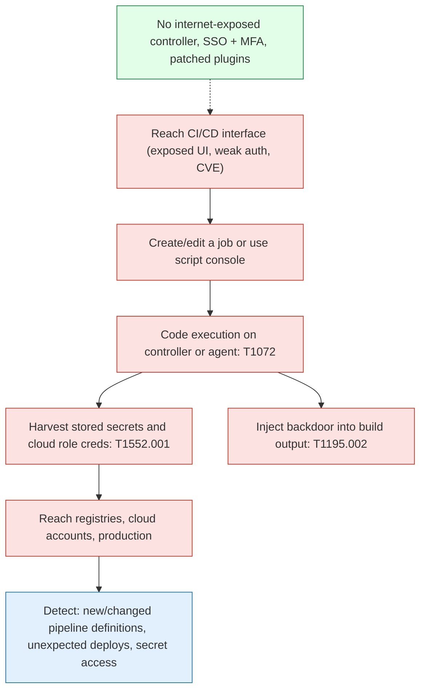

# CI/CD Pipeline Takeover (Jenkins and Automation Tools)

## Summary

A continuous integration / continuous delivery (CI/CD) system such as Jenkins, GitLab CI or GitHub Actions is one of the most powerful machines in an organisation: it holds credentials for source code, registries and production, and it runs arbitrary build steps on demand. Taking it over is ATT&CK T1072 (Software Deployment Tools): the attacker uses the organisation's own automation to run code and push changes everywhere the pipeline can reach.

## Why the pipeline is high value

- It stores or can read **deployment credentials** for cloud accounts, container registries, package repositories and servers.
- It **executes arbitrary code** by design (build and deploy scripts).
- Its output is **trusted** by everything downstream, so a change it makes is deployed without further scrutiny.

## How takeover happens

1. **Reach the control interface.** An exposed Jenkins UI, a weak or default login, an unauthenticated API, or a known CVE in the server or a plugin.
2. **Gain code execution.** Create or edit a job/pipeline, use a script console, or abuse a plugin to run commands on the controller or a build agent.
3. **Harvest secrets.** Read stored credentials, environment variables and mounted secrets (ATT&CK T1552.001). On a cloud build agent, read the instance metadata service for role credentials.
4. **Move and persist.** Use the harvested credentials to reach cloud accounts, registries and production, and modify pipeline definitions so malicious steps run on every future build.
5. **Poison the supply chain.** Inject a backdoor into build output so it ships to everyone who consumes the artifact (ATT&CK T1195.002).

## Attack flow

## Detection

- **Pipeline-definition changes**: new jobs, edited build steps, added credentials or webhooks, especially outside change control. Keep pipeline config in version control and review diffs.
- **Script console / agent command execution** events in the CI system's audit log.
- **Secret access**: credentials read by jobs that never used them before.
- **Unexpected deploys**: artifacts pushed, or infrastructure changed, with no matching commit or ticket.
- **Cloud side**: CI service-account or role credentials used from new IPs or for new actions.

## Defense

- Do not expose controllers to the internet; put them behind SSO with MFA, and restrict who can create or edit pipelines.
- Patch the server and plugins promptly; CI plugins are a frequent CVE source.
- Scope build credentials tightly (per-project, least privilege, short-lived), and prefer OIDC federation over long-lived keys.
- Isolate build agents, use ephemeral agents, and do not run untrusted pull-request code with privileged credentials.
- Keep pipeline definitions in version control with required review, and sign build artifacts.

## ATT&CK mapping

| ID | Name | Tactic |
|---|---|---|
| T1072 | Software Deployment Tools | Execution, Lateral Movement |
| T1195.002 | Supply Chain Compromise: Compromise Software Supply Chain | Initial Access |
| T1552.001 | Unsecured Credentials: Credentials In Files | Credential Access |

## Explanation

The CI/CD system is the organisation's printing press and key cabinet in one room. Anyone who gets into that room can print whatever they like with the company's seal and walk out with every key. Defending it means locking the room (no public exposure, SSO, MFA), checking who changes the press (reviewed pipeline config), and keeping only the keys each job truly needs.
