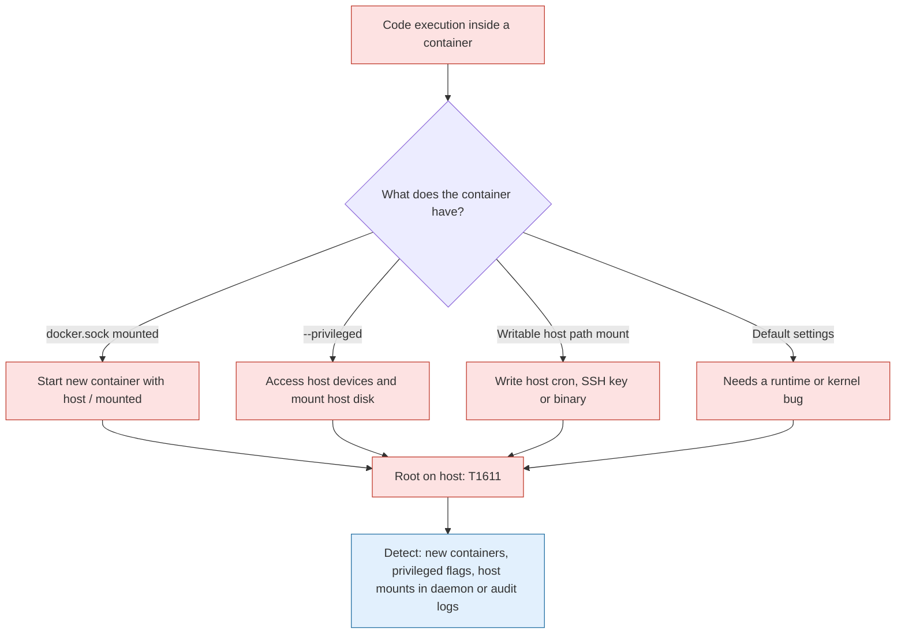

# Container Escape and Docker Misconfigurations

## Summary

A container is a normal Linux process that the kernel isolates with namespaces, cgroups, dropped capabilities, seccomp and an LSM profile (AppArmor or SELinux). It shares the host kernel. A **container escape** is any way for code inside the container to act on the host outside those limits. In practice most escapes come from configuration choices that remove isolation on purpose, and a smaller number come from bugs in the runtime or the kernel.

## How it works

### Misconfigurations that hand over the host

| Setting | What it gives the container | Why it leads to the host |
|---|---|---|
| `--privileged` | All capabilities, no default seccomp or AppArmor profile, no SELinux label, access to all host devices, read-write `/sys` and cgroup mounts | With host block devices and full capabilities, a process can mount the host disk or load kernel modules. Docker's own docs say the container can then do almost everything the host can. |
| Docker socket mounted (`-v /var/run/docker.sock:/var/run/docker.sock`) | Full control of the Docker daemon API | The daemon runs as root unless rootless mode is used. Anyone who can talk to it can start a new container with the host's `/` bind-mounted and read or change any host file. |
| Host path mounts of sensitive directories (`/`, `/etc`, `/root`, `/var/run`) | Direct read or write of host files | Writing to host cron, SSH keys or system binaries gives code execution on the host. |
| Extra capabilities (`--cap-add`), for example `SYS_ADMIN` or `SYS_MODULE` | Kernel operations normally blocked | `SYS_MODULE` allows loading kernel modules. `SYS_ADMIN` covers many privileged operations, including mounts. |
| Host namespaces (`--pid=host`, `--network=host`) | Sight of host processes or the host network stack | Combined with privileges, these let the container interact with host processes and services bound to localhost. |
| Docker API exposed on TCP without TLS | Remote daemon control | Same as the socket, but from the network. Current Docker versions refuse to start with an unauthenticated plain-HTTP TCP listener, but older installs may still have one. |

Membership in the `docker` group is equivalent to root on the host for the same reason as the socket: the group grants access to the daemon, and the daemon can mount the host.

### Default isolation, for comparison

By default Docker keeps a short allow-list of capabilities (for example `CHOWN`, `DAC_OVERRIDE`, `SETUID`, `SETGID`, `NET_BIND_SERVICE`, `NET_RAW`, `KILL`, `SYS_CHROOT`, `MKNOD`, `AUDIT_WRITE`, `FOWNER`, `FSETID`, `SETFCAP`, `SETPCAP`), applies a default seccomp profile and, where available, an AppArmor profile. Root inside a default container is therefore much weaker than root on the host, but it is still uid 0 unless user namespaces or rootless mode are used.

### Runtime bugs

Escapes also come from flaws in the container runtime itself. Two well-documented examples in `runc`:

- **CVE-2019-5736**: runc through 1.0-rc6 (Docker before 18.09.2) let a process running as root in a container overwrite the host `runc` binary through `/proc/self/exe`, giving root on the host.
- **CVE-2024-21626**: in runc 1.1.11 and earlier, a leaked file descriptor could leave a new container process with a working directory on the host filesystem, giving access to host files.

Keeping the runtime patched is the only defense against this class.

## Attack flow

## Detection

- **Container creation events** from the daemon or orchestrator audit log that request `--privileged`, host namespaces, added capabilities, or bind mounts of `/` or `docker.sock`. Starting a container with the API is itself ATT&CK T1610 (Deploy Container).
- **Processes inside containers** that run `mount`, load kernel modules, or touch `/proc/sys`, `/sys/fs/cgroup` or block devices.
- **Host file changes** to cron, SSH authorized keys, or system binaries that trace back to a container's process.
- **Runtime security tools** that watch syscalls per container can flag these behaviours.

## Defense

- Never use `--privileged` for application workloads. Add individual capabilities only when needed, and prefer `--cap-drop=ALL` plus the few that are required.
- Do not mount the Docker socket into containers. If a tool needs it, isolate that tool and treat it as host-root.
- Limit the `docker` group to administrators, or use rootless mode.
- Use user namespace remapping or rootless Docker so that root in the container is not root on the host.
- Keep the default seccomp and AppArmor or SELinux profiles enabled.
- Mount the root filesystem read-only where possible and avoid host path mounts.
- Patch the runtime (`runc`, `containerd`) and the host kernel.
- Protect any remote Docker API with TLS client certificates, or use SSH.

## ATT&CK mapping

| ID | Name | Tactic |
|---|---|---|
| T1611 | Escape to Host | Privilege Escalation |
| T1610 | Deploy Container | Execution |

## Explanation

A container is a fenced area inside one house, not a separate house. Most escapes happen because someone left a door in the fence open, such as handing the container the key to the Docker daemon or switching the fence off with `--privileged`. The rarer case is a hole in the fence itself, which is a runtime or kernel bug.
