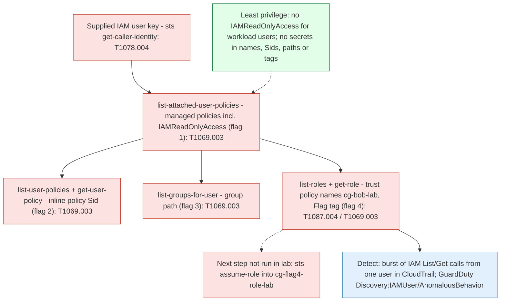

# Walkthrough: AWS IAM Enumeration (Policies, Groups and Role Trust)

> **Second entry in the walkthroughs series.** Where the
> [first walkthrough](aws-ec2-lambda-imds-secrets-walkthrough.md) chained many services into a
> privilege-escalation path, this one stays entirely inside IAM. It shows what a single
> credential with IAM read access can learn about itself, and why everything an identity can read
> about its own policies, groups and roles should be treated as visible to an attacker.
>
> For the full command reference (every IAM `list`/`get` call, `get-account-authorization-details`,
> enumeration without read access, PMapper, Pacu) see the
> [AWS IAM Enumeration Cheat Sheet](../../general/discovery-and-recon/aws-iam-enumeration-cheat-sheet.md).
> This page only covers the commands actually run in the lab.

## Lab and scope note

Reconstructed from an **authorized CloudGoat-style training lab** (`cg-bob-lab`) deployed into a
disposable AWS account. The lab hides four flags in four different places an IAM identity can read.
Every sensitive value has been **redacted**:

- Account ID as `<ACCOUNT_ID>`; the lab provider's and the organization management accounts as
  `<LAB_PROVIDER_ACCOUNT_ID>` and `<MGMT_ACCOUNT_ID>`.
- Unique IDs as `AIDA<REDACTED>` (user), `AGPA<REDACTED>` (group), `AROA<REDACTED>` (role).
- Flag values as `HSM{<REDACTED_FLAG>}` or `<REDACTED_FLAG>`; the *location* of each flag is kept,
  because the location is the lesson.

Scenario resource names (`cg-bob-lab`, `cg-flag1-managed-policy-lab`, `cg-flag4-role-lab`, …) are
kept so the flow is followable. Only run this against an account you own or are explicitly
authorized to test; see
[AWS Penetration Testing Methodology and Tooling](../cloud-security/aws-penetration-testing-methodology-and-tooling.md).

## Attack chain at a glance

| Stage | Command(s) | What it revealed | ATT&CK |
|---|---|---|---|
| 1 | `sts get-caller-identity` | Who the key belongs to (`cg-bob-lab`) | T1078.004 |
| 2 | `iam list-attached-user-policies` | Managed policies, incl. **flag 1** policy and `IAMReadOnlyAccess` | T1069.003 |
| 3 | `iam list-user-policies` + `get-user-policy` | Inline policy; **flag 2** in its statement `Sid` | T1069.003 |
| 4 | `iam list-groups-for-user` | Group membership; **flag 3** in the group's **path** | T1069.003 |
| 5 | `iam list-roles` + `get-role` | Role trust policy (`cg-bob-lab` can assume it) and **flag 4** in a role **tag** | T1087.004, T1069.003 |

## Flow



The key enabler is stage 2: the user has the AWS managed policy **`IAMReadOnlyAccess`**, which is
what makes stages 3 to 5 succeed. Without it, every later call returns `AccessDenied` and the
attacker has to fall back to brute-force probing (cheat sheet section 3).

---

## Stage 1 — Confirm the identity behind the key (T1078.004)

**Definition.** *Valid Accounts: Cloud Accounts* (T1078.004) is using legitimate cloud credentials.
`sts:GetCallerIdentity` returns the account, ARN and unique ID of whatever credential signed the
request. It needs no IAM permission, so it works even on the most locked-down key, which makes it
the universal first command.

**Walkthrough.**

```bash
aws sts get-caller-identity --profile IAM_enu
```

```json
{
    "UserId": "AIDA<REDACTED>",
    "Account": "<ACCOUNT_ID>",
    "Arn": "arn:aws:iam::<ACCOUNT_ID>:user/cg-bob-lab"
}
```

**What it reveals.** Three facts that drive everything after it:

- `:user/cg-bob-lab` means a long-term **IAM user** (not an assumed role), so user-scoped calls such
  as `list-attached-user-policies --user-name cg-bob-lab` are the natural next step.
- The `AIDA` prefix on `UserId` is the unique-ID prefix for IAM users (`AROA` is a role, `AGPA` a
  group), which you will see again in stages 4 and 5.
- The 12-digit account ID scopes every ARN you will build.

**Detection.** `GetCallerIdentity` is logged in CloudTrail. On its own it is noise (SDKs and tools
call it constantly); it matters as the **first event** in a burst of IAM reads from a new IP,
user agent or region.

**Defense.** Nothing blocks this call, so the control is upstream: avoid long-term user keys, rotate
and retire unused keys, and alert on key use from unfamiliar locations.

## Stage 2 — Attached (managed) policies: flag 1 (T1069.003)

**Definition.** *Permission Groups Discovery: Cloud Groups* (T1069.003) is enumerating the
permission groupings and policies applied to identities. ATT&CK names the role-side calls
(`ListRolePolicies`, `ListAttachedRolePolicies`) explicitly; the user-side calls used here
(`ListAttachedUserPolicies`, `ListUserPolicies`, `GetUserPolicy`, `ListGroupsForUser`) are the same
behaviour applied to a user. A **managed policy** is a standalone policy object (AWS-managed or
customer-managed) that can be attached to many identities.

**Walkthrough.**

```bash
aws iam list-attached-user-policies --user-name cg-bob-lab --profile IAM_enu
```

```json
{
    "AttachedPolicies": [
        {
            "PolicyName": "cg-flag1-managed-policy-lab",
            "PolicyArn": "arn:aws:iam::<ACCOUNT_ID>:policy/cg-flag1-managed-policy-lab"
        },
        {
            "PolicyName": "IAMReadOnlyAccess",
            "PolicyArn": "arn:aws:iam::aws:policy/IAMReadOnlyAccess"
        }
    ]
}
```

**What it reveals.**

- **Flag 1** is the customer-managed policy `cg-flag1-managed-policy-lab`. Note the ARN shape: a
  customer-managed policy carries your account ID, while an AWS-managed one shows `aws` in the
  account field (`arn:aws:iam::aws:policy/...`). To read what a managed policy actually grants,
  you would go one step further (not run in this session):
  `aws iam get-policy --policy-arn <ARN>` for the `DefaultVersionId`, then
  `aws iam get-policy-version --policy-arn <ARN> --version-id v1` for the JSON document.
- **`IAMReadOnlyAccess`** is the real finding. It grants `iam:Get*` and `iam:List*` across the
  account, so this user can read every user, group, role and policy, not just its own. That is
  why every following stage works.

**Detection.** CloudTrail `eventSource = iam.amazonaws.com`, `eventName = ListAttachedUserPolicies`.
IAM is a global service, so these events are delivered to the **us-east-1** trail region; make sure
your trail is multi-region or includes global service events.

**Defense.** Do not give workload or application users `IAMReadOnlyAccess`; very few identities
need to read the whole IAM configuration. Treat policy **names** as public to anyone with IAM read:
never encode secrets, ticket numbers with sensitive context, or internal hostnames in them.

## Stage 3 — Inline policy: flag 2 (T1069.003)

**Definition.** An **inline policy** is embedded directly in one user, group or role and lives and
dies with it. It does **not** show up in `list-attached-user-policies`, which only lists managed
policies. You need a separate pair of calls: `list-user-policies` to get the inline policy names,
then `get-user-policy` to read each document. Missing this distinction is the most common way
enumeration under-reports an identity's permissions.

**Walkthrough.**

```bash
aws iam list-user-policies --user-name cg-bob-lab --profile IAM_enu
```

```json
{
    "PolicyNames": [
        "cg-flag2-inline-policy-lab"
    ]
}
```

```bash
aws iam get-user-policy --user-name cg-bob-lab \
    --policy-name cg-flag2-inline-policy-lab --profile IAM_enu
```

```json
{
    "UserName": "cg-bob-lab",
    "PolicyName": "cg-flag2-inline-policy-lab",
    "PolicyDocument": {
        "Version": "2012-10-17",
        "Statement": [
            {
                "Action": "ec2:DescribeInstances",
                "Effect": "Allow",
                "Resource": "*",
                "Sid": "<REDACTED_FLAG>"
            }
        ]
    }
}
```

**What it reveals.**

- **Flag 2** is in the statement's **`Sid`** (statement ID), a free-text label inside the policy
  JSON. Anyone who can read the policy reads the Sid.
- The inline grant itself is a new capability: `ec2:DescribeInstances` on `*`. In a real
  engagement this is the pivot into infrastructure discovery (T1580), exactly as in stage 4 of the
  [first walkthrough](aws-ec2-lambda-imds-secrets-walkthrough.md#stage-4--ec2-infrastructure-discovery-t1580).

**Detection.** CloudTrail `ListUserPolicies` followed by `GetUserPolicy` for the same user. A user
reading its **own** inline policy document is rare in normal operation.

**Defense.** Prefer managed policies over inline ones so permissions are visible and reviewable in
one place. Keep Sids descriptive but non-sensitive (`AllowDescribeInstances`), never credentials or
secrets.

## Stage 4 — Group membership: flag 3 (T1069.003)

**Definition.** IAM **groups** attach permissions to many users at once, so a user's effective
permissions are its own policies **plus** every group's policies. `list-groups-for-user` shows which
groups a user is in. Every IAM entity also has a **path**, an optional organizing prefix that
becomes part of its ARN (`arn:aws:iam::<ACCOUNT_ID>:group/<path>/<name>`).

**Walkthrough.** (The lab switched to a second profile, `IAM_enu2`, for the same user.)

```bash
aws iam list-groups-for-user --user-name cg-bob-lab --profile IAM_enu2
```

```json
{
    "Groups": [
        {
            "Path": "/<REDACTED_FLAG>/",
            "GroupName": "cg-flag3-group-lab",
            "GroupId": "AGPA<REDACTED>",
            "Arn": "arn:aws:iam::<ACCOUNT_ID>:group/<REDACTED_FLAG>/cg-flag3-group-lab",
            "CreateDate": "2026-11-20T14:30:11+00:00"
        }
    ]
}
```

**What it reveals.**

- **Flag 3** is the group's **path**, which also appears inside the ARN, so it leaks anywhere the
  ARN is logged or shown.
- The group's own policies are the next thing to read (not run in this session):
  `aws iam list-attached-group-policies --group-name cg-flag3-group-lab` and
  `aws iam list-group-policies --group-name cg-flag3-group-lab`. Skipping group policies is the
  second most common way to under-count an identity's permissions.

**Detection.** CloudTrail `ListGroupsForUser`, typically in the same minute as the stage 2 and 3
calls.

**Defense.** Use paths for organization only, never for sensitive data. Review group membership as
part of access reviews, because group policies silently add to every member.

## Stage 5 — Roles and trust policy: flag 4 (T1087.004, T1069.003)

**Definition.** *Account Discovery: Cloud Account* (T1087.004) is listing identities in the account;
ATT&CK cites `aws iam list-roles` directly. A **role's trust policy**
(`AssumeRolePolicyDocument`) states **who may assume it**. Finding a role whose trust policy names
your current identity is finding a privilege-escalation or lateral-movement path. `list-roles` does
**not** return tags; `get-role` does.

**Walkthrough.** `list-roles` returned six roles (trimmed here to the security-relevant fields):

```bash
aws iam list-roles --profile IAM_enu2
```

```jsonc
{
  "Roles": [
    // Three AWS service-linked roles: trust a service principal, not a user
    { "Path": "/aws-service-role/organizations.amazonaws.com/", "RoleName": "AWSServiceRoleForOrganizations",
      "AssumeRolePolicyDocument": { "Statement": [{ "Principal": { "Service": "organizations.amazonaws.com" } }] } },
    { "Path": "/aws-service-role/support.amazonaws.com/",       "RoleName": "AWSServiceRoleForSupport" },
    { "Path": "/aws-service-role/trustedadvisor.amazonaws.com/","RoleName": "AWSServiceRoleForTrustedAdvisor" },

    // The lab target: trusts our own user
    { "Path": "/", "RoleName": "cg-flag4-role-lab", "RoleId": "AROA<REDACTED>",
      "Arn": "arn:aws:iam::<ACCOUNT_ID>:role/cg-flag4-role-lab",
      "AssumeRolePolicyDocument": { "Statement": [{
          "Effect": "Allow",
          "Principal": { "AWS": "arn:aws:iam::<ACCOUNT_ID>:user/cg-bob-lab" },
          "Action": "sts:AssumeRole" }] } },

    // Lab-platform roles: trust OTHER accounts (cross-account access)
    { "RoleName": "CourseStackAwsLabRole",
      "AssumeRolePolicyDocument": { "Statement": [{
          "Principal": { "AWS": "arn:aws:iam::<LAB_PROVIDER_ACCOUNT_ID>:role/CourseStackAwsLabControlPlane" } }] } },
    { "RoleName": "OrganizationAccountAccessRole",
      "AssumeRolePolicyDocument": { "Statement": [{
          "Principal": { "AWS": "arn:aws:iam::<MGMT_ACCOUNT_ID>:root" } }] } }
  ]
}
```

Then read the interesting role in full, which adds its tags:

```bash
aws iam get-role --role-name cg-flag4-role-lab --profile IAM_enu2
```

```json
{
    "Role": {
        "Path": "/",
        "RoleName": "cg-flag4-role-lab",
        "RoleId": "AROA<REDACTED>",
        "Arn": "arn:aws:iam::<ACCOUNT_ID>:role/cg-flag4-role-lab",
        "AssumeRolePolicyDocument": {
            "Version": "2012-10-17",
            "Statement": [
                {
                    "Effect": "Allow",
                    "Principal": { "AWS": "arn:aws:iam::<ACCOUNT_ID>:user/cg-bob-lab" },
                    "Action": "sts:AssumeRole"
                }
            ]
        },
        "MaxSessionDuration": 3600,
        "Tags": [
            { "Key": "Scenario", "Value": "scenario_template" },
            { "Key": "Stack",    "Value": "CloudGoat" },
            { "Key": "Flag",     "Value": "HSM{<REDACTED_FLAG>}" }
        ],
        "RoleLastUsed": {}
    }
}
```

**What it reveals.**

- **Flag 4** is in the role's **`Flag` tag**, visible only through `get-role` (or
  `list-role-tags`), not `list-roles`.
- **The trust policy names `cg-bob-lab` directly.** Our user is allowed to become this role. The
  logical next step (not run in this session) is
  `aws sts assume-role --role-arn arn:aws:iam::<ACCOUNT_ID>:role/cg-flag4-role-lab --role-session-name test`,
  then `list-attached-role-policies` / `list-role-policies` on the role to see what it grants.
  Trust alone is not enough: the user also needs `sts:AssumeRole` permission on that role ARN
  in its own policies, unless the trust policy names the user directly in the same account, as it
  does here.
- `"RoleLastUsed": {}` means the role has **never been assumed**. An unused role that trusts a user
  is a classic dormant escalation path.
- **Reading the other trust policies.** Service-linked roles trust only an AWS service and are not
  assumable by users. `OrganizationAccountAccessRole` trusting `<MGMT_ACCOUNT_ID>:root` is the
  default role AWS Organizations creates in member accounts, giving the management account admin
  access. `CourseStackAwsLabRole` trusting an external account is the lab provider's deploy role.
  In a real engagement, every role that trusts **another account** is an entry point to record,
  because whoever controls that account can assume in.

**Detection.** CloudTrail `ListRoles` then `GetRole`/`ListRoleTags` on a specific role. The
high-value follow-on to watch is `sts:AssumeRole` on a role whose `RoleLastUsed` was empty, or by a
principal that has never assumed it before.

**Defense.**

- Trust policies should name the narrowest principal possible, and add conditions (`aws:MultiFactorAuthPresent`,
  `sts:ExternalId` for third parties, `aws:SourceIp`/`aws:PrincipalOrgID` where they fit).
- Use **IAM Access Analyzer** to flag roles trusted by principals outside your account or
  organization, and review unused roles (`RoleLastUsed`) for removal.
- Tags are metadata, not a secret store. Anyone with `iam:GetRole` or `iam:ListRoleTags` reads them.
  Secrets belong in Secrets Manager or SSM Parameter Store (SecureString).

---

## Consolidated detection

All four flags were found with read-only, logged API calls. The signal is the **pattern**, not any
single event:

- **IAM read burst**: from one identity, within minutes, `GetCallerIdentity` →
  `ListAttachedUserPolicies` → `ListUserPolicies` → `GetUserPolicy` → `ListGroupsForUser` →
  `ListRoles` → `GetRole`. A workload user reading its own permissions and the account's roles is
  almost never legitimate behaviour.
- **Where to look**: CloudTrail management events with `eventSource = iam.amazonaws.com`, delivered
  to us-east-1 because IAM is global.
- **GuardDuty**: `Discovery:IAMUser/AnomalousBehavior` fires when an IAM principal makes discovery
  API calls (including IAM `List*`/`Get*`) in a way that deviates from its baseline. The
  `Recon:IAMUser/MaliciousIPCaller` and `Recon:IAMUser/TorIPCaller` types catch the same calls from
  known-bad or Tor IPs.
- **Follow-on**: an `AssumeRole` into a role with no prior use (stage 5's next step).

## Consolidated defense

1. **Remove `IAMReadOnlyAccess` from identities that do not administer IAM.** This single change
   turns stages 3 to 5 into `AccessDenied`. If a user needs to read its own permissions, scope it
   to `arn:aws:iam::<ACCOUNT_ID>:user/${aws:username}` instead of `*`.
2. **Treat every IAM string as readable.** Policy names, Sids, paths, descriptions and tags are all
   returned to anyone with IAM read. The lab hid flags in exactly these four places to make the
   point: none of them is a secret store.
3. **Tighten trust policies and retire unused roles.** A role trusting a user directly, never used,
   is an escalation path waiting to be found. Access Analyzer and `RoleLastUsed` find them.
4. **Alert on the enumeration pattern** in CloudTrail and enable GuardDuty, as above.

## ATT&CK mapping

| ID | Name | Tactic | Stage |
|---|---|---|---|
| T1078.004 | Valid Accounts: Cloud Accounts | Initial Access, Persistence, Privilege Escalation, Defense Evasion | 1 |
| T1069.003 | Permission Groups Discovery: Cloud Groups | Discovery | 2, 3, 4, 5 (`get-role` trust policy) |
| T1087.004 | Account Discovery: Cloud Account | Discovery | 5 (`list-roles`) |

Both discovery IDs were checked against the live ATT&CK pages and are current (not revoked; see
[KB-CORRECTIONS.md](../../KB-CORRECTIONS.md) for the IDs that were).

## Explanation

Think of IAM as an office building where you have been handed a visitor badge. The first thing you
do is look at the badge to see whose name is on it (stage 1). Then you find out the badge also lets
you read the building directory, which is the real mistake (`IAMReadOnlyAccess`). With the
directory you can read the list of rooms your badge opens (managed policies), the handwritten notes
stuck to your own badge (inline policies), which teams you belong to (groups), and the list of
master keys in the building along with who is allowed to pick each one up (roles and trust
policies). One of those master keys has your name on its pickup list. The lab hid its flags on the
labels: a room name, a sticky note, a team folder name and a tag on the master key. The lesson is
that labels are read by everyone who can read the directory, so never write anything secret on a
label, and do not hand out the directory to visitors.
