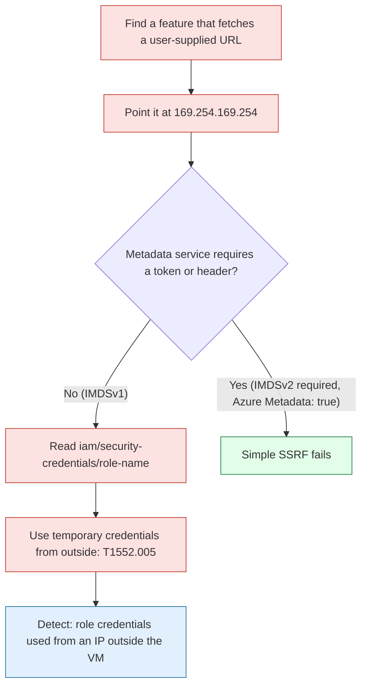

# Server-Side Request Forgery and the Cloud Metadata API

## Summary

Server-side request forgery (SSRF) is a bug where an application fetches a URL, or connects to a host, that the attacker controls. The request leaves from the server, so it can reach places the attacker cannot reach directly: localhost, private networks, and the link-local **instance metadata service** that cloud virtual machines use to learn about themselves. On a cloud VM that has a role or managed identity attached, the metadata service hands out short-lived credentials. An SSRF that can read those credentials turns a web bug into cloud account access.

## How it works

1. **A feature fetches URLs for the user.** Typical examples are link previews, webhook senders, PDF or image renderers, and "import from URL" functions.
2. **The attacker points it inward.** Instead of a public URL, the attacker supplies an internal address. On AWS, Azure and Google Cloud the metadata service listens on `169.254.169.254` (Google Cloud also answers at `metadata.google.internal`). AWS also offers `fd00:ec2::254` over IPv6 on Nitro-based instances.
3. **The server returns what it fetched.** If the response (or an error message, or a timing difference) comes back to the attacker, they can browse the metadata tree.
4. **Credentials are read.** On AWS EC2, an instance with an IAM role exposes temporary credentials at `/latest/meta-data/iam/security-credentials/<role-name>`. AWS rotates them automatically, but they are valid until they expire, and they work from anywhere.
5. **The attacker uses them outside the VM** with normal cloud APIs, with the permissions of the role.

SSRF is not limited to HTTP. Depending on the client library, schemes such as `file://`, `gopher://` or `dict://` may also be accepted, which widens what can be reached.

## Why the metadata service versions matter

| Service | What a request needs | Why it helps against SSRF |
|---|---|---|
| AWS IMDSv1 | A plain `GET` | Nothing. Any SSRF that can issue a GET can read it. |
| AWS IMDSv2 | First a `PUT` to `/latest/api/token` with header `X-aws-ec2-metadata-token-ttl-seconds` (1 to 21,600 seconds), then each `GET` sends the token in `X-aws-ec2-metadata-token` | Most SSRF bugs cannot send a `PUT` with custom headers. `PUT` requests that carry an `X-Forwarded-For` header are rejected, which blocks many open reverse proxies. The token response has an IP hop limit of 1 by default, so it does not reach beyond the instance. |
| Azure IMDS | Header `Metadata: true`, a mandatory `api-version` parameter, and no `X-Forwarded-For` header | A simple "fetch this URL" SSRF usually cannot add the required header. |

Instances can be configured so that IMDSv2 is **required**. Until that is done, IMDSv1 still answers, and the protection does not apply.

Note on containers: with the default hop limit of 1, IMDSv2 token responses do not reach containers that sit one network hop away. AWS suggests raising it to 2 for container workloads, which also makes the metadata service reachable from those containers again. Treat that as a trade-off, not a free setting.

## Attack flow

## Detection

- **Cloud audit logs:** look for API calls made with an instance role's credentials from a source IP that is not the instance itself (on AWS, CloudTrail records the source IP and the role session). This is the strongest signal that credentials left the box.
- **Web and proxy logs:** requests whose parameters contain `169.254.169.254`, `metadata.google.internal`, `fd00:ec2::254`, `localhost`, private ranges, or encoded forms of them.
- **Outbound traffic from the app tier** to unexpected internal hosts or ports.

## Defense

- **Require IMDSv2** on every EC2 instance and keep the hop limit at 1 unless containers truly need more.
- **Allow-list destinations** where the application only needs to talk to known services. Build the request from the allow-listed entry instead of passing the user's URL through.
- **Validate the resolved IP, then connect to that same IP.** Checking a hostname alone does not stop DNS rebinding. Normalize addresses first, because IPv4-mapped IPv6 such as `::ffff:169.254.169.254` reaches the same host.
- **Turn off redirect following** in the HTTP client, or re-validate every hop.
- **Block link-local and private ranges** (`169.254.0.0/16`, `127.0.0.0/8`, RFC 1918, `fc00::/7`, `fe80::/10`) as a last line of defense when an allow-list is impossible.
- **Least privilege on instance roles**, so stolen credentials can do little.

## ATT&CK mapping

| ID | Name | Tactic |
|---|---|---|
| T1552.005 | Unsecured Credentials: Cloud Instance Metadata API | Credential Access |

## Explanation

Think of the metadata service as a help desk that only answers people standing inside the building. SSRF tricks the building's own staff into asking the help desk a question and repeating the answer outside. IMDSv2 and Azure's required header add a rule that the help desk only answers people who first fill in a specific form, which most SSRF bugs cannot do.
