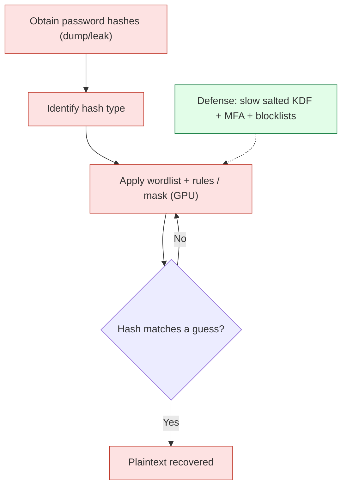

# Password Cracking and Tool Automation

## Summary

**Password cracking** is the offline recovery of plaintext passwords from captured **hashes** by repeatedly guessing a candidate, hashing it, and comparing — the sub-technique **Password Cracking** (T1110.002) under **Brute Force** (T1110). Because it happens offline, it is not slowed by account lockouts or server rate limits; the only limits are the hash algorithm's speed and the attacker's compute. Modern cracking (hashcat, John the Ripper) is **GPU-accelerated** and runs billions of guesses per second against fast hashes, using strategies that are far smarter than raw brute force: **wordlists** (leaked password corpora), **rule-based mutations** (capitalization, appended digits, leetspeak), **mask attacks** (targeting known structures), and **hybrid** combinations. Automation ties these into pipelines — dumping hashes, identifying the hash type, selecting wordlists and rules, and distributing work. The defense follows directly from how cracking works: the attacker's speed depends entirely on the **hash function**, so storing passwords with a **slow, salted, memory-hard KDF** (Argon2id, bcrypt, scrypt, or PBKDF2 with high iterations) turns billions of guesses per second into a trickle, while **per-user salts** defeat precomputation (rainbow tables) and force each password to be attacked individually. Combined with length/complexity, breach-password blocklists, and MFA, this makes cracked credentials far less useful even when hashes leak. For defenders, the same tools are used **constructively** to audit password strength and find weak accounts before attackers do.

## Cracking techniques and defenses

| Attacker approach | Defender countermeasure |
|---|---|
| **GPU brute force / mask** | Slow, memory-hard KDF (Argon2/bcrypt/scrypt) |
| **Wordlist + rules** | Breach-password blocklists; length minimums |
| **Rainbow tables (precompute)** | Unique per-user salt |
| **Credential stuffing (reuse)** | MFA; breached-credential checks |

The attacker's throughput is a function of the hash, so the single highest-impact control is how passwords are stored.

## Cracking flow

## Detection / value

- **Hash storage is decisive**: fast hashes (raw MD5/SHA-1/SHA-256) crack trivially; slow KDFs make mass cracking impractical.
- **Salts defeat precomputation**: without unique salts, one rainbow table cracks every matching password at once.
- **Reuse amplifies**: cracked passwords feed credential stuffing across other services.
- **Defensive auditing**: running the same tools against your own hashes surfaces weak accounts proactively.

## Defense / practices

- **Store passwords with Argon2id/bcrypt/scrypt/PBKDF2** at tuned cost; never fast hashes.
- **Use unique per-user salts** (built into these KDFs) and consider a secret pepper.
- **Enforce length and breach blocklists**; block known-compromised passwords.
- **Deploy MFA** so a cracked password alone is insufficient.
- **Audit your own hashes** periodically to find and reset weak credentials.

## ATT&CK mapping

| ID | Name | Tactic |
|---|---|---|
| T1110 | Brute Force | Credential Access |
| T1110.002 | Brute Force: Password Cracking | Credential Access |

## Explanation

When attackers steal a database, they rarely get passwords in plain text — they get scrambled "hashes." Password cracking is the patient game of guessing the original password, scrambling each guess the same way, and checking for a match. The crucial thing is that this happens on the attacker's own machines, so none of your website's defenses — lockouts, "too many attempts" — apply. With graphics cards built for exactly this kind of parallel work, a cracker can try billions of guesses a second, and they don't guess randomly: they start with huge lists of passwords leaked from past breaches, then twist each one the way humans do ("Password" → "P@ssw0rd!"). So whether your stolen password survives comes down almost entirely to how it was stored. If the site used a fast scrambler, your password falls in seconds. If it used a deliberately *slow* one designed for passwords — with a unique pinch of random "salt" mixed into each — those billions of guesses per second collapse to a crawl, and the attacker has to grind through every account separately. Add multi-factor authentication and a stolen password becomes nearly worthless on its own. The same cracking tools, pointed at your own password database, are also how a security team finds the weak accounts before the criminals do.
