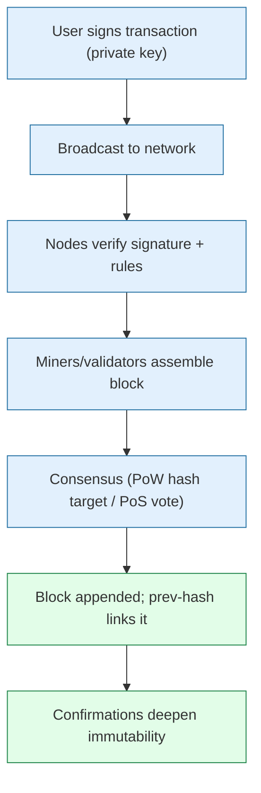

# Bitcoin, Blockchains and Ethereum

## Summary

A **blockchain** is an append-only ledger replicated across many independent nodes, where records are grouped into **blocks** and each block contains the cryptographic **hash of the previous block**, chaining them so that altering an old block changes every hash after it and is immediately detectable. Two cryptographic primitives make it work: **hash functions** (link blocks, commit to transaction sets via Merkle trees, and drive proof-of-work) and **digital signatures** (prove ownership — spending requires a signature from the holder of the corresponding private key). **Bitcoin** (per Nakamoto's 2008 design) is a decentralized payment ledger secured by **proof-of-work**: miners compete to find a block hash below a difficulty target, which makes rewriting history economically infeasible as long as honest participants control most mining power. **Ethereum** generalizes the ledger into a programmable platform where **smart contracts** — code deployed on-chain — execute deterministically across all nodes, enabling tokens and decentralized applications; Ethereum moved from proof-of-work to **proof-of-stake** (validators stake capital rather than burn energy). The security model is distinctive: the cryptography and consensus are strong, so attacks cluster at the edges — **private-key theft** (whoever holds the key owns the funds, irreversibly), **smart-contract bugs** (code is immutable once deployed and has lost vast sums to logic flaws), **51% / consensus attacks**, and **off-chain exchange or bridge compromises**. From a security practitioner's view, blockchains also appear as the **payment rails of cybercrime** (ransom payments, mixers) and as a source of forensic signal, since the ledger itself is public and traceable.

## Core elements

| Element | Role |
|---|---|
| **Block + prev-hash chaining** | Tamper-evident, append-only history |
| **Merkle tree** | Commits to all transactions in a block |
| **Digital signatures** | Prove ownership; authorize spends |
| **Proof-of-work / proof-of-stake** | Consensus; makes rewriting history costly |
| **Smart contracts (Ethereum)** | On-chain programs; immutable once deployed |

The math and consensus are robust; the losses happen at key custody, contract logic, and off-chain services.

## Transaction and block flow

## Security relevance

- **Key theft is irreversible**: no central party can reverse a transaction; stolen keys mean lost funds.
- **Smart-contract bugs are permanent**: immutable code has lost large sums to reentrancy and logic flaws; audits matter.
- **Consensus attacks**: a majority of mining/stake power can double-spend or censor (51% attacks on smaller chains).
- **Crime rails and forensics**: public ledgers enable both laundering (mixers) and chain-analysis tracing of illicit flows.

## Practices

- **Protect keys**: hardware wallets, multisig, cold storage; treat key compromise as total loss.
- **Audit contracts** before deployment; assume no post-deploy fixes.
- **Wait for confirmations** proportional to value; understand finality of the chain in use.
- **For investigations**, leverage ledger transparency and chain-analysis to trace ransom and laundering flows.

## Explanation

A blockchain is a shared notebook that thousands of strangers keep identical copies of, where new pages can only be added, never quietly edited. The trick that enforces this is simple: every new page carries a tiny fingerprint of the page before it, so changing an old page would scramble every fingerprint that follows, and everyone would notice instantly. Ownership is proven not by a name but by a secret key — spending Bitcoin means signing a message that only the rightful key-holder could sign, which also means that whoever holds the key *is* the owner, with no bank to call if it's stolen. Bitcoin adds a costly contest (mining) so that rewriting history would require out-computing the entire honest network, which is wildly expensive. Ethereum takes the same ledger and makes it programmable: you can post little programs, "smart contracts," that run exactly the same way on every computer in the network — powerful, but frozen once deployed, so a bug is forever. That's the pattern of blockchain security: the cryptography rarely fails; the damage happens where humans touch it — stolen keys, buggy contracts, and the exchanges and bridges at the edges. For defenders, there's a silver lining: because the whole ledger is public, criminal payments leave a permanent, traceable trail.
