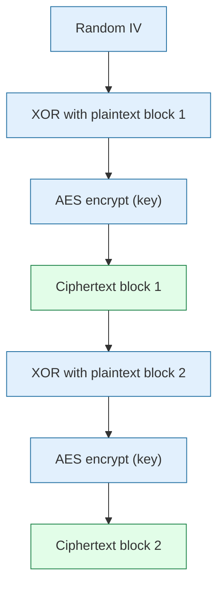

# Block Ciphers, AES and Modes of Operation

## Summary

A **block cipher** is a keyed, deterministic permutation on fixed-size blocks: given a key, it maps each possible plaintext block to a distinct ciphertext block, and the mapping is invertible with the key. **AES** (FIPS 197) is the standard block cipher, with a 128-bit block and 128-, 192-, or 256-bit keys, built from repeated rounds of substitution (the S-box), permutation (ShiftRows, MixColumns), and key mixing (AddRoundKey) — 10, 12, or 14 rounds depending on key size. A block cipher alone only encrypts one block; to encrypt arbitrary-length data you need a **mode of operation**. **ECB** (encrypt each block independently) is insecure because identical plaintext blocks yield identical ciphertext blocks, leaking structure. **CBC** chains blocks by XORing each plaintext block with the previous ciphertext block and requires a random, unpredictable IV. **CTR** turns the block cipher into a stream cipher by encrypting a counter and XORing the result with plaintext, allowing parallelism and random access. Confidentiality-only modes (CBC, CTR) do not protect integrity; **authenticated modes** such as **GCM** (SP 800-38D) add a tag that detects tampering. The recurring lesson is that the mode, IV/nonce handling, and integrity protection matter as much as the cipher: AES used in ECB, or with a reused CTR/GCM nonce, fails even though AES itself is sound.

## Modes at a glance

| Mode | Idea | Parallel | Provides |
|---|---|---|---|
| **ECB** | Each block encrypted independently | Yes | Confidentiality only — **leaks patterns, avoid** |
| **CBC** | XOR with previous ciphertext; random IV | Decrypt only | Confidentiality only (needs separate MAC) |
| **CTR** | Encrypt counter, XOR with data | Yes | Confidentiality only; nonce must be unique |
| **GCM** | CTR + GHASH authentication tag | Yes | Confidentiality **and** integrity (AEAD) |

The choice of mode, not the cipher, is where most real-world failures occur: ECB pattern leakage and nonce reuse in CTR/GCM both break security with a correct AES core.

## CBC encryption flow

## Security relevance

- **ECB leaks structure**: identical plaintext blocks produce identical ciphertext, exposing images and patterns; never use it for data.
- **IV/nonce discipline**: CBC needs an unpredictable IV; CTR and GCM need a unique nonce per key — reuse is catastrophic (keystream recovery in CTR, forgery and key-stream recovery in GCM).
- **Integrity is separate**: CBC and CTR protect confidentiality only; without a MAC they are malleable, enabling bit-flipping and padding-oracle attacks.
- **Prefer AEAD**: AES-GCM (or ChaCha20-Poly1305) combines encryption and authentication in one primitive.

## Practices

- **Use authenticated encryption (AES-GCM) by default**; avoid unauthenticated CBC/CTR unless a MAC is added correctly (encrypt-then-MAC).
- **Never reuse a (key, nonce) pair** in CTR or GCM.
- **Never use ECB** for anything beyond a single random block.
- **Use vetted libraries** and standard key sizes (AES-128/256); do not implement modes by hand.

## Explanation

Think of a block cipher as a reversible scrambling machine that only knows how to scramble a small, fixed chunk — 16 bytes for AES — using a secret key. AES does this scrambling well: decades of analysis have not broken it. But real messages are longer than one chunk, and the way you feed the chunks through the machine — the "mode" — is where things go right or wrong. The naive way, scrambling each chunk the same way (ECB), is a trap: two identical chunks come out identical, so a picture encrypted this way still shows its outline. Better modes stir in some randomness so that repeats vanish: CBC mixes each chunk with the previous scrambled output, and CTR encrypts a running counter and uses it like a one-time pad. Two rules decide whether these work: the random starter value (the IV or nonce) must never repeat with the same key, and you must separately prove nobody altered the message. Modern modes like GCM do both at once, which is why "use AES-GCM" is the standard advice — the cipher was never the weak point; the plumbing around it is.
