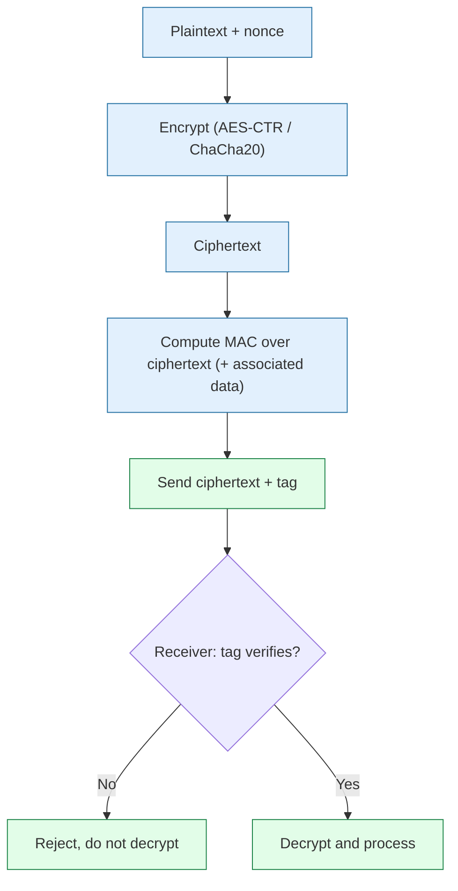

# MACs and Authenticated Encryption

## Summary

Encryption hides data but does not, by itself, prove the data was not altered. A **Message Authentication Code (MAC)** fixes that: it is a keyed function that produces a short tag over a message, and only someone with the key can produce a tag that verifies, so a correct tag proves both **integrity** (the message wasn't changed) and **authenticity** (it came from a key holder). **HMAC** (RFC 2104) is the standard MAC built from a hash function; **Poly1305** and **GMAC** are polynomial MACs used in AEAD. Combining confidentiality and integrity is the job of **Authenticated Encryption (AE)**, and **AEAD** (Authenticated Encryption with Associated Data) additionally authenticates unencrypted header data that must be bound to the ciphertext. The standard AEAD constructions are **AES-GCM** (SP 800-38D) and **ChaCha20-Poly1305** (RFC 8439). When composing a cipher and a MAC by hand, the safe order is **encrypt-then-MAC**: encrypt the plaintext, then MAC the ciphertext, and verify the tag *before* decrypting. The dangerous alternatives (MAC-then-encrypt, encrypt-and-MAC) have led to real attacks such as padding oracles. The central message is that confidentiality without integrity is usually a vulnerability: without a verified tag, ciphertext is malleable, and attackers exploit the act of decrypting attacker-modified data.

## MAC and AE building blocks

| Primitive | Role |
|---|---|
| **HMAC** | Hash-based keyed MAC (integrity + authenticity) |
| **GMAC / Poly1305** | Polynomial MACs used inside AEAD |
| **AES-GCM** | AEAD: AES-CTR + GHASH tag |
| **ChaCha20-Poly1305** | AEAD: stream cipher + Poly1305 tag |
| **Encrypt-then-MAC** | Safe composition; verify tag before decrypting |

Integrity is not optional: a verified tag is what turns "the attacker can't read it" into "the attacker can't read it *or* tamper with it undetected."

## Encrypt-then-MAC flow

## Security relevance

- **Malleability without a MAC**: CBC/CTR ciphertext can be altered to change plaintext in predictable ways; a verified tag prevents this.
- **Padding oracles**: decrypting-then-checking leaks whether padding was valid; encrypt-then-MAC with pre-decrypt verification closes the oracle.
- **Nonce reuse breaks AEAD**: reusing a (key, nonce) in GCM leaks the authentication key and enables forgery.
- **Constant-time tag comparison**: comparing tags with early-exit logic leaks timing; use constant-time equality.

## Practices

- **Use AEAD** (AES-GCM or ChaCha20-Poly1305) rather than composing primitives yourself.
- **If composing, encrypt-then-MAC** and verify before decrypting.
- **Unique nonce per key**; never reuse in GCM/Poly1305.
- **Bind context with associated data** (headers, versions) and compare tags in constant time.

## Explanation

Locking a message in a box keeps it secret, but it does not stop someone from swapping the box for a different one or jiggling the lock so the contents come out subtly changed. A MAC is a tamper-evident seal: using a shared secret, the sender stamps the message with a tag that only a key holder could produce, and the receiver checks the seal before trusting anything inside. Encryption plus a seal is "authenticated encryption," and the modern tools — AES-GCM and ChaCha20-Poly1305 — do both in one step, even sealing the address label on the outside (the header) so it can't be rerouted. The order matters more than people expect. If you seal the message and then lock the box, the receiver has to open the box before checking the seal, and that act of opening attacker-tampered contents has leaked secrets in famous real-world breaks. The right order is lock first, then seal the locked box, and refuse to open anything whose seal doesn't check out. The headline rule is simple: secrecy without integrity is usually a bug, not a feature.
