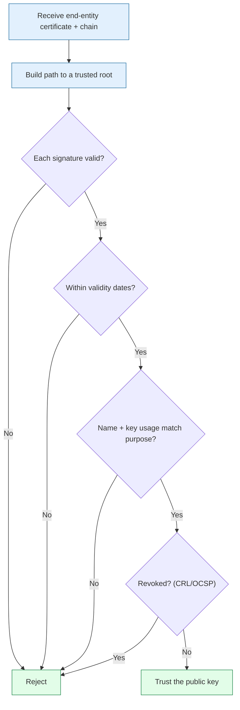

# Public-Key Certificate Management and PKI Use Cases

## Summary

Public-key cryptography lets you encrypt to, or verify a signature from, a public key — but only if you know the key genuinely belongs to the party you think. **Public Key Infrastructure (PKI)** solves that binding problem. A **Certificate Authority (CA)** issues an **X.509 certificate** (RFC 5280) that binds a public key to an identity (a domain, person, or device) and signs it with the CA's own key. Relying parties trust a small set of **root CAs**; roots sign **intermediate CAs**, which sign **end-entity certificates**, forming a **chain of trust** that a verifier validates up to a trusted root. Validation is more than checking a signature: the verifier confirms the chain links, that each certificate is within its validity dates, that the name matches the intended identity, that key-usage constraints allow the purpose, and that no certificate in the chain has been **revoked** (via CRLs or OCSP, RFC 6960). PKI underpins TLS/HTTPS, code signing, email (S/MIME), device identity, and document signing. Its operational hard parts are **lifecycle management** — issuance, renewal before expiry, revocation, and protecting CA private keys (often in HSMs) — because a compromised or mis-issuing CA, an expired certificate, or an unvalidated chain each breaks the trust the whole system depends on.

## PKI components and checks

| Element | Role |
|---|---|
| **Root CA** | Trust anchor; self-signed, kept offline |
| **Intermediate CA** | Signs end-entity certs; limits root exposure |
| **End-entity certificate** | Binds public key to a domain/person/device |
| **Validation** | Chain + dates + name + key usage + revocation |
| **Revocation** | CRL / OCSP marks compromised or retired certs |
| **Key protection** | CA keys in HSMs; strict issuance controls |

Trust flows down from a root through intermediates to the leaf, and a verifier must check every link, not just the leaf signature.

## Certificate chain validation

## Security relevance

- **Mis-issuance and CA compromise**: a rogue or breached CA can issue certificates for any name; Certificate Transparency logs help detect this.
- **Skipping revocation checks**: a stolen key stays trusted until clients honor CRL/OCSP; soft-fail revocation weakens this.
- **Expired/misconfigured chains**: missing intermediates or expired certs break validation and push users to bypass warnings.
- **Weak validation**: accepting an unmatched name or ignoring key-usage constraints enables impersonation.

## Practices

- **Validate the full chain**: signatures, dates, name, key usage, and revocation — fail closed.
- **Protect CA keys in HSMs** and keep roots offline; enforce strict issuance policy.
- **Automate lifecycle** (e.g. ACME) to prevent expiry outages and enable short-lived certs.
- **Monitor Certificate Transparency** for unexpected certificates in your names.
- **Support strong revocation** (OCSP stapling) and rotate compromised keys promptly.

## Explanation

Public-key crypto only helps if you can trust that a public key really belongs to the website or person you mean to reach — otherwise an impostor just hands you *their* key. PKI is the system of vouching that makes that trust work at internet scale. A Certificate Authority is a notary: it checks who you are and issues a signed certificate stating "this public key belongs to this domain." Your browser trusts a short list of root notaries baked in; those roots vouch for intermediate notaries, who vouch for individual websites, so trust flows down a chain. When you connect to a site, your browser doesn't just glance at the certificate — it walks the whole chain back to a root it trusts, checks the dates haven't expired, confirms the name matches the site, and asks whether the certificate has been revoked (cancelled early because a key was stolen). The painful parts are all operational: certificates expire and must be renewed before they do, revoked certificates must actually be checked, and the CA's own signing keys must be guarded fanatically, because a notary who can be tricked or robbed can forge trust for anyone.
