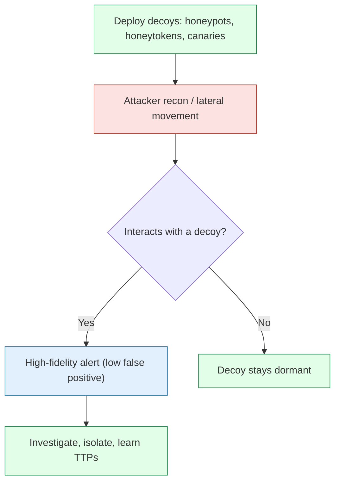

# Traps, Deception and Honeypots Against Attackers

## Summary

**Deception** is a defensive strategy that plants fake but attractive assets so that any interaction with them is, by definition, suspicious — flipping the attacker's advantage by making the environment itself a tripwire. A **honeypot** is a decoy system (or service) with no legitimate purpose; since no real user should ever touch it, any connection is a high-fidelity alert with very low false positives. Deception spans a range: **honeytokens** (fake credentials, API keys, documents, or database rows that raise an alarm when used or exfiltrated), **honeypots** (decoy hosts/services, low-interaction for detection or high-interaction for studying attacker behavior), **honeynets** (whole decoy networks), and **canary files/accounts** seeded in real systems. The strategic strengths are **low false positives** (legitimate activity avoids the decoys), **early warning** (attackers often probe decoys during reconnaissance and lateral movement), and **intelligence** (high-interaction honeypots reveal tools and TTPs). The trade-offs are that high-interaction decoys carry **risk** (a compromised honeypot could be used as a pivot if not isolated), require careful **isolation and monitoring**, and only catch attackers who actually touch them. Deception complements, rather than replaces, prevention and detection: it is most valuable as a layer that catches intruders who have evaded other controls, precisely because it does not depend on recognizing known-bad signatures — only on recognizing that someone touched something they never should have.

## Deception techniques

| Technique | Use |
|---|---|
| **Honeytoken** | Fake credential/key/file; alerts on use or theft |
| **Low-interaction honeypot** | Decoy service for cheap detection |
| **High-interaction honeypot** | Real-ish system to study TTPs (needs isolation) |
| **Honeynet** | Decoy network for broad visibility |
| **Canary file/account** | Seeded in real systems as tripwire |

Because no legitimate user has any reason to touch a decoy, interaction is a near-certain sign of an intruder — high signal, low noise.

## Deception flow

## Detection / value

- **High-fidelity alerts**: any decoy interaction is suspicious by construction, cutting false positives dramatically.
- **Early warning**: attackers probe decoys during recon and lateral movement, before reaching real crown jewels.
- **Threat intelligence**: high-interaction honeypots capture real tools, malware, and techniques.
- **Exfiltration tripwires**: honeytokens fire when stolen data is used, even after the breach.

## Defense / practices

- **Seed honeytokens** (fake credentials, canary documents) in realistic locations and alert on use.
- **Place decoys along likely attacker paths** (recon targets, lateral-movement routes).
- **Isolate high-interaction honeypots** so they can't be used as a pivot; monitor them closely.
- **Treat any decoy hit as an incident** and integrate alerts into SOC workflows.

## Explanation

Most defenses try to recognize bad behavior, which is hard because attackers work to look normal. Deception flips the problem: instead of spotting the intruder, you leave out bait that only an intruder would ever touch. A honeypot is a fake computer that does nothing real, so the instant anyone connects to it, you know something's wrong — there's no innocent reason to be there. A honeytoken is even simpler: a fake password, a decoy spreadsheet labeled "salaries," a dummy API key, planted where a snooping attacker will find it; the moment someone tries to use it, an alarm goes off, often revealing a breach you'd otherwise have missed for months. The beauty of this approach is how quiet it is — real employees never stumble into the traps, so when one springs, it almost always means a genuine intruder, not a false alarm. The catch is that you have to be careful with the most realistic decoys: if you build a convincing fake system and don't wall it off, a clever attacker might use it as a stepping stone deeper in. Done well, deception is a patient net strung across the paths intruders tend to walk, catching the ones who slipped past everything else.
