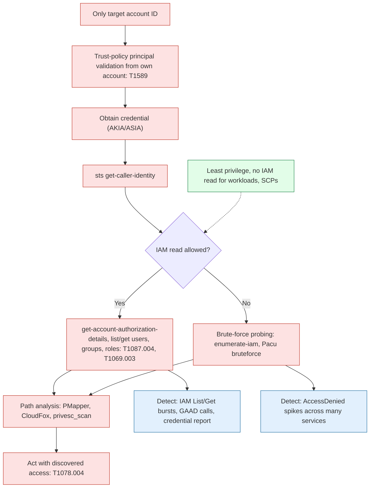

# AWS IAM Enumeration Cheat Sheet

## Summary

A command-first quick reference for **enumerating AWS Identity and Access Management (IAM)**: finding out which account a credential belongs to, which users, groups, roles and policies exist, and what a given principal is actually allowed to do. It is organised by how much access you start with: **nothing**, **a credential you can't read policies with**, and **a credential that can read IAM**. Each command notes what it reveals and what it leaves in the logs.

The concepts behind this (key prefixes, policy evaluation, the escalation permissions that enumeration is looking for) are explained in [AWS IAM Enumeration and Privilege Abuse](../../cloud/cloud-security/aws-iam-enumeration-and-privilege-abuse.md). The broader engagement flow is in [AWS Penetration Testing Methodology and Tooling](../../cloud/cloud-security/aws-penetration-testing-methodology-and-tooling.md), and the companion [AWS and API Penetration Testing Cheat Sheet](aws-and-api-pentesting-cheat-sheet.md) covers the other AWS services. This file goes deeper on IAM only.

> Run these only against accounts you own or are explicitly authorized to assess. Everything below is **read-only** except where marked. Account IDs, names and ARNs are placeholders.

## Quick map: start point → technique

| You have | Goal | Go to |
|---|---|---|
| Only an account ID or a company name | Find valid role/user names without touching the target | [Unauthenticated](#1-unauthenticated-enumeration) |
| A leaked access key ID | Which account owns it | [`get-access-key-info`](#account-id-from-an-access-key-id) |
| Keys, but `iam:Get*`/`List*` denied | What can this key call at all | [Brute-force probing](#3-authenticated-without-iam-read-permissions) |
| Keys with IAM read access | The full picture: every principal, policy and trust | [Full dump](#2-authenticated-with-iam-read-permissions) |
| The full picture | Which paths lead to admin | [Path analysis](#4-turning-enumeration-into-paths) |

## 0. Set up the credential

```bash
# Long-term keys (AKIA...) or temporary keys (ASIA... + session token)
aws configure --profile target
# For ASIA keys, also set the token:
aws configure set aws_session_token <token> --profile target

export AWS_PROFILE=target
```

- `AKIA` = long-term IAM user (or root) key. `ASIA` = temporary STS credentials, which always need the session token and expire. [Certain]
- IAM is a **global** service; its API calls are recorded in CloudTrail in **us-east-1**. You don't need `--region` for IAM commands. [Certain]

## 1. Unauthenticated enumeration

These work from **your own** AWS account against a target account ID. The noisy part lands in *your* CloudTrail, not the target's. [Likely: AWS documents the logging for `GetAccessKeyInfo`; for the trust-policy method it follows from where the API call is made.]

### Account ID from an access key ID

```bash
aws sts get-access-key-info --access-key-id AKIAEXAMPLEEXAMPLE
# { "Account": "111122223333" }
```

- Needs any valid credential of **your** account; no permission on the target. Logged only in the caller's account. [Certain]
- Use: a key ID found in a repo, log or screenshot → which account it belongs to, without using the secret.

### Valid role and user names via cross-account trust policies

AWS validates principal ARNs when you save a resource or trust policy. If you put `arn:aws:iam::<target>:role/<guess>` in a role trust policy **in your own account**, AWS accepts it if that role exists and rejects it (`MalformedPolicyDocument: Invalid principal in policy`) if it doesn't. Iterating a wordlist reveals which names exist in the target account. [Certain: behaviour; Likely: still unpatched, as AWS treats it as expected]

```text
# Pacu, run with keys from YOUR account, not the target's
run iam__enum_roles --role-name-list roles.txt --account-id 111122223333
run iam__enum_users --user-name-list users.txt --account-id 111122223333
# iam__enum_roles can also try to AssumeRole each found role to spot
# over-trusting ones. That step is ACTIVE: authorized scope only.
```

- Quiet Riot (open-source) does the same at larger scale across several services' resource-policy validators.
- This is ATT&CK **T1589** (Gather Victim Identity Information): it maps identities without authenticating to the target.

### Other places account IDs and principal names leak

- Public AMIs, EBS/RDS snapshots shared to all accounts (owner account ID shown).
- Error messages and ARNs in public code, CloudFormation templates and Terraform state files.
- S3 bucket → account ID via the `s3:ResourceAccount` policy condition (tool: `s3-account-search`), given a role you can assume that can read the bucket. [Likely]

## 2. Authenticated with IAM read permissions

### Who am I

```bash
aws sts get-caller-identity
# { "UserId": "AIDA...", "Account": "111122223333",
#   "Arn": "arn:aws:iam::111122223333:user/dev-ci" }
```

- Needs **no permissions** and works even under an explicit deny. [Certain]
- `UserId` prefix tells the principal type: `AIDA` user, `AROA` role (shown as `AROA...:session-name`). [Certain]

### One-call full dump (best first move if allowed)

```bash
aws iam get-account-authorization-details > gaad.json
# Every user, group, role (with trust policy), managed policy
# (all versions) and inline policy, in one JSON document.

# Narrow it:
aws iam get-account-authorization-details --filter Role
aws iam get-account-authorization-details --filter LocalManagedPolicy
```

Requires `iam:GetAccountAuthorizationDetails`. Allowed by AWS's `ReadOnlyAccess`/`SecurityAudit` managed policies, so audit roles often have it. [Certain: API; Likely: on those managed policies' current versions]

### Account-level overview

```bash
aws iam get-account-summary              # counts: users, roles, MFA devices, root key present
aws iam list-account-aliases
aws iam get-account-password-policy
aws iam generate-credential-report && sleep 5
aws iam get-credential-report --query Content --output text | base64 -d > creds.csv
# Per user: password enabled/last used, MFA, key age, key last used
```

`AccountAccessKeysPresent: 1` in the summary means the **root** user has an access key, a finding on its own. [Certain]

### Users

| Command | Reveals |
|---|---|
| `aws iam list-users` | All IAM users, ARNs, create date, password last used |
| `aws iam get-user --user-name <u>` | One user; tags (often hold owner/team info) |
| `aws iam list-groups-for-user --user-name <u>` | Group membership → inherited permissions |
| `aws iam list-attached-user-policies --user-name <u>` | Managed policies on the user |
| `aws iam list-user-policies --user-name <u>` | Inline policy **names** only |
| `aws iam get-user-policy --user-name <u> --policy-name <p>` | Inline policy document |
| `aws iam list-access-keys --user-name <u>` | Key IDs and status (never the secret) |
| `aws iam get-access-key-last-used --access-key-id <k>` | Last use time, service, region (stale vs live keys) |
| `aws iam list-mfa-devices --user-name <u>` | Whether MFA is enrolled |
| `aws iam get-login-profile --user-name <u>` | Whether console login exists (error = no password) |
| `aws iam list-ssh-public-keys` / `list-service-specific-credentials` | CodeCommit SSH keys, service credentials |

### Groups

```bash
aws iam list-groups
aws iam get-group --group-name <g>                 # members
aws iam list-attached-group-policies --group-name <g>
aws iam list-group-policies --group-name <g>       # inline names
aws iam get-group-policy --group-name <g> --policy-name <p>
```

Group-level policy reads are ATT&CK **T1069.003** (Permission Groups Discovery: Cloud Groups).

### Roles (where most escalation paths live)

```bash
aws iam list-roles --query 'Roles[].[RoleName,Arn]' --output table
aws iam get-role --role-name <r>                   # includes AssumeRolePolicyDocument (trust policy)
aws iam list-attached-role-policies --role-name <r>
aws iam list-role-policies --role-name <r>
aws iam get-role-policy --role-name <r> --policy-name <p>
aws iam list-instance-profiles                     # roles attachable to EC2

# Roles that trust another AWS account or everyone
aws iam list-roles --query 'Roles[].[RoleName,AssumeRolePolicyDocument.Statement[].Principal]' --output json
```

Read the trust policy for: `"Principal": {"AWS": "*"}`, whole external accounts (`arn:aws:iam::<other>:root`) with no `sts:ExternalId` condition, and federated principals (GitHub OIDC `token.actions.githubusercontent.com`) without a `sub` condition pinning the repo. [Certain: these are the documented risky patterns]

### Policies

```bash
aws iam list-policies --scope Local                # customer-managed only (skip ~1,000+ AWS-managed)
aws iam get-policy --policy-arn <arn>              # shows DefaultVersionId
aws iam list-policy-versions --policy-arn <arn>    # older versions may be more permissive
aws iam get-policy-version --policy-arn <arn> --version-id v3
aws iam list-entities-for-policy --policy-arn <arn>  # who has this policy
```

Up to five versions are kept per managed policy. A permissive old version is a latent risk: anyone with `iam:SetDefaultPolicyVersion` can switch back to it. [Certain]

### Ask IAM directly: "can this principal do X?"

```bash
aws iam simulate-principal-policy \
  --policy-source-arn arn:aws:iam::111122223333:user/dev-ci \
  --action-names iam:PassRole iam:CreateAccessKey lambda:CreateFunction \
  --query 'EvaluationResults[].[EvalActionName,EvalDecision]' --output table
```

Needs `iam:SimulatePrincipalPolicy`. It evaluates identity policies and boundaries, but **does not** include SCPs from AWS Organizations or most resource-based policies unless you pass them, so "allowed" here is not a guarantee. [Likely: matches AWS's documented simulator limits]

### Other identity surfaces worth one call each

```bash
aws iam list-saml-providers
aws iam list-open-id-connect-providers           # e.g. GitHub Actions, EKS
aws iam list-server-certificates
aws organizations describe-organization          # is this a member account?
aws sso-admin list-instances                     # IAM Identity Center in use?
aws accessanalyzer list-analyzers                # is the defender watching?
```

Listing services and their configuration beyond IAM is **T1526** (Cloud Service Discovery).

## 3. Authenticated without IAM read permissions

When `iam:List*`/`Get*` returns `AccessDenied`, you can't read your own policy, so you **probe**: call many harmless read APIs and record which succeed.

```bash
# enumerate-iam (andresriancho): tries hundreds of List/Describe/Get calls
python3 enumerate-iam.py --access-key AKIA... --secret-key ... [--session-token ...]
```

```text
# Pacu
import_keys target
run iam__enum_permissions          # tries to read own policies first (quiet when allowed)
run iam__bruteforce_permissions    # falls back to probing
whoami                             # shows what Pacu has learned about the key
```

```bash
# CloudFox (Bishop Fox), attack-path oriented, read-only
cloudfox aws --profile target permissions     # every permission per principal (needs IAM read)
cloudfox aws --profile target principals
cloudfox aws --profile target role-trusts     # who can assume which role
cloudfox aws --profile target iam-simulator   # runs the policy simulator for common actions
```

Trade-off: probing is **loud**. Hundreds of calls across many services from one key in minutes, most of them `AccessDenied`, is one of the clearest enumeration signatures in CloudTrail. [Certain]

## 4. Turning enumeration into paths

Enumeration is only useful when you can see which permission chains end in admin.

```bash
# PMapper (NCC Group): builds a graph of who can become whom
pmapper --profile target graph create
pmapper --profile target query 'who can do iam:PassRole with *'
pmapper --profile target query 'preset privesc *'
pmapper --profile target analysis               # list of escalation risks
pmapper --profile target visualize --filetype png
```

```text
# Pacu
run iam__privesc_scan              # flags known escalation methods.
                                   # Can EXPLOIT them if you confirm: authorized scope only.
```

What to look for in the output (each is explained in the [IAM privilege-abuse file](../../cloud/cloud-security/aws-iam-enumeration-and-privilege-abuse.md)):

- `iam:PassRole` on `*` plus a compute service (`ec2:RunInstances`, `lambda:CreateFunction`, `glue:CreateDevEndpoint`, `cloudformation:CreateStack`).
- `iam:CreateAccessKey`, `iam:CreateLoginProfile` / `iam:UpdateLoginProfile` on other users.
- `iam:CreatePolicyVersion`, `iam:SetDefaultPolicyVersion`, `iam:Attach*Policy`, `iam:Put*Policy`.
- `iam:UpdateAssumeRolePolicy`, or `sts:AssumeRole` into an over-trusting role.

Using a credential found this way is **T1078.004** (Valid Accounts: Cloud Accounts).

## Flow



## Detection

| Signal (CloudTrail `eventSource: iam.amazonaws.com` / `sts.amazonaws.com`) | Indicates |
|---|---|
| `GetAccountAuthorizationDetails` from a workload role or unusual user | Full IAM dump (rarely needed outside audit tooling) |
| Many `List*`/`Get*` IAM events from one principal in minutes | Scripted enumeration (Pacu, CloudFox, PMapper) |
| `errorCode: AccessDenied` across many services from one key | Brute-force permission probing |
| `GenerateCredentialReport` / `GetCredentialReport` by a non-audit identity | Account-wide credential recon |
| `SimulatePrincipalPolicy` from a non-admin | Permission checking before acting |
| `GetCallerIdentity` from a new IP/ASN, first call of a session | Someone testing a leaked key |
| `userAgent` containing `Pacu`, `enumerate-iam`, `boto3` from a desktop-only user | Tooling (trivially spoofed, so a bonus signal, not a control) |

- **GuardDuty** flags much of this: `Discovery:IAMUser/AnomalousBehavior` (unusual discovery API patterns), `Recon:IAMUser/MaliciousIPCaller`, and `PenTest:IAMUser/KaliLinux` / `ParrotLinux` / `PentooLinux` (based on user agent). [Certain: finding types exist]
- **Unauthenticated enumeration is invisible to the target.** Trust-policy validation and `GetAccessKeyInfo` are logged only in the attacker's own account. The only defence is making names unguessable and trust policies tight. [Likely]
- CloudTrail **event history** shows 90 days of management events. Read-only IAM calls are management *read* events, so a trail configured for write-only events will **miss all of this**. Check the trail's event selector. [Certain]

## Defense

- **Don't give workloads IAM read.** Application and CI roles almost never need `iam:List*`/`Get*`; removing them turns a stolen key into a blind key.
- **Least privilege on audit roles.** `SecurityAudit`/`ReadOnlyAccess` include full IAM reads: restrict who can assume those roles and require MFA.
- **SCPs** to deny IAM writes and sensitive reads outside a small admin set.
- **Tight trust policies:** no `"AWS": "*"`, `sts:ExternalId` for third parties, `sub` conditions on OIDC providers.
- **Prune policy versions** and delete unused users, keys and roles (use the credential report and `get-access-key-last-used`).
- **IAM Access Analyzer** for external-access and unused-access findings.
- **Log read events too:** multi-region trail to S3 with read + write management events, plus GuardDuty.
- **Run PMapper or CloudFox yourself** so you see the same graph an attacker would build.

## ATT&CK mapping

| ID | Name | Tactic |
|---|---|---|
| T1589 | Gather Victim Identity Information | Reconnaissance |
| T1087.004 | Account Discovery: Cloud Account | Discovery |
| T1069.003 | Permission Groups Discovery: Cloud Groups | Discovery |
| T1526 | Cloud Service Discovery | Discovery |
| T1078.004 | Valid Accounts: Cloud Accounts | Initial Access, Persistence, Privilege Escalation, Stealth |

## Explanation

IAM enumeration is reading the building's access-control list. With no badge at all, you can still stand outside and test whether names are on the list by asking the front desk to forward mail to them: the desk tells you which names exist, and only your own mailroom keeps a record. With a badge that can read the list, one request prints the whole thing. With a badge that can't, you walk down the corridor trying every door, which works but leaves a long trail of "denied" entries in the guard's log. The last step is drawing the map of which doors, opened in sequence, end up at the master key — because a scattered list of permissions is harmless until someone connects them into a path. The defence is the same on both sides of the wall: keep each badge narrow, keep the name list unguessable, keep the trust rules tight, and watch the guard's log for anyone reading the whole building at once.