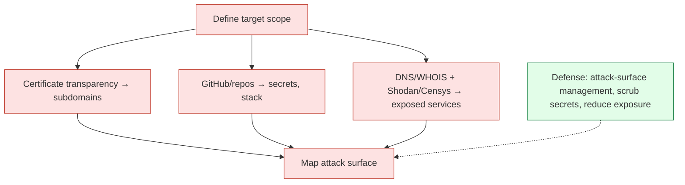

# Open-Source Intelligence Gathering on a Target (GitHub, Certificates, Web Infrastructure)

## Summary

**Open-Source Intelligence (OSINT)** reconnaissance is the gathering of information about a target from publicly available sources, and it is the first phase of both real attacks and authorized penetration tests — mapped in ATT&CK as **Search Open Websites/Domains** (T1593) and **Search Open Technical Databases** (T1596). The power of OSINT is that it is **passive** (it touches public sources, not the target directly, so it is hard to detect) yet it can reveal a surprising amount of attack surface. Key sources: **code repositories** (GitHub/GitLab, where developers accidentally commit secrets — API keys, credentials, internal hostnames — and reveal technology stacks), **certificate transparency logs** (every public TLS certificate is logged, exposing subdomains and internal naming conventions), **DNS and WHOIS** (domains, name servers, registration details), **passive DNS and internet-wide scan data** (Shodan, Censys — exposed services, open ports, software versions), **job postings** (revealing technologies and tooling in use), **social media and employee profiles** (LinkedIn for org structure and targets for phishing), and **web archives and metadata** (historical pages, document metadata). For defenders, understanding OSINT is dual-purpose: it is what attackers do first, so reducing your **OSINT footprint** (scrubbing secrets from repos, limiting exposed services, controlling information disclosure) shrinks attack surface; and defenders use the same techniques for **attack-surface management** — continuously discovering their own exposed assets, leaked credentials, and shadow IT before adversaries do. The core insight: organizations leak far more than they realize through public sources, and that leakage is the attacker's roadmap — so seeing yourself as an attacker sees you is a defensive necessity.

## OSINT sources

| Source | Reveals |
|---|---|
| **Code repos (GitHub)** | Leaked secrets, tech stack, hostnames |
| **Certificate transparency** | Subdomains, naming conventions |
| **DNS/WHOIS** | Domains, name servers, registration |
| **Shodan/Censys** | Exposed services, ports, versions |
| **Job posts / social** | Technologies in use; phishing targets |
| **Web archives/metadata** | Historical content, document authorship |

OSINT is passive and hard to detect, yet it maps the attack surface — which is why reducing your public footprint is a defensive priority.

## OSINT recon flow

## Detection / value

- **Passive and stealthy**: OSINT rarely touches the target, so it evades detection — defenders must assume it happens.
- **Leaked secrets**: committed API keys and credentials are a common, high-impact finding.
- **Subdomain/asset discovery**: certificate logs and passive DNS reveal forgotten, exposed assets.
- **Defensive use**: attack-surface management applies the same techniques to find your own exposure first.

## Defense / practices

- **Monitor your OSINT footprint**: scan repos for leaked secrets; watch certificate transparency for your domains.
- **Run attack-surface management**: continuously discover exposed services, subdomains, and shadow IT.
- **Reduce exposure**: minimize public services, control information in job posts and metadata.
- **Rotate leaked credentials** immediately and prevent secrets in code (pre-commit scanning, secret vaults).

## ATT&CK mapping

| ID | Name | Tactic |
|---|---|---|
| T1593 | Search Open Websites/Domains | Reconnaissance |
| T1596 | Search Open Technical Databases | Reconnaissance |

## Explanation

Before a skilled attacker touches your systems at all, they go shopping for information about you in plain sight — and the amount lying around is often alarming. This is OSINT: open-source intelligence, built entirely from public sources, which makes it nearly invisible because the attacker never knocks on your door. Where do they look? Developers' code repositories are a goldmine, because busy programmers routinely paste passwords, API keys, and internal server names into code they accidentally make public. Certificate transparency logs — public records of every website security certificate ever issued — quietly reveal the names of internal and forgotten subdomains. Search engines for internet-connected devices, like Shodan, show exactly which of your servers are exposed and what software (and versions) they run. Job listings advertise the exact technologies you use, and employee LinkedIn profiles map out who works where, perfect for crafting a convincing phishing email. Stitch these together and an attacker has a detailed map of your weak points without ever triggering an alarm. The defensive takeaway is to turn the telescope around: look at yourself the way an attacker does. Scan your own repositories for leaked secrets, watch the certificate logs for your domains, continuously hunt for exposed and forgotten assets, and shrink what you broadcast to the world. You can't stop people from looking at public information, but you can make sure there's a lot less worth finding.
