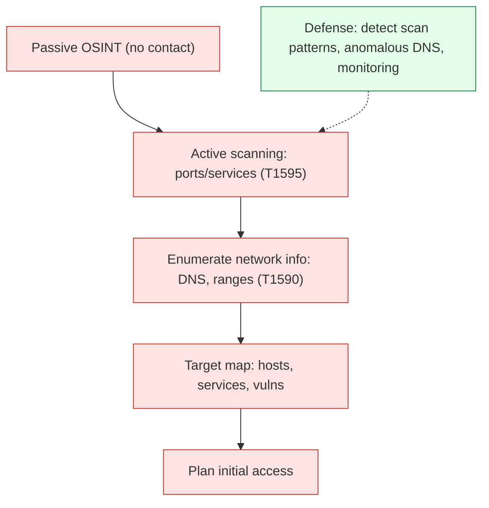

# Red Team Reconnaissance and Environment Monitoring

## Summary

**Reconnaissance** is the information-gathering phase that precedes an attack, and in a red-team or real intrusion it spans **passive** OSINT and **active** probing of the target — mapped in ATT&CK as **Active Scanning** (T1595) and **Gather Victim Network Information** (T1590). Where passive OSINT reads public sources without touching the target, **active reconnaissance** directly interacts with target systems — port scanning, service and version enumeration, vulnerability scanning, DNS enumeration, web crawling — which is more revealing but also **detectable** (it generates traffic defenders can see). Red teamers balance thoroughness against stealth, pacing scans and using techniques that blend with normal traffic. Reconnaissance produces the **target map**: live hosts, open ports, running services and versions, technologies, subdomains, and likely vulnerabilities — the basis for planning initial access. "**Environment monitoring**" in an operation refers to the attacker (or red team) observing the target's environment over time: watching for changes, defender activity, new exposed assets, or windows of opportunity, and after a foothold, performing **internal reconnaissance** (discovery) to map the internal network, identities, and privileges. For defenders, this phase is a **detection opportunity**: active scanning and enumeration leave traces (unusual connection patterns, port-scan signatures, anomalous DNS queries) that monitoring can catch, and recognizing reconnaissance can provide early warning of an impending attack. The dual lesson is that attackers invest heavily in understanding a target before striking, and that this activity — especially its active forms — is both a source of the attacker's advantage and a signal defenders can detect and act on.

## Reconnaissance types

| Type | Method | Detectable? |
|---|---|---|
| **Passive (OSINT)** | Public sources, no target contact | Rarely |
| **Active scanning (T1595)** | Port/vuln scans, enumeration | Yes |
| **Network info (T1590)** | DNS, subdomains, IP ranges | Partly |
| **Internal recon (post-foothold)** | Discovery of hosts/identities | Yes, if monitored |

Active recon trades stealth for detail; the traffic it generates is exactly what defenders can detect as early warning.

## Reconnaissance flow

## Detection / value

- **Active recon is detectable**: port scans and enumeration produce traffic patterns monitoring can flag.
- **Early warning**: recognizing reconnaissance can precede the actual attack.
- **Target map drives attacks**: the quality of recon shapes the attacker's success.
- **Internal discovery**: post-foothold reconnaissance is a key detection point for intrusions in progress.

## Defense / practices

- **Monitor for scanning and enumeration**: port-scan signatures, anomalous connection and DNS patterns.
- **Reduce attack surface**: fewer exposed services means less for recon to find.
- **Detect internal discovery**: watch for unusual host/identity enumeration post-foothold.
- **Treat recon signals as early warning** and raise vigilance accordingly.

## ATT&CK mapping

| ID | Name | Tactic |
|---|---|---|
| T1595 | Active Scanning | Reconnaissance |
| T1590 | Gather Victim Network Information | Reconnaissance |

## Explanation

No competent attacker charges in blind. Like a burglar casing a house, they study the target first — and that studying is called reconnaissance. It comes in two flavors. The quiet kind reads public information without ever touching your systems, so you can't see it. The louder kind actually pokes at your systems directly: scanning which doors (ports) are open, what software is running behind them, and which of it has known weaknesses. This active probing is far more revealing — it builds a detailed map of live machines, services, versions, and likely vulnerabilities — but it also makes noise, generating traffic that a watchful defender can notice. So attackers and red teamers walk a tightrope, gathering as much detail as they can while trying not to set off alarms, sometimes slowing their scans or disguising them as normal activity. "Environment monitoring" extends this over time: watching the target for changes, new exposures, or moments when defenses are weak, and once they've gotten inside, quietly mapping the internal network to find where the valuable systems and powerful accounts live. For defenders, the good news buried here is that reconnaissance — especially the active kind — is a chance to catch an attack *before* it really begins. The scanning patterns and odd probing are detectable signals, and spotting them is like noticing someone slowly circling your house at night: an early warning that lets you raise your guard before the break-in.
