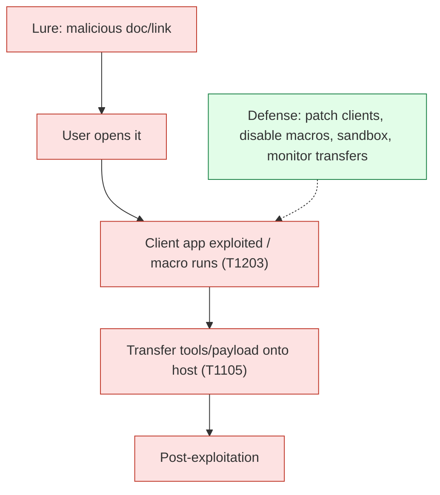

# Client-Side Attacks, Public Exploits and File Transfers

## Summary

**Client-side attacks** target the software a user runs — browsers, document readers, email clients, media players — rather than exposed network services, because in a well-defended environment the user's applications are often the easiest way in (**Exploitation for Client Execution**, T1203). The attacker gets the victim to *open* something malicious: a booby-trapped document (malicious macros, exploit-laden PDF), a link to an exploit page, or a crafted file, turning the user into the delivery mechanism and bypassing perimeter defenses. **Public exploits** are the readily-available exploit code (from exploit databases, Metasploit modules, and proof-of-concept releases) that attackers and testers use against known vulnerabilities; their existence means that once a vulnerability is public, exploitation is often trivial and fast, underscoring patch urgency. **File transfers** are the practical post-exploitation step of moving tools and payloads onto a compromised host (**Ingress Tool Transfer**, T1105) and extracting data — testers and attackers use many techniques (HTTP servers, `scp`, `certutil`, PowerShell downloads, living-off-the-land binaries) that defenders can monitor. For defenders, the chain is instructive: client-side attacks exploit user applications (so patching clients, disabling macros, sandboxing, and user awareness matter), public exploits make unpatched known bugs cheap to attack (so timely patching is critical), and ingress tool transfer is a detectable post-exploitation behavior. The unifying insight is that when network perimeters are hardened, the user and their everyday applications become the frontline — and the subsequent movement of tools onto the host is a key detection opportunity.

## Attack chain elements

| Element | Detail |
|---|---|
| **Client-side attack (T1203)** | Exploit user apps via opened file/link |
| **Delivery** | Malicious docs/macros, exploit pages |
| **Public exploits** | Ready code for known vulns (fast, cheap) |
| **File transfer (T1105)** | Move tools/payloads onto the host |

When the perimeter is hard, the user's everyday applications are the frontline, and ingress tool transfer is a key detection point.

## Attack flow

## Detection / value

- **User apps are the frontline**: client-side exploitation bypasses perimeter defenses via opened content.
- **Public exploits make known bugs cheap**: once disclosed, exploitation is fast — patch urgently.
- **Macros and documents**: a dominant delivery vector worth disabling/restricting.
- **Ingress tool transfer (T1105)**: moving tools onto a host is a detectable post-exploitation step.

## Defense / practices

- **Patch client software promptly** (browsers, readers, Office); exploits follow disclosure quickly.
- **Disable or restrict macros** and use protected-view/sandboxing for documents.
- **User awareness**: don't open unexpected attachments/links; report suspicious content.
- **Monitor file transfers and LOLBins** (`certutil`, PowerShell downloads) as post-exploitation signals.

## ATT&CK mapping

| ID | Name | Tactic |
|---|---|---|
| T1203 | Exploitation for Client Execution | Execution |
| T1105 | Ingress Tool Transfer | Command and Control |

## Explanation

When a company locks down its network perimeter well, attackers stop trying to kick in the front door and instead trick someone inside into opening a window for them — that's the essence of a client-side attack. Rather than exploiting an exposed server, they exploit the ordinary programs you use every day: your browser, your PDF reader, your email client, Microsoft Office. They send a document rigged with a malicious macro, or a link to a page that silently exploits your browser, and the moment you open it, their code runs — using *you* as the delivery van that carried it past all the perimeter defenses. What makes this cheap and fast is "public exploits": ready-made attack code, freely available, for known vulnerabilities. The grim implication is that once a bug is public, breaking into anyone who hasn't patched becomes almost trivial — which is exactly why patching quickly is so urgent. Once they're in, attackers need to move their tools onto the machine and later haul data off it, a step called file transfer, and they have a whole bag of tricks for it, including abusing legitimate Windows utilities so it blends in. For defenders, every link in this chain is a place to fight back: patch the everyday apps before exploits catch up, shut off risky features like document macros, teach people not to open surprises, and watch for the telltale moment when tools get pulled onto a machine — because that quiet file transfer is often the clearest sign an intruder has arrived.
