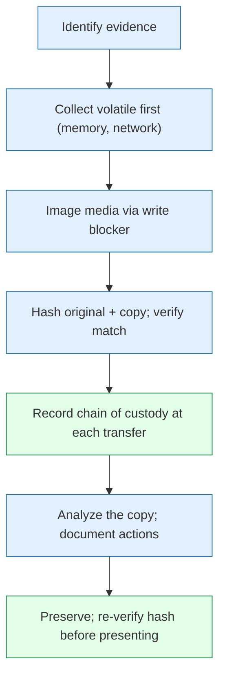

# Evidence Handling and Chain of Custody

## Summary

Digital evidence is only as useful as it is **trustworthy**, and trustworthiness depends on disciplined handling from the moment evidence is identified through its presentation. The core principles are: **integrity** (prove the evidence has not changed since collection, using cryptographic **hashing** — hash at acquisition and re-verify to show the copy matches the original), **chain of custody** (an unbroken, documented record of who collected, handled, transferred, and stored the evidence, when, and why — any gap can render evidence inadmissible or disputable), **working on copies** (analyze a forensic image, never the original, and use **write blockers** to prevent altering source media), **order of volatility** (collect the most fleeting data first — memory and network state before disk, since they vanish on power-off), and **documentation** (contemporaneous notes of every action and tool, so the process is repeatable and defensible). These practices come from guidance such as NIST SP 800-86 and ISO/IEC 27037. The reason they matter beyond legal proceedings is that **any investigation's conclusions are only as credible as the evidence behind them**: if you cannot demonstrate that the data is authentic and unaltered, you cannot reliably attribute actions, and in court the evidence may be thrown out. Chain of custody and integrity verification are therefore not bureaucratic overhead but the foundation that makes forensic findings mean something.

## Evidence-handling principles

| Principle | Practice |
|---|---|
| **Integrity** | Hash at acquisition; re-verify copies match |
| **Chain of custody** | Document every handler, transfer, time, reason |
| **Work on copies** | Image + write blockers; never touch the original |
| **Order of volatility** | Memory/network first, disk later |
| **Documentation** | Contemporaneous notes of actions and tools |

Credibility is the product: evidence you cannot prove is authentic and unaltered cannot safely support any conclusion.

## Evidence lifecycle

## Detection / value

- **Hash verification** proves the analyzed copy is identical to the source and unaltered since collection.
- **Documented custody** closes the "could it have been tampered with?" question that defense or dispute will raise.
- **Volatility order** preserves fleeting evidence (RAM, connections) that disk imaging alone would lose.
- **Write blockers** ensure the act of collecting does not change the source, which would taint everything.

## Practices

- **Hash at acquisition** and re-verify before analysis and presentation; record the algorithm and value.
- **Maintain an unbroken chain-of-custody record** for every item and transfer.
- **Image and analyze copies** using write blockers; never work on originals.
- **Collect in order of volatility**; capture memory and network state before power-down.
- **Keep contemporaneous, tool-attributed notes** so the process is repeatable and defensible.

## Explanation

Imagine finding a crucial document at a crime scene and then carrying it around in your pocket, making a few edits, and losing track of who else touched it. In court, it would be worthless — nobody could be sure it was genuine or unchanged. Digital evidence is exactly the same, except it's even easier to alter without noticing, so forensic examiners follow strict rituals to keep it trustworthy. The first is proving nothing changed: they run the data through a hashing function that produces a unique fingerprint, both when they collect it and again later, so any tampering would show up as a different fingerprint. The second is the chain of custody — a logbook recording every single person who touched the evidence, when, and why, with no gaps, so no one can claim it was swapped or altered along the way. They never poke at the original drive; they make an exact copy using a "write blocker" (a device that lets them read without accidentally writing), and they work only on that copy. And because some evidence is fleeting — the contents of memory and live network connections disappear the instant you pull the plug — they grab the most perishable things first. None of this is red tape. It's the difference between an investigation whose conclusions hold up and one that evaporates the moment someone asks, "but how do you know?"
