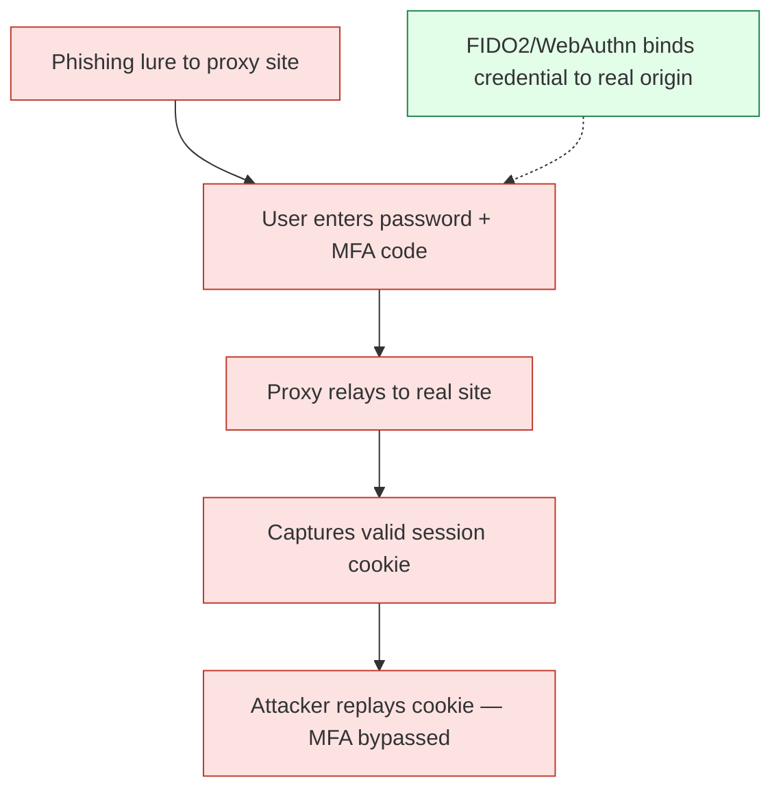

# Multifactor Authentication Attack Techniques

## Summary

**Multi-factor authentication (MFA)** dramatically reduces account takeover, but it is not unbreakable, and attackers have developed techniques to defeat weaker MFA forms — which is why the *type* of MFA matters as much as having it. The main techniques are: **MFA fatigue / push bombing** (**Multi-Factor Authentication Request Generation**, T1621) — after obtaining a valid password, the attacker spams repeated push approvals until a worn-down or confused user taps "approve"; **real-time phishing / adversary-in-the-middle (AiTM)** — a proxy phishing site relays the login and captures both the one-time code and, crucially, the resulting **session cookie**, bypassing MFA entirely by stealing the authenticated session; **MFA interception** (T1111) — capturing codes via SMS interception, SIM swapping, or malware; **SIM swapping** — socially engineering a carrier to move the victim's number to an attacker SIM, defeating SMS-based MFA; and **endpoint/session theft** — stealing session tokens so no authentication is replayed at all. The common thread is that **phishable factors** (SMS codes, TOTP, and even simple push) can be relayed, intercepted, or socially engineered, whereas **phishing-resistant MFA** (FIDO2/WebAuthn passkeys, which cryptographically bind the credential to the legitimate site origin) defeats AiTM and fatigue by design. The defensive conclusion is concrete: deploy MFA everywhere, but prefer phishing-resistant factors, use number-matching and limited push attempts to blunt fatigue, protect session tokens, and monitor for the behavioral signs of these attacks.

## MFA attack techniques

| Technique | How it works | Beaten by |
|---|---|---|
| **MFA fatigue (T1621)** | Spam push prompts until approved | Number matching; limited attempts; FIDO2 |
| **AiTM phishing** | Proxy relays login, steals session cookie | Phishing-resistant MFA (FIDO2/WebAuthn) |
| **MFA interception (T1111)** | Capture SMS/TOTP via malware/SS7 | App or hardware factors; FIDO2 |
| **SIM swap** | Carrier moves number to attacker SIM | Avoid SMS; use app/hardware factors |
| **Session/token theft** | Replay stolen session cookie | Token binding, short sessions, device trust |

Not all MFA is equal: SMS and basic push are phishable/social-engineerable, while FIDO2/WebAuthn is phishing-resistant by construction.

## Attack flow (AiTM)

## Detection / value

- **Repeated push denials** followed by an approval signal MFA fatigue (T1621).
- **Impossible travel / new-device sign-ins** after a known phish suggest AiTM session theft.
- **SIM-swap indicators**: sudden loss of mobile service plus account resets.
- **Session anomalies**: a session cookie used from a new IP/device without a fresh authentication.

## Defense / practices

- **Prefer phishing-resistant MFA** (FIDO2/WebAuthn passkeys), especially for admins.
- **Harden push**: number matching, limited attempts, and context in prompts to stop fatigue.
- **Avoid SMS** for high-value accounts; use app or hardware tokens.
- **Protect sessions**: short lifetimes, token binding/device trust, and conditional access.
- **Educate users** not to approve unexpected prompts and to report prompt spam.

## ATT&CK mapping

| ID | Name | Tactic |
|---|---|---|
| T1621 | Multi-Factor Authentication Request Generation | Credential Access |
| T1111 | Multi-Factor Authentication Interception | Credential Access |

## Explanation

Adding a second step to login — a code or a tap — stops the vast majority of account break-ins, but attackers have found ways around the weaker kinds, so it's worth knowing that not all "second steps" are equally strong. One trick is pure persistence: once criminals have your password, they trigger login approval prompts over and over, late at night, until you either tap "yes" to make it stop or assume it's a glitch. Another is a fake login page that sits in the middle, invisibly passing your password *and* your code through to the real site while pocketing the "you're logged in" token — so even a correct code doesn't save you, because they stole the session itself. Others target your phone number directly, sweet-talking your mobile carrier into moving it to their SIM so your text-message codes arrive on their device. The pattern is that codes and taps can be relayed, intercepted, or socially engineered. The strongest answer is a kind of MFA that can't be phished at all — passkeys (FIDO2/WebAuthn) — because they're cryptographically wired to the genuine website and simply refuse to work on a lookalike. Short of that, small tweaks help a lot: making users type a matching number instead of blindly tapping, limiting how many prompts can be fired, and avoiding text-message codes for important accounts.
