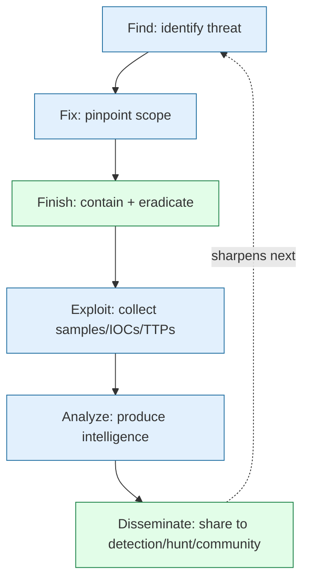

# F3EAD (Find, Fix, Finish, Exploit, Analyze, Disseminate)

## Summary

**F3EAD** — **Find, Fix, Finish, Exploit, Analyze, Disseminate** — is a targeting and intelligence cycle borrowed from military special operations and adapted to cyber incident response and threat intelligence, where it fuses **operations** (the "F3" half: acting against a threat) with **intelligence** (the "EAD" half: learning from it and feeding that learning back). **Find** identifies the threat or target (a compromised host, an adversary's infrastructure, an active intrusion). **Fix** locates and confirms it precisely — pinning down scope and footprint. **Finish** takes action — containment, eradication, remediation. Then the intelligence half begins: **Exploit** gathers everything of value from the operation (malware samples, IOCs, attacker TTPs, artifacts). **Analyze** turns that raw material into intelligence — understanding the adversary, their capabilities, and intent. **Disseminate** shares the finished intelligence to those who can use it (detection engineering, hunting, other teams, the community). The power of F3EAD for defenders is that it **closes the loop between response and intelligence**: an incident is not just cleaned up and forgotten, it is mined for knowledge that improves detection and prevention, which in turn makes the next "Find" faster. It complements the IR cycle by explicitly treating each incident as an intelligence opportunity, turning reactive firefighting into a learning system that compounds defensive advantage over time.

## F3EAD stages

| Stage | Action |
|---|---|
| **Find** | Identify the threat/target |
| **Fix** | Pinpoint and confirm scope/footprint |
| **Finish** | Contain, eradicate, remediate |
| **Exploit** | Collect samples, IOCs, artifacts, TTPs |
| **Analyze** | Turn raw data into intelligence |
| **Disseminate** | Share finished intelligence to defenders |

The operations half (F3) stops the threat; the intelligence half (EAD) ensures the organization is permanently smarter for it.

## F3EAD flow

## Detection / value

- **Operations + intelligence fusion**: F3EAD prevents "clean and forget" by mining each incident for knowledge.
- **Faster future Finds**: disseminated IOCs and TTPs feed detection, so the next intrusion is caught sooner.
- **Adversary understanding**: the Analyze step builds a picture of capability and intent, not just indicators.
- **Compounding advantage**: the loop makes the defense smarter with every engagement.

## Practices

- **Treat every incident as intelligence**: plan to Exploit and Analyze, not just Finish.
- **Capture artifacts** (samples, IOCs, TTPs) during response for later analysis.
- **Produce finished intelligence** that answers who/how/why, not just raw indicators.
- **Disseminate** to detection engineering, threat hunting, and trusted sharing communities.
- **Feed intelligence back** into detection and hunting to accelerate the next Find.

## Explanation

Soldiers developed F3EAD as a way to hunt a target and, crucially, to squeeze every drop of useful knowledge out of each operation so the next hunt is easier — and it maps beautifully onto cyber defense. The first three steps are the "doing" part: Find the threat (an intruder, a compromised machine), Fix it by pinning down exactly where it is and how far it spread, and Finish it by shutting it down. If you stop there — which most overworked teams do — you've cleaned up the mess but learned nothing. F3EAD's insight is that the operation just handed you a goldmine, so the back half is all about learning. Exploit means harvesting everything valuable the incident left behind: the malware, the attacker's addresses, their techniques. Analyze turns that pile of raw clues into real understanding — who is this adversary, what are they capable of, what are they after? And Disseminate shares that hard-won knowledge with the people who can act on it: the folks who write detection rules, the threat hunters, sometimes the wider community. The magic is the loop: the intelligence from today's incident makes tomorrow's "Find" faster, so instead of fighting the same fire over and over, your defense gets steadily, permanently smarter.
