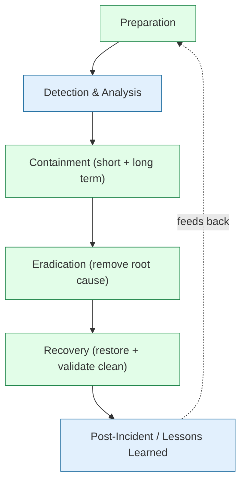

# Incident Response Cycle

## Summary

The **incident response (IR) cycle** is the standard, repeatable lifecycle for handling security incidents, designed so that organizations respond consistently rather than improvising under pressure. The two dominant models agree closely. **NIST SP 800-61** defines four phases: **Preparation**, **Detection & Analysis**, **Containment, Eradication & Recovery**, and **Post-Incident Activity**. The **SANS** model expands this into six steps — **Preparation, Identification, Containment, Eradication, Recovery, Lessons Learned (PICERL)**. The phases map onto the same arc: get ready before anything happens (tooling, playbooks, access, training); detect and confirm that an incident is real and understand its scope; **contain** it to stop the bleeding (isolate affected systems, often in short-term then long-term containment); **eradicate** the root cause (remove malware, close the vulnerability, revoke compromised credentials); **recover** by restoring systems to normal and validating they are clean; and finally **learn** — a post-incident review that feeds improvements back into preparation. The cycle is explicitly a **loop**: lessons learned strengthen preparation for the next incident. Its value is that it imposes order on chaos — ensuring responders contain before they eradicate (so they don't tip off an attacker or destroy evidence prematurely), preserve evidence throughout, and close the loop so the same incident doesn't recur. Preparation is the phase that most determines outcomes, because everything downstream depends on having the people, tools, and plans ready in advance.

## IR phases (NIST / SANS)

| NIST | SANS | Goal |
|---|---|---|
| **Preparation** | Preparation | Tools, playbooks, access, training |
| **Detection & Analysis** | Identification | Confirm and scope the incident |
| **Containment, Eradication, Recovery** | Containment / Eradication / Recovery | Stop spread, remove cause, restore |
| **Post-Incident Activity** | Lessons Learned | Improve and feed back |

The cycle is a loop: its final phase strengthens its first, so each incident makes the next response better.

## IR cycle flow

## Detection / value

- **Consistency under pressure**: a defined cycle prevents panic-driven mistakes and skipped steps.
- **Contain before eradicate**: ordering limits damage while preserving evidence and avoiding premature tip-off.
- **Validated recovery**: confirming systems are clean before return prevents reinfection.
- **Closed loop**: lessons learned reduce the chance and impact of recurrence.

## Practices

- **Invest in preparation**: playbooks, tooling, logging, access, and trained responders before incidents.
- **Confirm and scope** before acting; understand breadth to contain effectively.
- **Contain in stages**, then eradicate root cause and recover with validation.
- **Hold a blameless post-incident review** and feed improvements into preparation.
- **Preserve evidence throughout** in case of legal or deeper investigation.

## Explanation

When a security incident hits, the worst possible plan is to make it up as you go — panicking, yanking cables, and accidentally destroying the evidence you'll later need. The incident response cycle exists to replace that chaos with a calm, rehearsed routine. It starts long before any attack, in preparation: having the tools, the contact lists, the step-by-step playbooks, and trained people ready. When something trips an alarm, you first detect and analyze — is this real, and how bad is it? Then comes containment: stop the spread, like closing doors to keep a fire from jumping rooms, often first with a quick fix and then a more thorough isolation. Only once it's contained do you eradicate the cause — delete the malware, patch the hole, reset the stolen passwords — and then recover, carefully bringing systems back and double-checking they're truly clean before trusting them again. The final step is the one everyone's tempted to skip when they're exhausted: sitting down afterward to ask what happened and how to do better, without blaming individuals. That review loops straight back into preparation, so the next incident finds you better armed. The quiet insight is that the teams who handle incidents well are the ones who did the boring preparation work when nothing was on fire.
