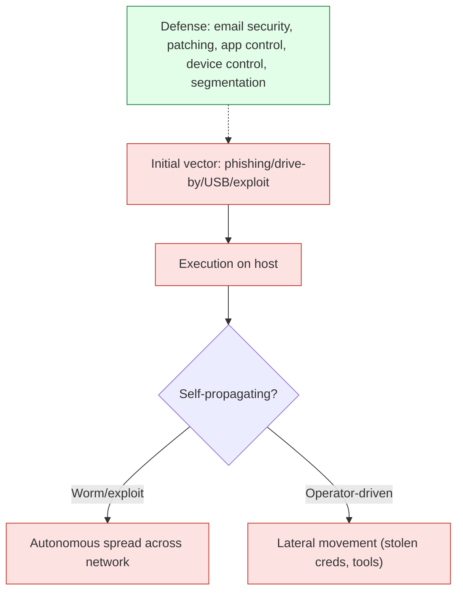

# Malware Propagation and Infection Vectors

## Summary

**Infection vectors** are the routes by which malware first reaches and executes on a target, and understanding them is foundational because blocking the vector prevents the infection. The common vectors: **phishing** (malicious email attachments or links — the dominant vector, **Phishing**, T1566); **drive-by downloads** (compromised or malicious websites exploiting the browser or tricking downloads — **Drive-by Compromise**, T1189); **malicious downloads/trojanized software** (fake or cracked software, poisoned installers, and supply-chain compromise); **removable media** (USB drives, exploiting autorun or curiosity); **exploitation of exposed services** (worming through unpatched network vulnerabilities); **malvertising** (malicious ads); and **social engineering** broadly. **Propagation** describes how malware spreads *after* initial infection: **worms** self-propagate across networks (exploiting vulnerabilities or credentials), malware moves **laterally** using stolen credentials and legitimate tools, and some spreads via removable media or network shares. A useful distinction is **requires user action** (phishing, trojanized downloads) vs. **autonomous** (worms, drive-by exploits). For defenders, mapping infection vectors directly informs controls: email security and awareness for phishing, patching and browser hardening for drive-by/exploits, application control and software provenance for trojanized downloads, device control for removable media, and segmentation to limit propagation. The core insight is that malware must have a way **in** (initial infection) and often a way to **spread** (propagation), so defense-in-depth targets both: reduce the initial-access vectors (the most common being phishing and unpatched exposure), and contain propagation through segmentation, least privilege, and monitoring — because stopping malware at the vector is far cheaper than cleaning up after it has spread.

## Vectors and propagation

| Vector | Type |
|---|---|
| **Phishing (T1566)** | Requires user action; dominant vector |
| **Drive-by download (T1189)** | Browser exploit / tricked download |
| **Trojanized software / supply chain** | Fake/poisoned installers |
| **Removable media (USB)** | Autorun / curiosity |
| **Exposed-service exploitation** | Autonomous (worms) |
| **Propagation** | Worms, lateral movement, shares |

Malware needs a way in and often a way to spread — defense targets both: reduce initial vectors and contain propagation.

## Infection and spread flow

## Detection / value

- **Phishing dominates**: most infections start with a user opening an attachment or link (T1566).
- **Drive-by needs patching**: browser/plugin exploits (T1189) are closed by updates and hardening.
- **Propagation amplifies impact**: worms and lateral movement turn one infection into many.
- **Vector mapping drives controls**: each vector maps to a specific, effective defense.

## Defense / practices

- **Email security + awareness** for phishing; **patch and harden browsers** for drive-by.
- **Application control and software provenance** against trojanized/supply-chain downloads.
- **Device control** for removable media; disable autorun.
- **Segment networks and enforce least privilege** to contain propagation; monitor for lateral movement.

## ATT&CK mapping

| ID | Name | Tactic |
|---|---|---|
| T1566 | Phishing | Initial Access |
| T1189 | Drive-by Compromise | Initial Access |

## Explanation

Before malware can do any damage, it has to get onto a machine and run — and the route it takes to get there is called the infection vector. The single most common route is phishing: a booby-trapped email attachment or link that a person opens. Close behind are drive-by downloads, where simply visiting a hacked or malicious website is enough for your browser to get exploited; trojanized software, like a "free" or cracked program that comes with a hidden passenger (and its scarier cousin, supply-chain attacks that poison legitimate software); infected USB sticks left for the curious to plug in; and worms that exploit unpatched, internet-exposed services all on their own. A helpful way to sort these is whether they need a human to do something (clicking, plugging in) or whether they spread by themselves. That second idea — spreading — is propagation: what malware does *after* the first infection. Some strains are worms that automatically leap from machine to machine; others are steered by a human operator who uses stolen passwords and the network's own tools to creep sideways from one computer to the next. For defenders, the beauty of thinking in vectors is that each one has a matching defense: email filtering and training stop phishing, patching stops drive-bys, application control stops trojanized downloads, disabling USB autorun stops removable-media attacks, and chopping the network into segments stops a single infection from becoming a company-wide outbreak. The guiding principle is simple and economical — it is vastly cheaper to block malware at the door than to chase it across your whole network after it has spread, so you defend both the way in and the way it moves.
