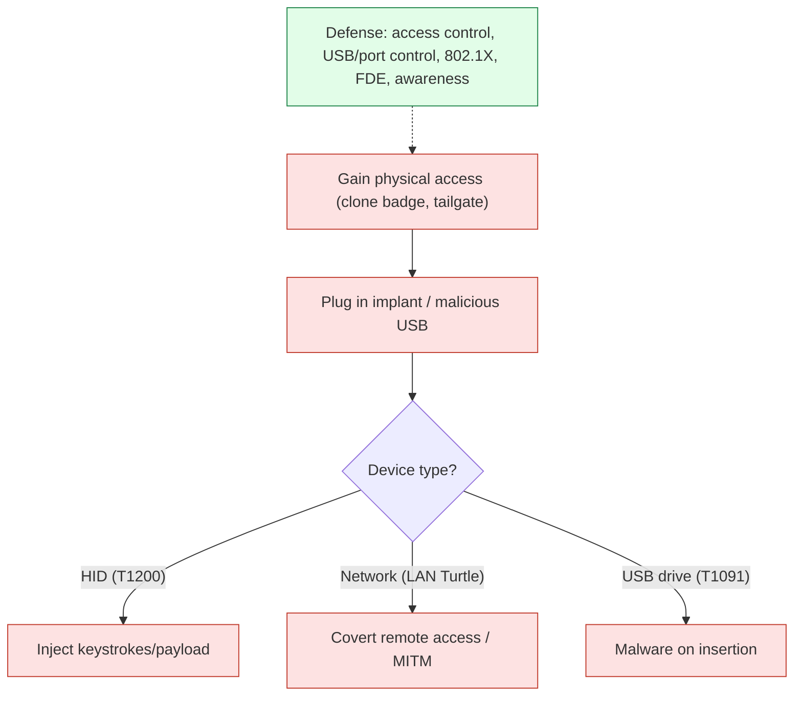

# Physical Security Attacks (Cloners, LAN Turtle, Bash Bunny)

## Summary

**Physical security attacks** exploit physical access to facilities, devices, and people to bypass digital defenses — because an attacker with physical access often defeats controls designed for remote threats. They span several techniques, frequently combined with social engineering. **Access-control attacks**: **RFID/badge cloning** (reading and duplicating proximity badges to enter, often with inexpensive cloners), lock bypass, tailgating, and impersonation. **Malicious hardware implants** (**Hardware Additions**, T1200): dropping or plugging in attacker devices — **USB attack tools** like the **Bash Bunny** and Rubber Ducky (which emulate keyboards to inject keystrokes/payloads at machine speed, **Replication Through Removable Media**-adjacent and HID injection), the **LAN Turtle** and similar implants (covert network devices plugged into a LAN to provide remote access or man-in-the-middle), and malicious USB drives (bait devices exploiting curiosity). **Direct device attacks**: booting from external media, DMA attacks, extracting disks, or accessing exposed ports on unattended/kiosk systems. These are staples of **red-team physical assessments** and real intrusions alike. The defensive lesson is that **physical access is a powerful attack vector** often under-protected relative to network defenses: a cloned badge, a planted network implant, or a malicious USB can sidestep firewalls entirely. Defenses include **physical access controls** (secure badging, anti-tailgating, visitor management), **device hardening** (disabling unused USB/boot options, port control, full-disk encryption, screen locks), **endpoint controls** (USB device control, HID attack mitigations), **network access control** (802.1X to stop rogue LAN implants), and **awareness** (tailgating, found-USB hygiene). The core insight is that security must account for the physical layer, because an adversary who can touch a device or walk into a building has advantages that purely digital defenses cannot counter.

## Physical attack techniques

| Technique | Example |
|---|---|
| **Badge/RFID cloning** | Duplicate proximity cards to enter |
| **HID injection (T1200)** | Bash Bunny / Rubber Ducky inject keystrokes |
| **Network implant** | LAN Turtle: covert remote access / MITM |
| **Malicious USB (T1091)** | Bait drives exploiting curiosity |
| **Direct device access** | Boot media, DMA, disk extraction, open ports |

Physical access sidesteps network defenses entirely — a cloned badge, a planted implant, or a malicious USB bypasses the firewall.

## Physical attack flow

## Detection / value

- **Physical access bypasses network defenses**: firewalls don't stop a plugged-in implant.
- **HID injection is fast and stealthy**: keystroke-injection tools run payloads in seconds, looking like a keyboard.
- **Rogue network devices**: LAN implants provide persistent covert access; NAC detects them.
- **Badge cloning**: cheap cloners duplicate weak proximity cards, enabling entry.

## Defense / practices

- **Physical access controls**: secure badging (resist cloning), anti-tailgating, visitor management.
- **Harden devices**: disable unused USB/boot, control ports, enforce FDE and screen locks.
- **Endpoint USB/HID controls**: device control and keystroke-injection mitigations.
- **Network access control (802.1X)** to block rogue LAN implants.
- **Awareness**: tailgating vigilance and never plugging in found USB devices.

## ATT&CK mapping

| ID | Name | Tactic |
|---|---|---|
| T1200 | Hardware Additions | Initial Access |
| T1091 | Replication Through Removable Media | Initial Access, Lateral Movement |

## Explanation

We spend enormous effort defending against remote attackers, but an adversary who can physically walk up to a device or into a building gets to skip most of those defenses — which is why physical security attacks are so potent. Some target the way you get *in*: cheap gadgets can read and clone the proximity badge in your wallet, and "tailgating" (slipping through a door behind someone) needs no technology at all. Others involve planting malicious hardware. A device the size of a USB stick, like the Bash Bunny or Rubber Ducky, pretends to be a keyboard and, the instant it's plugged in, "types" a malicious payload faster than any human could — your computer trusts it because, as far as it knows, it's just a keyboard. A LAN Turtle looks like a harmless network adapter but, once quietly plugged into a network port, hands the attacker a secret remote doorway into your network. And the classic trick still works: scatter a few USB drives in the parking lot labeled "Salaries" and wait for someone curious to plug one in. The uncomfortable truth these attacks reveal is that physical security is often the neglected sibling of network security — a cloned badge or a planted implant sails right past the firewall you spent a fortune on. Defending against them means thinking about the physical layer too: badges that can't be easily cloned, doors that resist tailgating, computers that won't boot from a stranger's USB or accept rogue keyboards, network ports that reject unknown devices, encrypted drives, and — crucially — people who don't hold doors for strangers or plug in mystery USB sticks. Security has to reach all the way down to who can touch the hardware.
