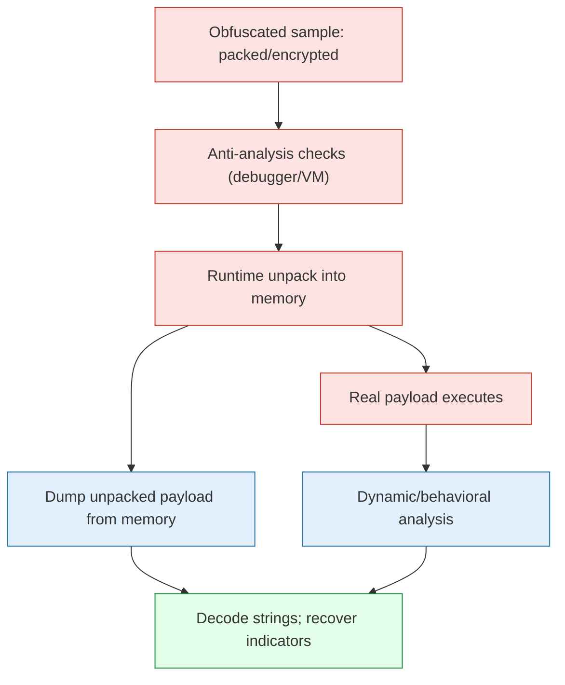

# Code Obfuscation and Deobfuscation

## Summary

**Obfuscation** is the deliberate transformation of code or data to make it hard to understand, analyze, or detect while preserving its behavior — used both defensively (protecting intellectual property, hardening software) and offensively (malware hiding from analysts and signature-based tools). Common techniques include **packing/compression and encryption** (the real payload is stored compressed or encrypted and unpacked only at runtime, so static tools see a stub); **string and data obfuscation** (encoding, encrypting, or splitting strings, URLs, and constants so indicators don't appear in plain text); **control-flow obfuscation** (flattening or adding bogus branches so the logic is hard to follow); **dead/junk code and opaque predicates** (meaningless code and always-true/false conditions that mislead analysis); **instruction substitution and metamorphism/polymorphism** (rewriting code so each sample looks different, defeating signatures); and **anti-analysis checks** (detecting debuggers, virtual machines, or sandboxes and behaving differently). In ATT&CK terms, obfuscating files or information (**T1027**, under the Stealth tactic) captures this behavior. **Deobfuscation** is the analyst's reverse process: **unpacking** (running or emulating the sample so it reveals the real payload in memory, then dumping it), **decoding/decrypting** strings and data, **simplifying control flow**, and using **dynamic analysis** and emulation to observe true behavior when static reading is blocked. The security relevance is twofold: obfuscation is a core malware evasion tactic (so defenders need behavioral and memory-based detection, not just signatures), and deobfuscation is an essential reverse-engineering skill (to recover indicators, logic, and capabilities). The core insight is that obfuscation hides *how* code works without changing *what* it does, so defeating it means getting the code to reveal itself — often by running or emulating it — rather than reading the scrambled surface.

## Obfuscation techniques and countermeasures

| Technique | Analyst countermeasure |
|---|---|
| **Packing/encryption** | Unpack via execution/emulation; dump memory |
| **String/data obfuscation** | Decode/decrypt; recover indicators |
| **Control-flow obfuscation** | Simplify/normalize flow; dynamic tracing |
| **Junk code / opaque predicates** | Identify and prune dead paths |
| **Polymorphism/metamorphism** | Behavioral detection, not signatures |
| **Anti-debug/anti-VM** | Harden sandbox; patch or bypass checks |

Obfuscation hides *how* code works without changing *what* it does — so defeating it means making the code reveal itself.

## Security relevance

- **Core evasion tactic**: obfuscation defeats signature and string-based detection (ATT&CK T1027).
- **Behavioral detection required**: polymorphism and packing mean defenders must watch behavior and memory, not just files.
- **Reverse-engineering skill**: deobfuscation recovers indicators, logic, and capabilities analysts need.
- **Anti-analysis arms race**: malware detects sandboxes and debuggers, so analysis environments must be hardened.

## Practices

- **Unpack by running or emulating** the sample and dumping the real payload from memory.
- **Decode and decrypt strings/data** to recover URLs, keys, and other indicators.
- **Normalize control flow** and prune junk code to make logic readable.
- **Rely on behavioral/memory detection** against polymorphic and packed threats.
- **Harden the sandbox** against anti-VM/anti-debug checks, or patch them out.

## ATT&CK mapping

| ID | Technique | Tactic |
|---|---|---|
| T1027 | Obfuscated Files or Information | Stealth |

## Explanation

Obfuscation is the art of making code hard to read while keeping it working exactly the same. Software vendors use it to protect their secrets, but malware authors love it because it hides them from both human analysts and the automated tools that hunt for known-bad patterns. The most common trick is packing: the real malicious code is squeezed down or encrypted and wrapped in a small loader, so if you open the file you just see the loader and a blob of noise — the nasty part only appears when the program runs and unpacks itself in memory. Authors also scramble the telltale strings (web addresses, commands) so they don't show up in plain text, tangle up the logic with fake branches and pointless code so the flow is a maze, and rewrite the code slightly in every copy so no two samples look alike to a signature scanner. Many samples even check whether they're being watched — sniffing for a debugger or a virtual machine — and play dead if they are. The analyst's answer, deobfuscation, mostly comes down to making the code show its hand instead of trying to read the scrambled surface. The classic move is to let the sample run (safely) just far enough to unpack itself, then grab the now-revealed real code straight out of memory. From there you decode the hidden strings to recover the indicators you need, untangle the control flow, and watch the program's actual behavior. The deep lesson is that obfuscation changes how code looks, not what it does, so the reliable way to beat it is behavioral: run it, watch it, and catch it in the act rather than squinting at the disguise.
